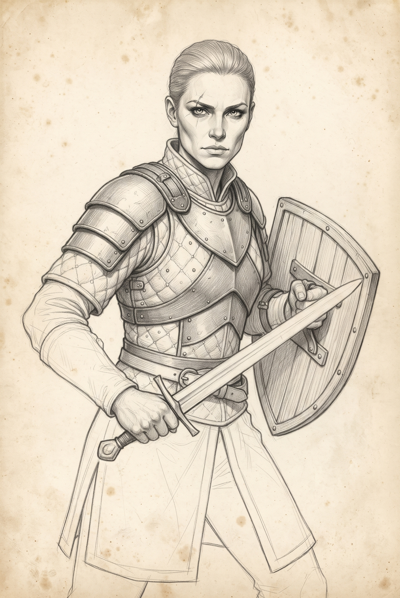
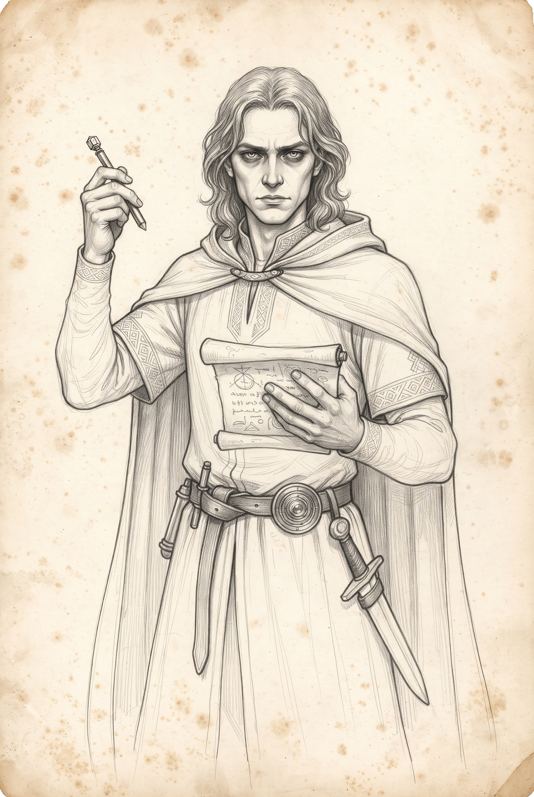
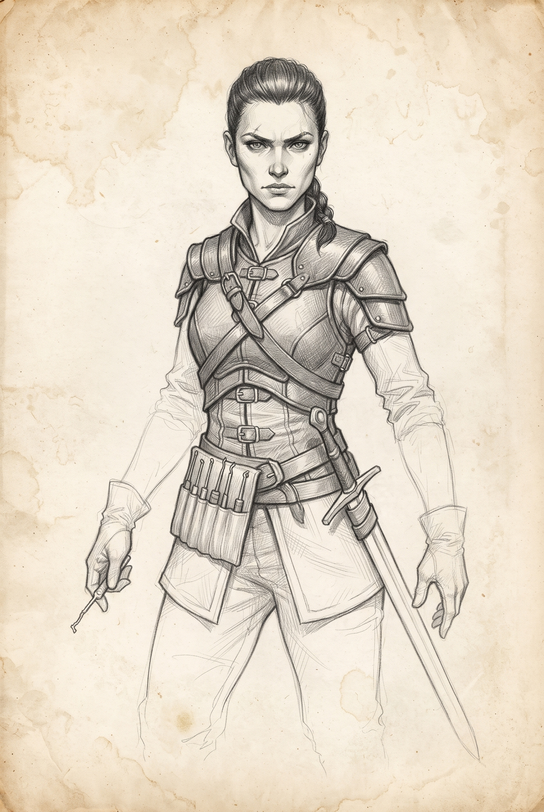

<h1 align="center">Dado e Prosa</h1>

  
  
  

<strong>Um RPG de fantasia de mesa para mestres e jogadores iniciantes.</strong>

  <a href="regras.md">Regras</a> ·
  <a href="personagens-iniciais.md">Personagens iniciais</a> ·
  <a href="compendium.md">Monstrous Compendium</a> ·
  <a href="aventuras/">Aventuras</a>

Dado e Prosa é um jogo de interpretação em que os jogadores criam personagens, enfrentam desafios e constroem uma história em conjunto. O mestre apresenta o mundo, interpreta os demais personagens e ajuda o grupo a resolver situações incertas usando as regras e os dados.

Este material é um ponto de partida. Toda contribuição é bem-vinda para ajudar a desenvolver e aprimorar o jogo.

A proposta tem como inspiração a simplicidade e o espírito de aventura dos tempos iniciais de Dungeons & Dragons, especialmente sua primeira edição. O foco é o jogo de tabuleiro, com um aplicativo planejado como apoio para ajudar o mestre e os jogadores durante a partida. Criar esse aplicativo está no roadmap do projeto.

---

## PDFs para compartilhar

| | |
|:--|:--|
| 📕 [Regras — Dado e Prosa (versão 0.9)](pdf/Dado-e-Prosa-Regras-0.9.pdf) | 🧙 [Personagens iniciais](pdf/Personagens-iniciais.pdf) |
| 👹 [Monstrous Compendium](pdf/Bestiario.pdf) | 🎒 [Lista de compras, itens e talentos](pdf/Lista-de-compras.pdf) |

---

## Comece por aqui

- [Regras](regras.md) — criação de personagens, atributos, talentos, equipamentos, testes e combate.
- [Personagens iniciais](personagens-iniciais.md) — dez fichas de referência para começar a jogar ou inspirar personagens próprios.
- [Lista de compras, itens e talentos](lista-de-compras.md) — consulta de equipamentos e opções disponíveis.
- [Monstrous Compendium](compendium.md) — fichas de animais, monstros e personagens controlados pelo mestre.
- [Aventuras](aventuras/) — materiais para preparar e conduzir sessões.

## Para quem está começando

Os jogadores podem escolher uma ficha inicial ou criar seus próprios personagens seguindo as regras. As fichas prontas são exemplos para facilitar o início e não impõem classes ou escolhas obrigatórias.

O mestre conduz a aventura e decide como o mundo reage às ações do grupo. Os materiais de aventura podem incluir informações destinadas somente ao mestre. Antes de compartilhar uma pasta de aventura com os jogadores, confira quais arquivos devem permanecer reservados.

## Como participar

Este projeto está em desenvolvimento. Este material é apenas um ponto de partida, e contribuições são bem-vindas. Você pode ajudar apontando trechos confusos, sugerindo ajustes ou propondo ideias para regras, personagens, criaturas, aventuras e para o aplicativo de apoio ao jogo.

- Tem uma dúvida ou sugestão? Participe das [discussões da comunidade](https://github.com/ebeall/Dados-e-Prosa/discussions). Se a ideia envolver uma regra, indique a seção e dê um exemplo de como a mudança funcionaria na sua mesa.
- Jogou ou mestrou uma sessão? Conte como foi em [Relatos de partidas](https://github.com/ebeall/Dados-e-Prosa/discussions/categories/relatos-de-partidas). Vale contar o que funcionou bem ou em que momento o grupo precisou parar para consultar uma regra.
- Encontrou um problema específico, como um link quebrado ou valores divergentes em uma ficha? Registre o problema em [Issues](https://github.com/ebeall/Dados-e-Prosa/issues) e indique onde o encontrou.

Sugestões podem ser discutidas antes de serem incorporadas. A versão publicada representa o estado do material naquele momento, e mudanças futuras podem ajustar regras após revisão.

## Sobre esta edição

Esta pasta reúne uma edição pública dos materiais do projeto. Os documentos de consulta são adaptações em Markdown das fontes estruturadas usadas no desenvolvimento do aplicativo. O aplicativo em si não faz parte desta publicação.

## Créditos e referências

O compêndio e alguns materiais podem incluir adaptações baseadas em referências externas, identificadas nos próprios documentos. Consulte as atribuições incluídas nas fichas e aventuras ao reutilizar esse conteúdo.
