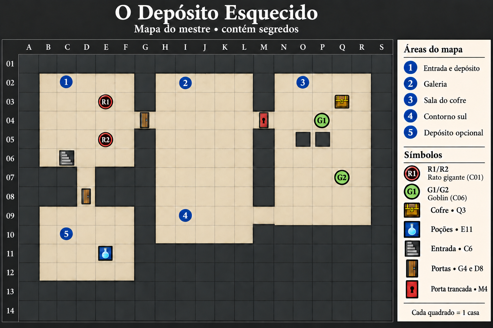

# O Depósito Esquecido — mapa quadriculado
**Somente para o mestre: contém posições e tesouros.**

## Versão visual



Imagem gerada com a ferramenta integrada de imagens e revisada contra as coordenadas abaixo. Os pilares O5 e P5 bloqueiam a casa inteira, mesmo que o ícone deixe uma pequena margem visual.

## Planta de referência

19 colunas (A–S), 14 linhas (01–14). Norte no topo. **Cada símbolo ocupa uma casa quadrada**, não um hexágono. Transponha a planta para o tabuleiro; os espaços entre símbolos são apenas separadores. Revele áreas conforme exploradas, sem entregar a planta inteira.

```text
    A B C D E F G H I J K L M N O P Q R S
01  # # # # # # # # # # # # # # # # # # #
02  # . 1 . . . # . 2 . . . # . 3 . . . #
03  # . . . r . # . . . . . # . . . C . #
04  # . . . . . + . . . . . T . . g . . #
05  # . . . r . # . . . . . # . # # . . #
06  # . E . . . # . . . . . # . . . . . #
07  # # # . # # # . . . . . # . . . g . #
08  # # # + # # # . . . . . # . . . . . #
09  # . . . . . # . 4 . . . . . . . . . #
10  # . 5 . . . # . . . . . # # # # # # #
11  # . . . B . # # # # # # # # # # # # #
12  # . . . . . # # # # # # # # # # # # #
13  # # # # # # # # # # # # # # # # # # #
14  # # # # # # # # # # # # # # # # # # #
```

## Legenda

| Símbolo | Significado |
|---|---|
| # | Parede ou pilar: bloqueia movimento e todos os projéteis. |
| . | Piso livre. |
| 1–5 | Número da área, sobre piso livre. |
| E | Escada de entrada/saída em C6, piso transitável. |
| + | Porta fechada, destrancada: G4 e D8. |
| T | Porta fechada e trancada: M4. |
| r | Rato gigante (C01): E3 (R1), E5 (R2). |
| g | Goblin (C06): P4 (G1), Q7 (G2). |
| C | Cofre em Q3. Objeto pequeno, não bloqueia a casa. |
| B | Caixa das poções em E11. Não bloqueia a casa. |

Portas ocupam uma casa de passagem; quando abertas, ela é piso livre. Fechadas bloqueiam movimento e projéteis. Não contam como cobertura parcial. Pilares O5 e P5 têm altura total; não permitem disparar através deles.

## Áreas e conexões

| Área | Limites | Acessos |
|---|---|---|
| 1 — Entrada e depósito | B2:F6 | Escada C6; G4 para 2; D7–D8 para 5. |
| 2 — Galeria | H2:L6 | G4 para 1; M4 para 3; abertura H7:L7 para 4. |
| 3 — Sala do cofre | N2:R9 | M4 para 2; M9–N9 para 4. |
| 4 — Contorno sul | H7:L10 | Norte aberto para 2; L9–M9–N9 para 3. |
| 5 — Depósito opcional | B9:F12 | D9–D8–D7–D6 para 1. |

## Posições e uso

- PCs começam em C6, B6 e D6; jogadores escolhem quem ocupa cada casa. Mostre os indivíduos de Rato gigante (C01) antes de iniciar combate.
- No segundo encontro, não reposicione os PCs automaticamente: use as casas em que chegaram por M4 ou M9.
- G1 e G2 usam as posições marcadas somente se ainda não se moveram. O mestre registra mudanças motivadas por ruídos ou conversa.
- Tudo fora do piso desenhado é parede. Não se atravessam aliados, inimigos, paredes ou quinas bloqueadas.
- Diagonais custam uma casa. Para trajetórias, trace centro a centro e aplique as regras vigentes.
- As salas permitem reorganização; G4, M4, M9 e D8 são passagens de uma casa. Não pare um aliado na passagem se pretende que outros a atravessem.
- Sacos, poeira e marcas descritos no guia ficam nos cantos e não acrescentam obstáculos invisíveis ao mapa.
- Não há regra de escuridão neste teste: a luz da entrada e as tochas usadas pelo grupo permitem observar as áreas apresentadas, sem bônus/penalidades inventados.

**Rota alternativa verificável com M4 fechada:** H4 → H9 → L9 → M9 → N9 → Q9 → Q3. Percorra casas intermediárias; isso não é um único movimento. Pilares ficam fora dessa rota. A fechadura nunca é a única passagem.

