# Monstrous Compendium

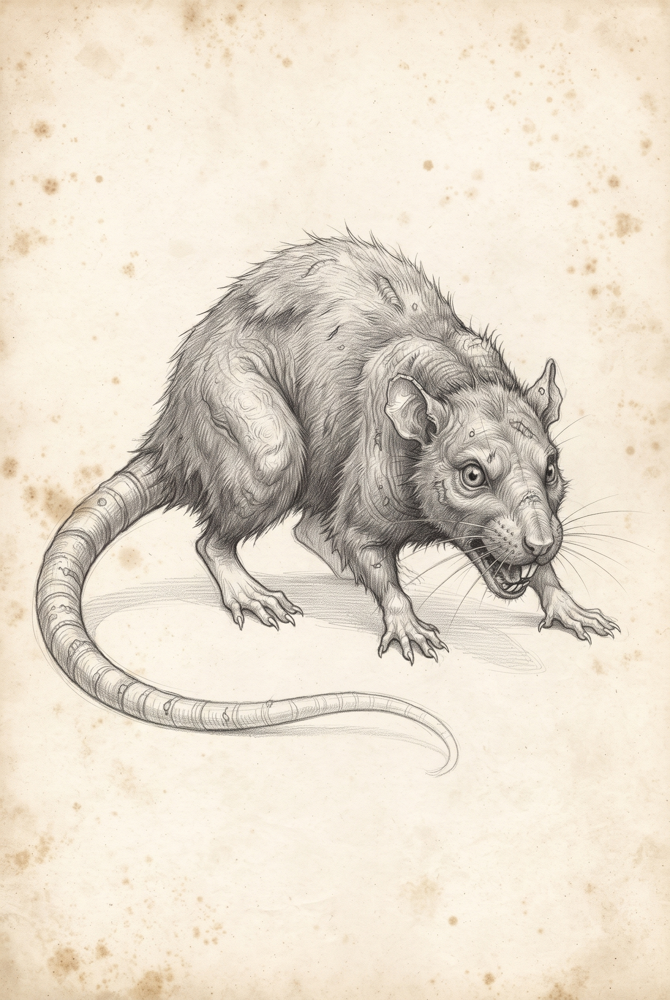

## Rato gigante (C01)

**Tipo:** Animal
**Nível:** 1
**Status:** Adaptada com atributos; equilíbrio ainda não validado.
**Vigor:** 1
**Destreza:** 2
**Intelecto:** 0

### Talentos e características

- identificador: armas-naturais
- identificador: constituicao-fragil, faixa: -8
- identificador: lentidao-natural, faixa: -1

### Ações

- nome: Mordida, equipamento: arma-natural-c01, atributo: vigor

### Equipamento

- identificador: arma-natural-c01, nome: Mordida, tipo: arma, quantidade: 1, treinamento: armas-naturais, dano: 1d3, alcance: adjacente

### Saque

Sem saque habitual. O mestre pode colocar no ninho um objeto perdido no depósito.

### Detalhes

- titulo: Cena sugerida, texto: Esgotos e depósitos. Pode fugir quando perde acesso à comida.
- titulo: Adaptação, texto: Sem doenças ou veneno.

### Referência

Giant Rat.

---

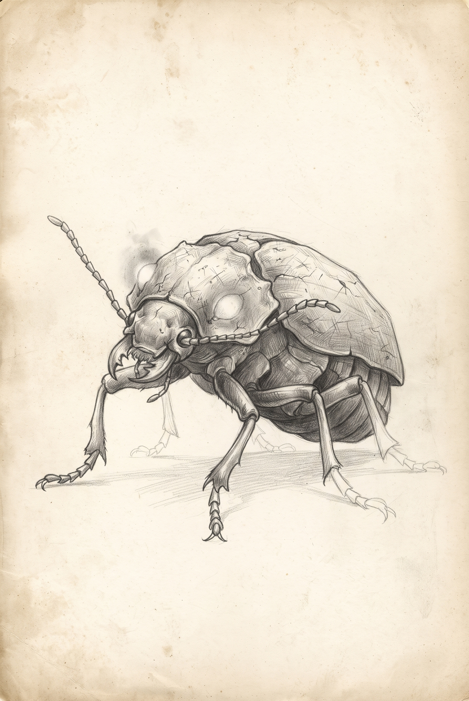

## Besouro luminoso gigante (C02)

**Tipo:** Animal
**Nível:** 1
**Status:** Adaptada com atributos; equilíbrio ainda não validado.
**Vigor:** 1
**Destreza:** 0
**Intelecto:** 0

### Talentos e características

- identificador: armas-naturais
- identificador: pele-resistente
- identificador: constituicao-fragil, faixa: -6
- identificador: lentidao-natural, faixa: -1

### Ações

- nome: Mordida, equipamento: arma-natural-c02, atributo: vigor

### Equipamento

- identificador: arma-natural-c02, nome: Mordida, tipo: arma, quantidade: 1, treinamento: armas-naturais, dano: 1d3, alcance: adjacente

### Saque

Ocasionalmente, uma asa rígida e iridescente, aproveitável como adorno.

### Detalhes

- titulo: Cena sugerida, texto: Cavernas. Seu brilho ajuda a anunciar a presença antes do encontro.
- titulo: Adaptação, texto: Brilho apenas descritivo; sem dano contínuo ou resistência a fogo.

### Referência

Giant Fire Beetle.

---

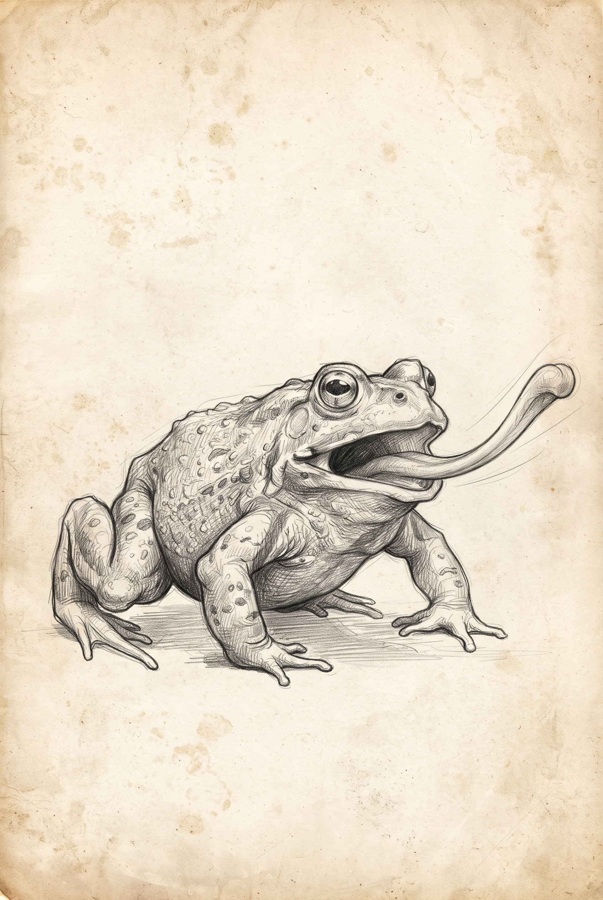

## Sapo gigante (C03)

**Tipo:** Animal
**Nível:** 1
**Status:** Adaptada com atributos; equilíbrio ainda não validado.
**Vigor:** 1
**Destreza:** 1
**Intelecto:** 0

### Talentos e características

- identificador: armas-naturais
- identificador: constituicao-fragil, faixa: -6
- identificador: lentidao-natural, faixa: -1

### Ações

- nome: Mordida, equipamento: arma-natural-c03, atributo: vigor

### Equipamento

- identificador: arma-natural-c03, nome: Mordida, tipo: arma, quantidade: 1, treinamento: armas-naturais, dano: 1d3, alcance: adjacente

### Saque

Sem saque habitual.

### Detalhes

- titulo: Cena sugerida, texto: Margens de lagoas e ruínas úmidas. Defende seu esconderijo.
- titulo: Adaptação, texto: Sem engolir ou agarrar; usar encontro em chão firme.

### Referência

Giant Frog.

---

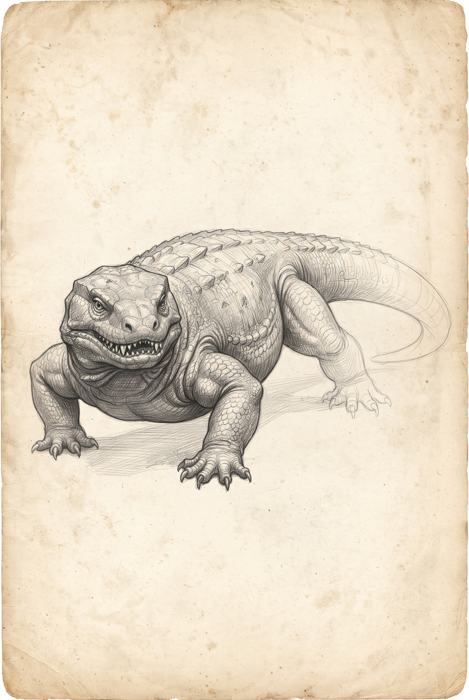

## Lagarto gigante (C04)

**Tipo:** Animal
**Nível:** 1
**Status:** Adaptada com atributos; equilíbrio ainda não validado.
**Vigor:** 1
**Destreza:** 1
**Intelecto:** 0

### Talentos e características

- identificador: armas-naturais
- identificador: pele-resistente
- identificador: constituicao-fragil, faixa: -4

### Ações

- nome: Mordida, equipamento: arma-natural-c04, atributo: vigor

### Equipamento

- identificador: arma-natural-c04, nome: Mordida, tipo: arma, quantidade: 1, treinamento: armas-naturais, dano: 1d3, alcance: adjacente

### Saque

Ocasionalmente, um pedaço de casca de ovo junto ao ninho. Pode servir de amostra para identificar a criatura.

### Detalhes

- titulo: Cena sugerida, texto: Pedreiras e túneis largos. Pode guardar um ninho.
- titulo: Adaptação, texto: Sem escalada automática; o tamanho exige caminhos largos.

### Referência

Giant Lizard.

---

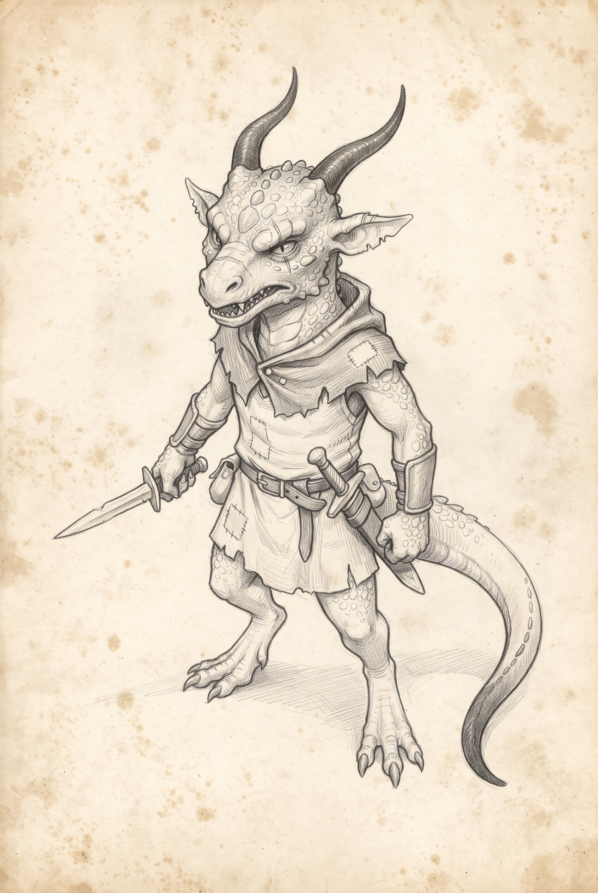

## Kobold (C05)

**Tipo:** Monstro
**Nível:** 1
**Status:** Adaptada com atributos; equilíbrio ainda não validado.
**Vigor:** 1
**Destreza:** 2
**Intelecto:** 1

### Talentos e características

- identificador: laminas-uma-mao
- identificador: arremesso
- identificador: constituicao-fragil, faixa: -6

### Ações

- nome: Adaga, equipamento: adaga, atributo: vigor
- nome: Adaga arremessada, equipamento: adaga, atributo: destreza, alcance: 4 casas, treinamento: arremesso

### Equipamento

- identificador: adaga, nome: Adaga, tipo: arma, quantidade: 2, treinamento: laminas-uma-mao, dano: 1d3, alcance: adjacente
- identificador: armadura-leve, nome: Armadura leve, tipo: armadura, quantidade: 1, defesa: 1, penalidadeMovimento: 0

### Saque

1 a 3 moedas. Ocasionalmente, um pedaço de giz usado para marcar bifurcações nos túneis.

### Detalhes

- titulo: Cena sugerida, texto: Pequeno sentinela de túneis. Pode negociar passagem ou pedir ajuda.
- titulo: Adaptação, texto: Pode arremessar adaga com +2 (Destreza), dano 1d3, alcance 4; leva duas. Uma ação por ataque.

### Referência

Kobold Warrior.

---

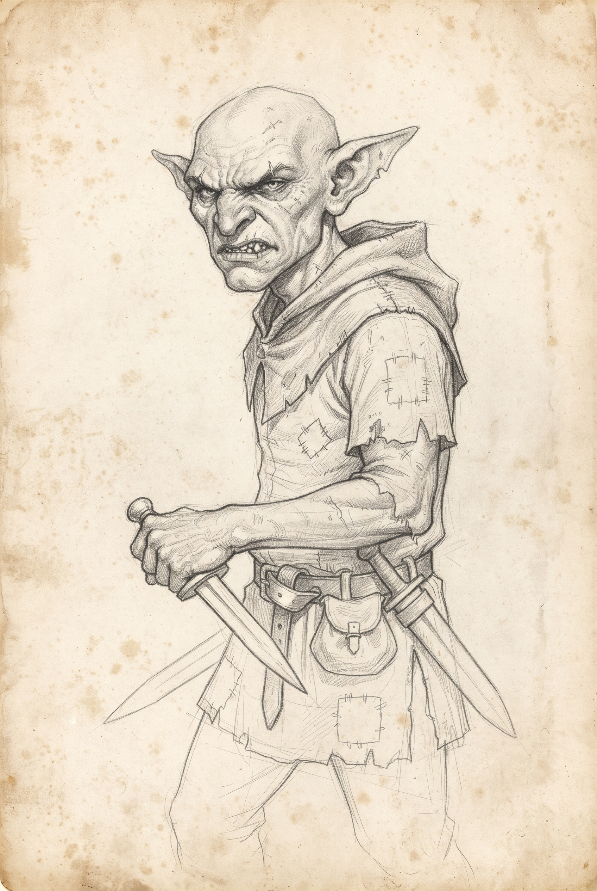

## Goblin (C06)

**Tipo:** Monstro
**Nível:** 1
**Status:** Adaptada com atributos; equilíbrio ainda não validado.
**Vigor:** 1
**Destreza:** 2
**Intelecto:** 1

### Talentos e características

- identificador: laminas-uma-mao
- identificador: arremesso
- identificador: constituicao-fragil, faixa: -6

### Ações

- nome: Adaga, equipamento: adaga, atributo: vigor
- nome: Adaga arremessada, equipamento: adaga, atributo: destreza, alcance: 4 casas, treinamento: arremesso

### Equipamento

- identificador: adaga, nome: Adaga, tipo: arma, quantidade: 2, treinamento: laminas-uma-mao, dano: 1d3, alcance: adjacente
- identificador: armadura-leve, nome: Armadura leve, tipo: armadura, quantidade: 1, defesa: 1, penalidadeMovimento: 0

### Saque

1 a 3 moedas. Ocasionalmente, uma ração embrulhada em pano entre os suprimentos recolhidos nas ruínas.

### Detalhes

- titulo: Cena sugerida, texto: Explorador de ruínas. Pode disputar suprimentos em vez de lutar até cair.
- titulo: Adaptação, texto: Duas adagas e armadura leve. Arremesso: 1d20 + 2 (Destreza), dano 1d3, alcance 4 casas. Uma ação por ataque; sem ação extra.

### Referência

Goblin Warrior.

---

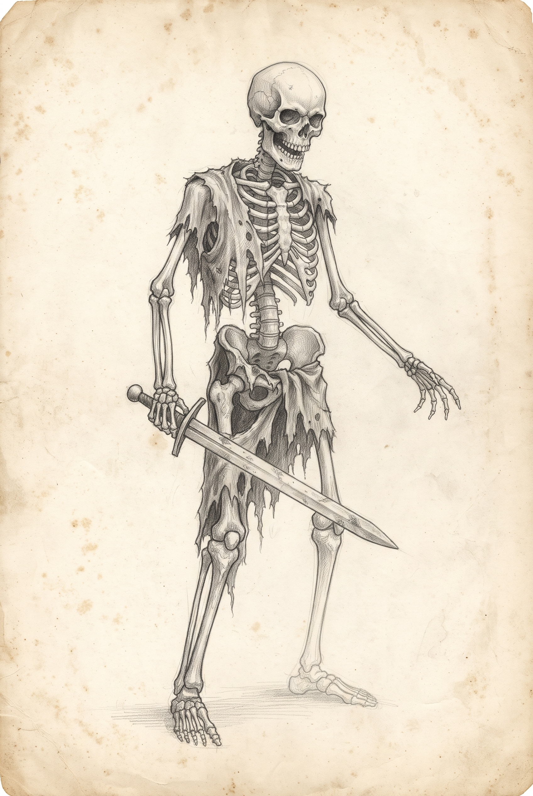

## Esqueleto (C07)

**Tipo:** Monstro
**Nível:** 1
**Status:** Adaptada com atributos; equilíbrio ainda não validado.
**Vigor:** 1
**Destreza:** 0
**Intelecto:** 0

### Talentos e características

- identificador: laminas-uma-mao
- identificador: pele-resistente
- identificador: constituicao-fragil, faixa: -4
- identificador: lentidao-natural, faixa: -1

### Ações

- nome: Espada, equipamento: espada, atributo: vigor

### Equipamento

- identificador: espada, nome: Espada, tipo: arma, quantidade: 1, treinamento: laminas-uma-mao, dano: 1d4, alcance: adjacente

### Saque

Ocasionalmente, 1 a 3 moedas deixadas como oferenda funerária. Também pode haver uma insígnia antiga que permite reconhecer a quem o esqueleto servia em vida.

### Detalhes

- titulo: Cena sugerida, texto: Guarda de uma porta antiga. Uma inscrição pode explicar sua tarefa.
- titulo: Adaptação, texto: Sem imunidades, vulnerabilidades ou ataques extras.

### Referência

Skeleton.

---

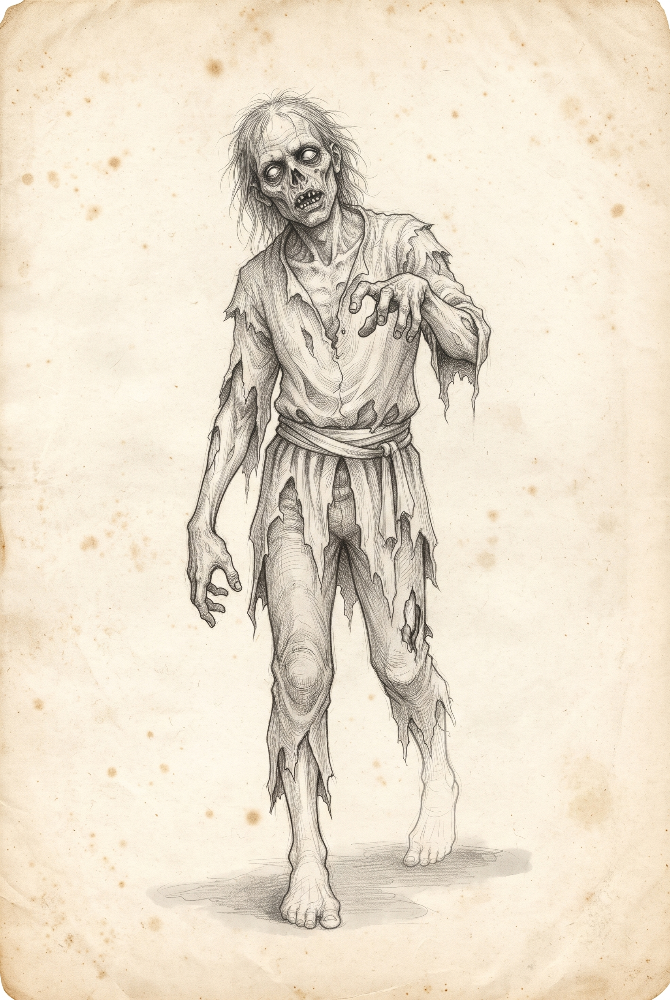

## Zumbi (C08)

**Tipo:** Monstro
**Nível:** 1
**Status:** Adaptada com atributos; equilíbrio ainda não validado.
**Vigor:** 1
**Destreza:** 0
**Intelecto:** 0

### Talentos e características

- identificador: armas-naturais
- identificador: constituicao-fragil, faixa: -2
- identificador: lentidao-natural, faixa: -2

### Ações

- nome: Pancada, equipamento: arma-natural-c08, atributo: vigor

### Equipamento

- identificador: arma-natural-c08, nome: Pancada, tipo: arma, quantidade: 1, treinamento: armas-naturais, dano: 1d3, alcance: adjacente

### Saque

Ocasionalmente, 1 a 3 moedas esquecidas num bolso. Também pode haver um anel com iniciais que ajudam a identificar quem o zumbi foi em vida.

### Detalhes

- titulo: Cena sugerida, texto: Vigia lento de um local abandonado. É possível contorná-lo.
- titulo: Adaptação, texto: Sem voltar a agir depois de derrotado.

### Referência

Zombie.

---

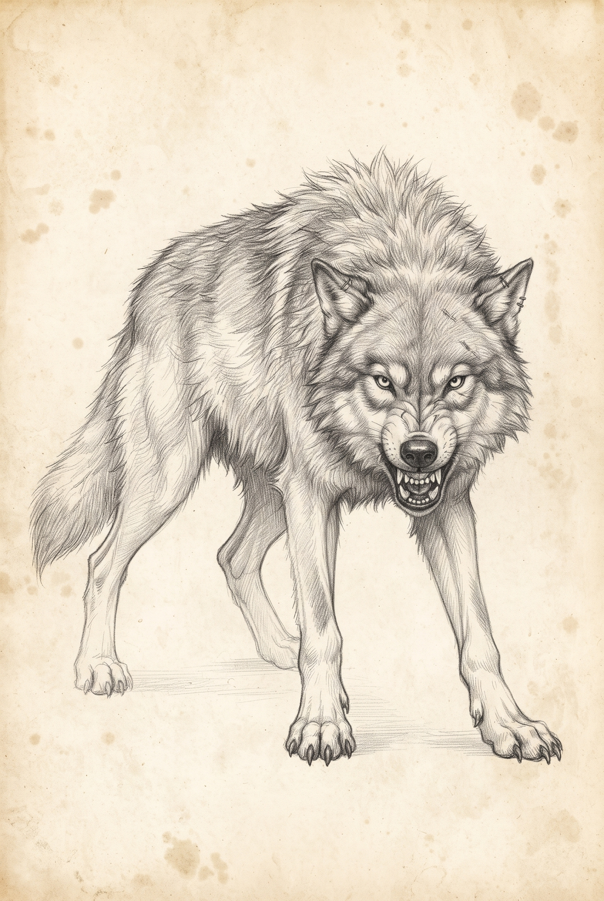

## Lobo (C09)

**Tipo:** Animal
**Nível:** 1
**Status:** Adaptada com atributos; equilíbrio ainda não validado.
**Vigor:** 2
**Destreza:** 2
**Intelecto:** 0

### Talentos e características

- identificador: armas-naturais
- identificador: pele-resistente
- identificador: constituicao-fragil, faixa: -6

### Ações

- nome: Mordida, equipamento: mordida, atributo: vigor

### Equipamento

- identificador: mordida, nome: Mordida, tipo: arma, quantidade: 1, treinamento: armas-naturais, dano: 1d4, alcance: adjacente

### Saque

Sem saque habitual.

### Detalhes

- titulo: Cena sugerida, texto: Bosques e cavernas. Pode proteger filhotes ou alimento.
- titulo: Adaptação, texto: Sem armadura ou escudo. Mordida é uma arma natural treinada; uma ação por ataque. Sem derrubar e sem bônus automático de matilha.

### Referência

Wolf.

---

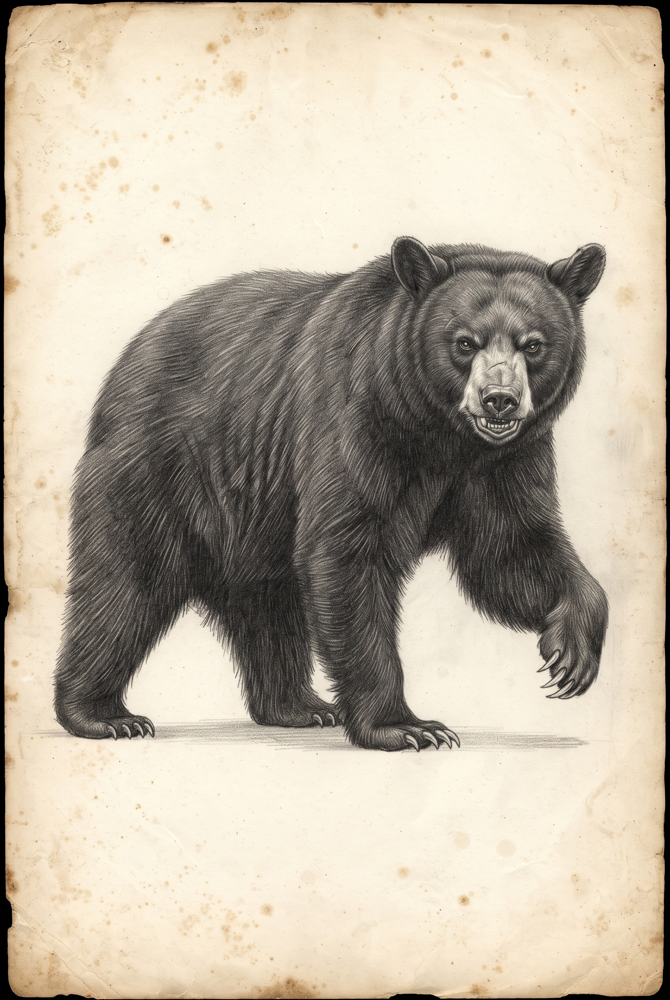

## Urso-negro (C10)

**Tipo:** Animal
**Nível:** 1
**Status:** Adaptada com atributos; equilíbrio ainda não validado.
**Vigor:** 2
**Destreza:** 0
**Intelecto:** 0

### Talentos e características

- identificador: armas-naturais
- identificador: pele-resistente
- identificador: constituicao-fragil, faixa: -4
- identificador: lentidao-natural, faixa: -1

### Ações

- nome: Garra, equipamento: arma-natural-c10, atributo: vigor

### Equipamento

- identificador: arma-natural-c10, nome: Garra, tipo: arma, quantidade: 1, treinamento: armas-naturais, dano: 1d4, alcance: adjacente

### Saque

Ocasionalmente, uma garra que pode ser guardada como troféu.

### Detalhes

- titulo: Cena sugerida, texto: Florestas. Prefere proteger seu espaço a perseguir aventureiros.
- titulo: Adaptação, texto: Uma garra por ação; sem ataque adicional de mordida.

### Referência

Black Bear.

---

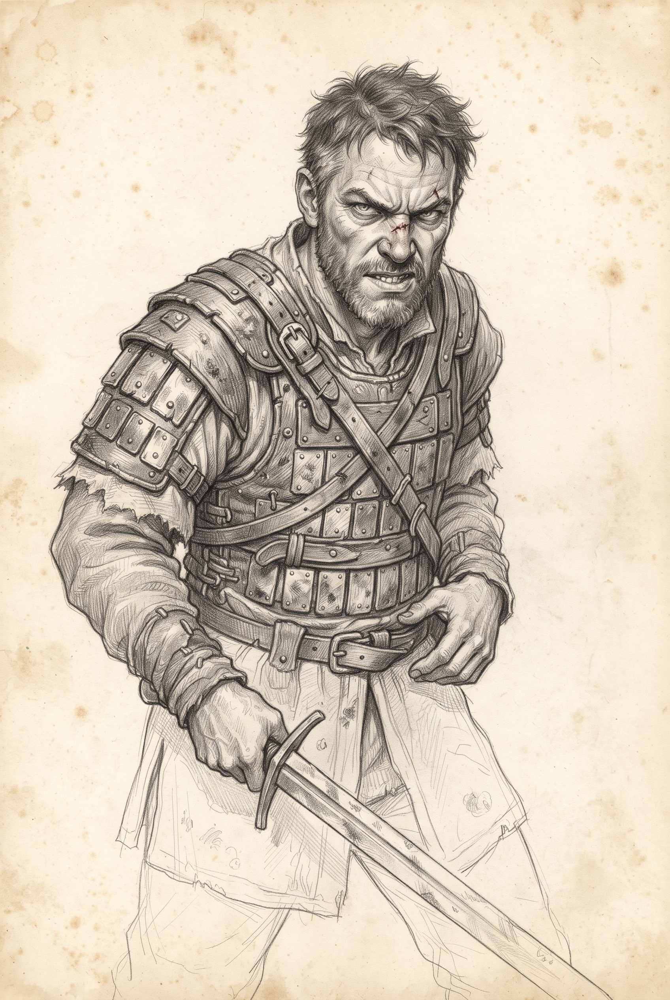

## Bandido (H01)

**Tipo:** Humano
**Nível:** 1
**Status:** Adaptada com atributos; equilíbrio ainda não validado.
**Vigor:** 2
**Destreza:** 1
**Intelecto:** 1

### Talentos e características

- identificador: laminas-uma-mao
- identificador: mobilidade-natural, faixa: 1
- identificador: constituicao-fragil, faixa: -4

### Ações

- nome: Espada, equipamento: espada, atributo: vigor

### Equipamento

- identificador: espada, nome: Espada, tipo: arma, quantidade: 1, treinamento: laminas-uma-mao, dano: 1d4, alcance: adjacente
- identificador: armadura-media, nome: Armadura média, tipo: armadura, quantidade: 1, defesa: 2, penalidadeMovimento: 1

### Saque

1 a 3 moedas. Ocasionalmente, uma corda.

### Detalhes

- titulo: Cena sugerida, texto: Pode ser inimigo, informante ou alguém disposto a se render.
- titulo: Atenção, texto: Não possui escudo.

### Referência

Bandit, representado como humano nesta adaptação.

---

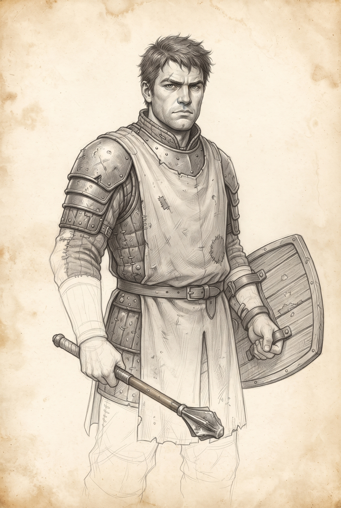

## Guarda (H02)

**Tipo:** Humano
**Nível:** 1
**Status:** Adaptada com atributos; equilíbrio ainda não validado.
**Vigor:** 1
**Destreza:** 0
**Intelecto:** 1

### Talentos e características

- identificador: impacto-uma-mao
- identificador: constituicao-fragil, faixa: -2

### Ações

- nome: Maça, equipamento: maca, atributo: vigor

### Equipamento

- identificador: maca, nome: Maça, tipo: arma, quantidade: 1, treinamento: impacto-uma-mao, dano: 1d4, alcance: adjacente
- identificador: armadura-media, nome: Armadura média, tipo: armadura, quantidade: 1, defesa: 2, penalidadeMovimento: 1
- identificador: escudo, nome: Escudo, tipo: escudo, quantidade: 1

### Saque

1 a 3 moedas. Ocasionalmente, uma tocha.

### Detalhes

- titulo: Cena sugerida, texto: Protege um portão ou acompanha uma caravana. Não precisa ser antagonista.
- titulo: Atenção, texto: O escudo sem Treinamento com escudos concede +1 Defesa. Não pode Defender aliado.

### Referência

Guard, representado como humano nesta adaptação.

---

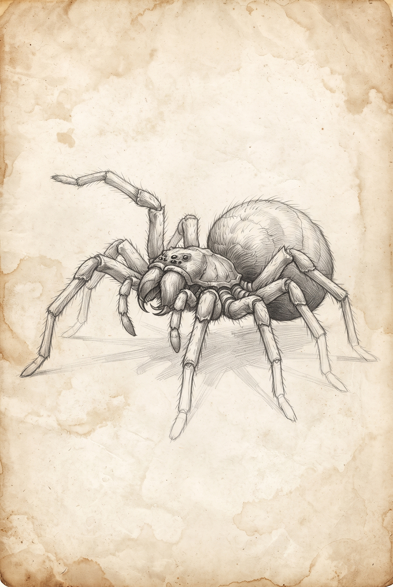

## Aranha gigante (C11)

**Tipo:** Animal
**Nível:** 2
**Status:** Adaptada com atributos; equilíbrio ainda não validado.
**Vigor:** 2
**Destreza:** 2
**Intelecto:** 0

### Talentos e características

- identificador: armas-naturais
- identificador: pele-resistente
- identificador: constituicao-fragil, faixa: -2
- identificador: lentidao-natural, faixa: -1

### Ações

- nome: Mordida, equipamento: arma-natural-c11, atributo: vigor

### Equipamento

- identificador: arma-natural-c11, nome: Mordida, tipo: arma, quantidade: 1, treinamento: armas-naturais, dano: 1d4, alcance: adjacente

### Saque

Ocasionalmente, uma bolsa de viajante presa na teia, se já houve uma vítima no local. O mestre decide o conteúdo conforme a aventura.

### Detalhes

- titulo: Cena sugerida, texto: Salões abandonados. Teias antigas podem anunciar o perigo.
- titulo: Adaptação, texto: Sem veneno ou aprisionamento nesta versão; teias são descrição, não condição automática.

### Referência

Giant Spider.

---

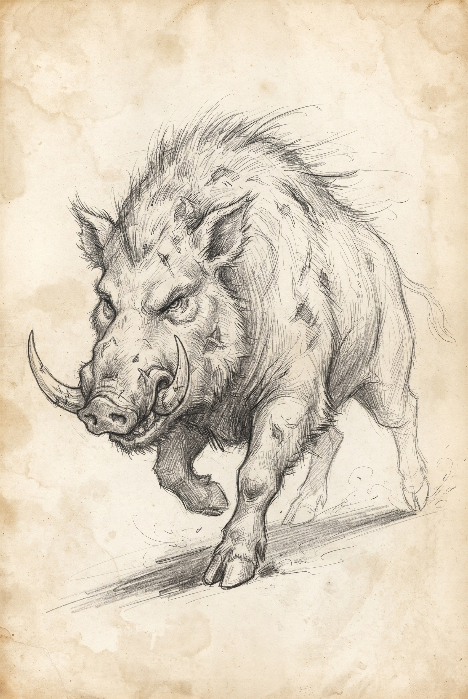

## Javali gigante (C12)

**Tipo:** Animal
**Nível:** 2
**Status:** Adaptada com atributos; equilíbrio ainda não validado.
**Vigor:** 2
**Destreza:** 1
**Intelecto:** 0

### Talentos e características

- identificador: armas-naturais
- identificador: pele-resistente

### Ações

- nome: Presas, equipamento: arma-natural-c12, atributo: vigor

### Equipamento

- identificador: arma-natural-c12, nome: Presas, tipo: arma, quantidade: 1, treinamento: armas-naturais, dano: 1d4, alcance: adjacente

### Saque

Ocasionalmente, uma presa curva, aproveitável para entalhe ou como adorno.

### Detalhes

- titulo: Cena sugerida, texto: Clareiras e passagens de mata. Pode reagir à aproximação brusca.
- titulo: Adaptação, texto: Sem dano extra de investida.

### Referência

Giant Boar.

---

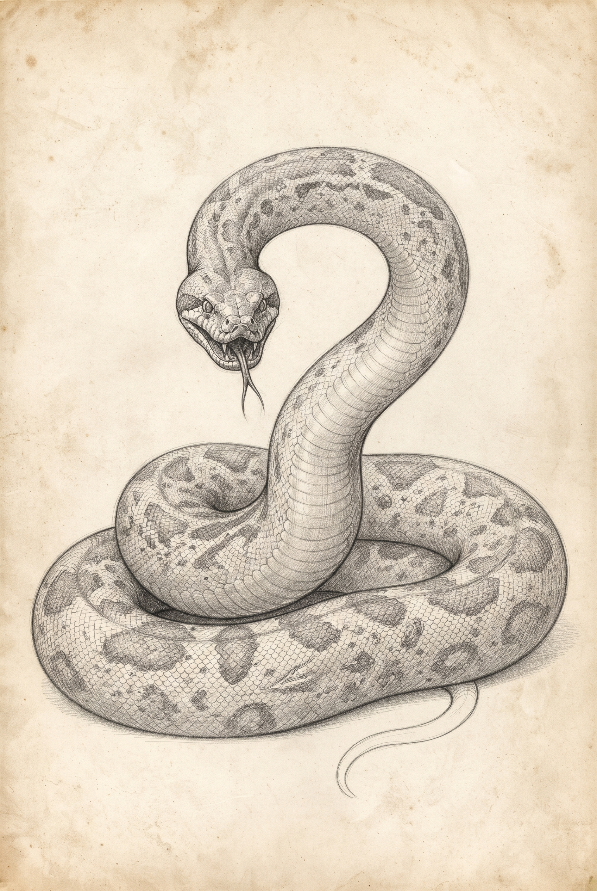

## Serpente constritora (C13)

**Tipo:** Animal
**Nível:** 2
**Status:** Adaptada com atributos; equilíbrio ainda não validado.
**Vigor:** 2
**Destreza:** 1
**Intelecto:** 0

### Talentos e características

- identificador: armas-naturais
- identificador: pele-resistente
- identificador: constituicao-fragil, faixa: -2

### Ações

- nome: Mordida, equipamento: arma-natural-c13, atributo: vigor

### Equipamento

- identificador: arma-natural-c13, nome: Mordida, tipo: arma, quantidade: 1, treinamento: armas-naturais, dano: 1d4, alcance: adjacente

### Saque

Ocasionalmente, uma muda de pele entre as pedras. Os jogadores podem recolhê-la mesmo que evitem o combate.

### Detalhes

- titulo: Cena sugerida, texto: Ruínas tomadas pela vegetação. Pode ser evitada por outro caminho.
- titulo: Adaptação, texto: Sem agarrar ou sufocar; a base representa o espaço de combate, não o comprimento total.

### Referência

Constrictor Snake.

---

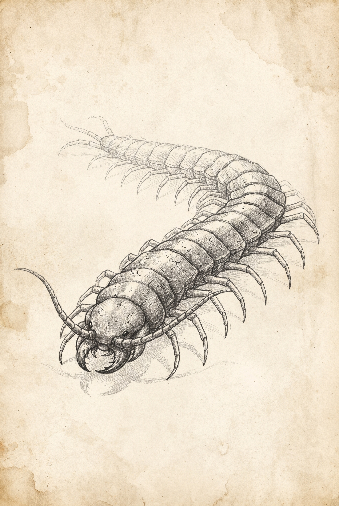

## Centopeia gigante (C14)

**Tipo:** Animal
**Nível:** 2
**Status:** Adaptada com atributos; equilíbrio ainda não validado.
**Vigor:** 2
**Destreza:** 2
**Intelecto:** 0

### Talentos e características

- identificador: armas-naturais
- identificador: pele-resistente
- identificador: constituicao-fragil, faixa: -4
- identificador: lentidao-natural, faixa: -1

### Ações

- nome: Mordida, equipamento: arma-natural-c14, atributo: vigor

### Equipamento

- identificador: arma-natural-c14, nome: Mordida, tipo: arma, quantidade: 1, treinamento: armas-naturais, dano: 1d4, alcance: adjacente

### Saque

Sem saque habitual.

### Detalhes

- titulo: Cena sugerida, texto: Fendas e depósitos úmidos. Pode sair quando seu abrigo é perturbado.
- titulo: Adaptação, texto: Sem veneno; alcance somente adjacente.

### Referência

Giant Centipede.

---

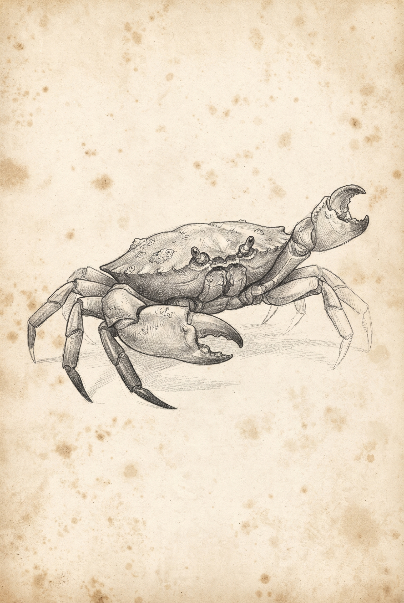

## Caranguejo gigante (C15)

**Tipo:** Animal
**Nível:** 2
**Status:** Adaptada com atributos; equilíbrio ainda não validado.
**Vigor:** 1
**Destreza:** 0
**Intelecto:** 0

### Talentos e características

- identificador: armas-naturais
- identificador: pele-resistente
- identificador: lentidao-natural, faixa: -2

### Ações

- nome: Pinça, equipamento: arma-natural-c15, atributo: vigor

### Equipamento

- identificador: arma-natural-c15, nome: Pinça, tipo: arma, quantidade: 1, treinamento: armas-naturais, dano: 1d4, alcance: adjacente

### Saque

Ocasionalmente, uma pinça intacta que pode servir de recipiente ou troféu.

### Detalhes

- titulo: Cena sugerida, texto: Praias e grutas. Sua carapaça é sua principal defesa.
- titulo: Adaptação, texto: Sem agarrar; encontro em superfície firme, sem regras de combate submerso.

### Referência

Giant Crab.

---

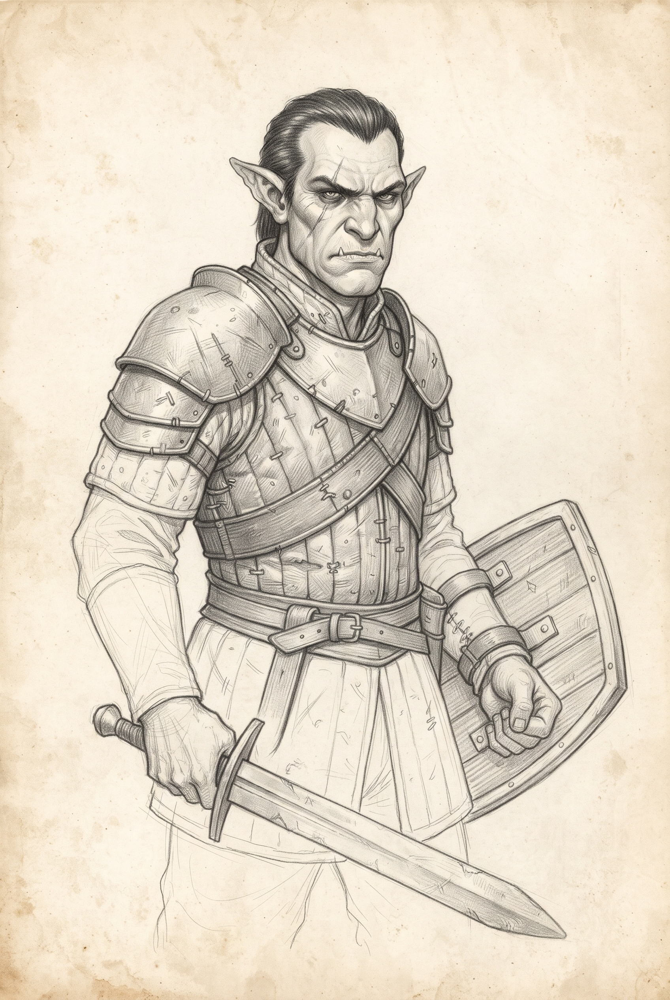

## Hobgoblin (C16)

**Tipo:** Monstro
**Nível:** 2
**Status:** Adaptada com atributos; equilíbrio ainda não validado.
**Vigor:** 2
**Destreza:** 1
**Intelecto:** 1

### Talentos e características

- identificador: laminas-uma-mao
- identificador: constituicao-fragil, faixa: -2

### Ações

- nome: Espada, equipamento: espada, atributo: vigor

### Equipamento

- identificador: espada, nome: Espada, tipo: arma, quantidade: 1, treinamento: laminas-uma-mao, dano: 1d4, alcance: adjacente
- identificador: armadura-media, nome: Armadura média, tipo: armadura, quantidade: 1, defesa: 2, penalidadeMovimento: 1
- identificador: escudo, nome: Escudo, tipo: escudo, quantidade: 1

### Saque

2 a 6 moedas. Ocasionalmente, uma ordem de patrulha que indica o posto de vigia e o horário da troca da guarda.

### Detalhes

- titulo: Cena sugerida, texto: Sentinela disciplinado. Pode obedecer a ordens ou aceitar rendição.
- titulo: Adaptação, texto: Armadura média e escudo sem treino: Defesa 10 + 2 + 1. Pode Defender a si, mas não aliado.

### Referência

Hobgoblin Warrior.

---

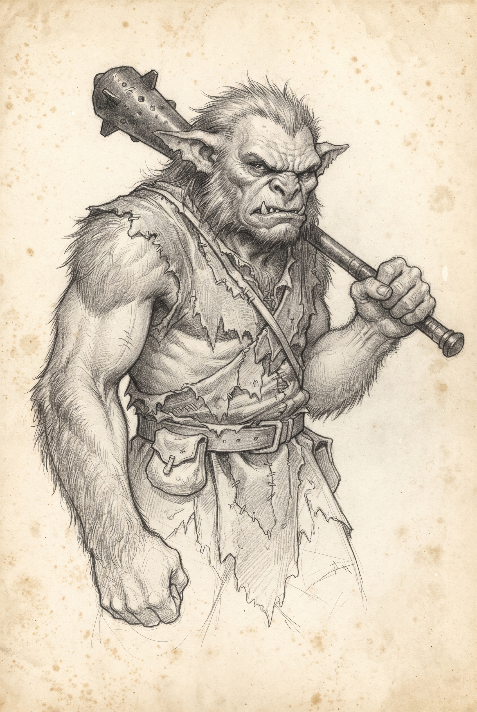

## Bugbear (C17)

**Tipo:** Monstro
**Nível:** 2
**Status:** Adaptada com atributos; equilíbrio ainda não validado.
**Vigor:** 3
**Destreza:** 1
**Intelecto:** 1

### Talentos e características

- identificador: impacto-uma-mao
- identificador: mobilidade-natural, faixa: 1
- identificador: constituicao-fragil, faixa: -2

### Ações

- nome: Maça, equipamento: maca, atributo: vigor

### Equipamento

- identificador: maca, nome: Maça, tipo: arma, quantidade: 1, treinamento: impacto-uma-mao, dano: 1d4, alcance: adjacente
- identificador: armadura-media, nome: Armadura média, tipo: armadura, quantidade: 1, defesa: 2, penalidadeMovimento: 1

### Saque

2 a 6 moedas. Ocasionalmente, um apito de osso usado para alertar o acampamento.

### Detalhes

- titulo: Cena sugerida, texto: Vigia forte de um acampamento. Pode tentar encerrar a luta intimidando.
- titulo: Adaptação, texto: Sem dano surpresa, alcance ampliado ou ataque extra.

### Referência

Bugbear Warrior.

---

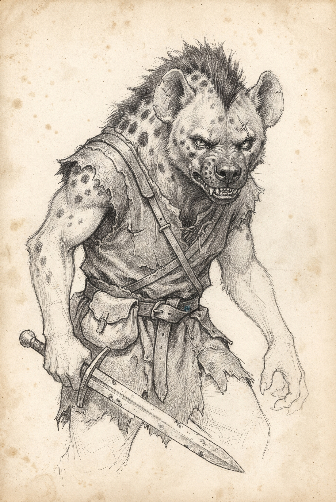

## Gnoll (C18)

**Tipo:** Monstro
**Nível:** 2
**Status:** Adaptada com atributos; equilíbrio ainda não validado.
**Vigor:** 2
**Destreza:** 2
**Intelecto:** 1

### Talentos e características

- identificador: laminas-uma-mao
- identificador: constituicao-fragil, faixa: -2

### Ações

- nome: Espada, equipamento: espada, atributo: vigor

### Equipamento

- identificador: espada, nome: Espada, tipo: arma, quantidade: 1, treinamento: laminas-uma-mao, dano: 1d4, alcance: adjacente
- identificador: armadura-media, nome: Armadura média, tipo: armadura, quantidade: 1, defesa: 2, penalidadeMovimento: 1

### Saque

2 a 6 moedas. Ocasionalmente, um mapa de trilha com um vau marcado para atravessar o rio.

### Detalhes

- titulo: Cena sugerida, texto: Patrulheiro de ermos. Pode estar guardando uma rota ou mercadoria.
- titulo: Adaptação, texto: Sem ataque adicional ao derrubar alguém.

### Referência

Gnoll Warrior.

---

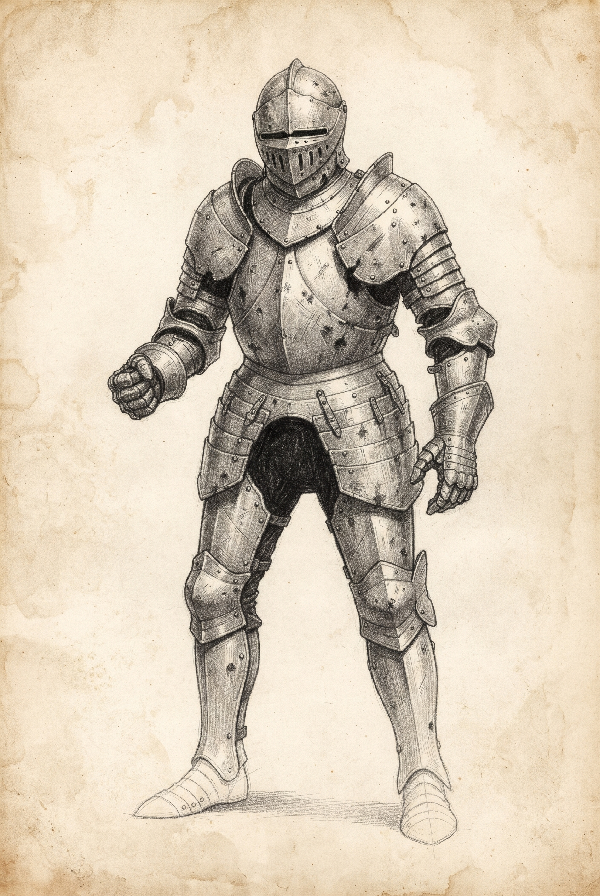

## Armadura animada (C19)

**Tipo:** Monstro
**Nível:** 2
**Status:** Adaptada com atributos; equilíbrio ainda não validado.
**Vigor:** 2
**Destreza:** 0
**Intelecto:** 0

### Talentos e características

- identificador: armas-naturais
- identificador: pele-resistente
- identificador: constituicao-fragil, faixa: -2
- identificador: lentidao-natural, faixa: -2

### Ações

- nome: Pancada, equipamento: arma-natural-c19, atributo: vigor

### Equipamento

- identificador: arma-natural-c19, nome: Pancada, tipo: arma, quantidade: 1, treinamento: armas-naturais, dano: 1d4, alcance: adjacente

### Saque

Sem moedas habituais. Ocasionalmente, um brasão de metal preso ao peitoral identifica a casa que a armadura guarda.

### Detalhes

- titulo: Cena sugerida, texto: Guarda mágico de salão. Pode obedecer a uma senha ou sinal.
- titulo: Adaptação, texto: Defesa própria da criatura; sem imunidades. Não é armadura vestível automaticamente recuperável.

### Referência

Animated Armor.

---

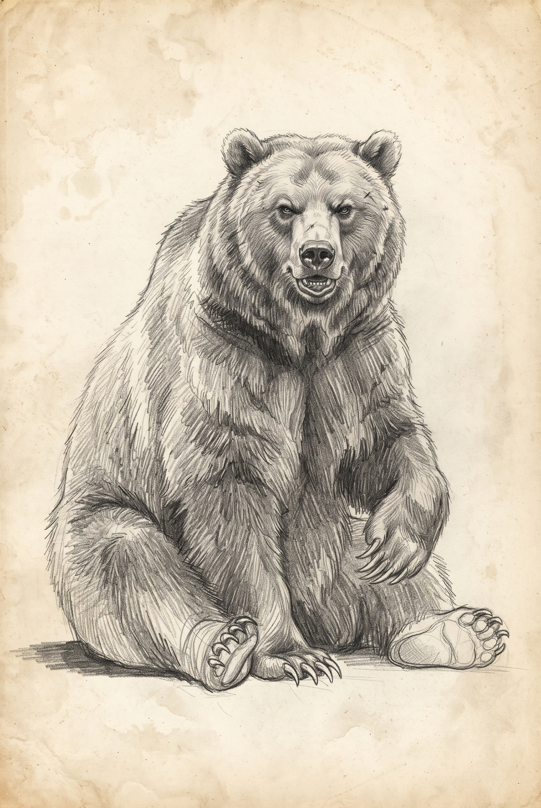

## Urso-pardo (C20)

**Tipo:** Animal
**Nível:** 2
**Status:** Adaptada com atributos; equilíbrio ainda não validado.
**Vigor:** 3
**Destreza:** 1
**Intelecto:** 0

### Talentos e características

- identificador: armas-naturais
- identificador: pele-resistente

### Ações

- nome: Garra, equipamento: arma-natural-c20, atributo: vigor

### Equipamento

- identificador: arma-natural-c20, nome: Garra, tipo: arma, quantidade: 1, treinamento: armas-naturais, dano: 1d4, alcance: adjacente

### Saque

Ocasionalmente, uma pele espessa, útil como coberta depois de preparada.

### Detalhes

- titulo: Cena sugerida, texto: Matas e cavernas amplas. Anuncia sua presença antes de atacar.
- titulo: Adaptação, texto: Uma garra por ação; sem agarrar.

### Referência

Brown Bear.

---

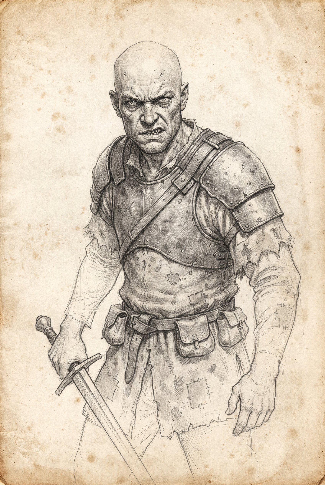

## Batedor humano (H03)

**Tipo:** Humano
**Nível:** 2
**Status:** Adaptada com atributos; equilíbrio ainda não validado.
**Vigor:** 1
**Destreza:** 3
**Intelecto:** 1

### Talentos e características

- identificador: arquearia
- identificador: laminas-uma-mao

### Ações

- nome: Arco, equipamento: arco, atributo: destreza
- nome: Espada, equipamento: espada, atributo: vigor

### Equipamento

- identificador: arco, nome: Arco e flechas, tipo: arma, quantidade: 1, treinamento: arquearia, dano: 1d4, alcance: 8 casas
- identificador: espada, nome: Espada, tipo: arma, quantidade: 1, treinamento: laminas-uma-mao, dano: 1d4, alcance: adjacente
- identificador: armadura-leve, nome: Armadura leve, tipo: armadura, quantidade: 1, defesa: 1, penalidadeMovimento: 0

### Saque

2 a 6 moedas. Ocasionalmente, uma pederneira.

### Detalhes

- titulo: Cena sugerida, texto: Vigia estradas e procura rotas seguras. Pode oferecer pistas ou perseguir intrusos.
- titulo: Atenção, texto: O arco ocupa duas mãos e não pode ser disparado com inimigo adjacente, inclusive na diagonal. Trocar entre arco e espada consome uma ação.

### Referência

Scout, representado como humano nesta adaptação.

---

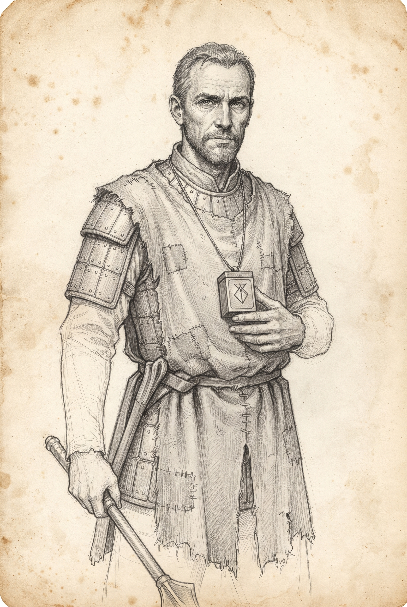

## Acólito humano (H04)

**Tipo:** Humano
**Nível:** 2
**Status:** Adaptada com atributos; equilíbrio ainda não validado.
**Vigor:** 1
**Destreza:** 0
**Intelecto:** 2

### Talentos e características

- identificador: impacto-uma-mao
- identificador: milagres-restauradores

### Ações

- nome: Maça, equipamento: maca, atributo: vigor
- nome: Relicário de cura, equipamento: relicario-cura, atributo: intelecto

### Equipamento

- identificador: maca, nome: Maça, tipo: arma, quantidade: 1, treinamento: impacto-uma-mao, dano: 1d4, alcance: adjacente
- identificador: armadura-leve, nome: Armadura leve, tipo: armadura, quantidade: 1, defesa: 1, penalidadeMovimento: 0
- identificador: relicario-cura, nome: Relicário de cura — 3 cargas, tipo: item-magico, quantidade: 1, treinamento: milagres-restauradores, cargasMaximas: 3, alcance: 6 casas, efeito: tipo: cura, valor: 6

### Saque

2 a 6 moedas. Ocasionalmente, um medalhão de madeira com o símbolo de seu templo.

### Detalhes

- titulo: Cena sugerida, texto: Responsável por um santuário. Pode curar viajantes ou apoiar guardiões.
- titulo: Atenção, texto: A cura bem-sucedida traz um inconsciente vivo de volta com 1 PV e ele perde a próxima rodada. Não ressuscita mortos. Sem Pergaminhos; não recarrega o relicário.

### Referência

Priest Acolyte, representado como humano nesta adaptação.

---

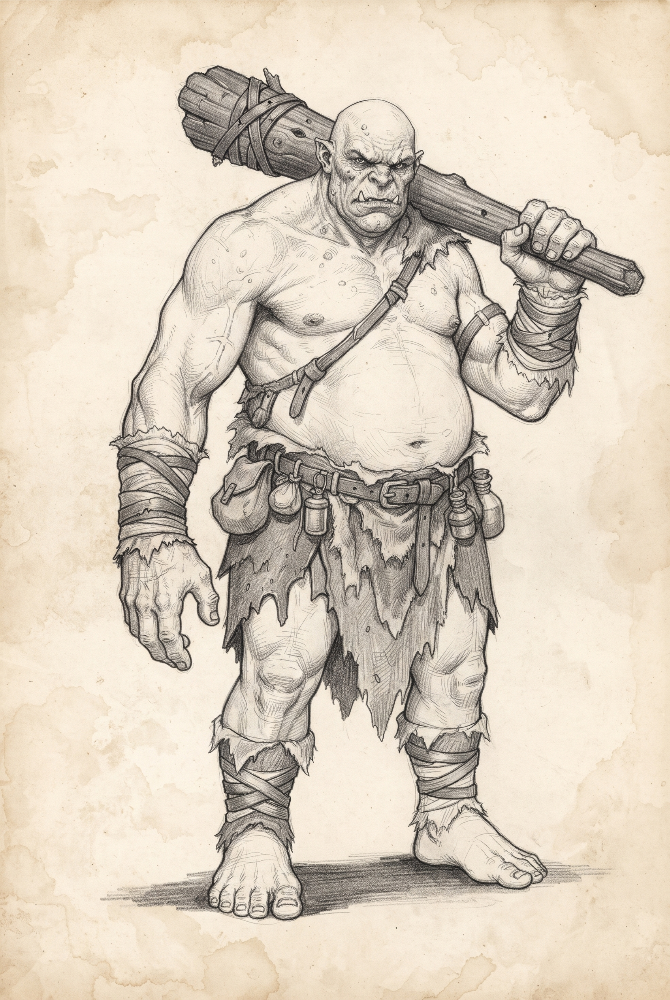

## Ogro (C21)

**Tipo:** Monstro
**Nível:** 3
**Status:** Adaptada com atributos; equilíbrio ainda não validado.
**Vigor:** 5
**Destreza:** 0
**Intelecto:** 0

### Talentos e características

- identificador: armas-pesadas
- identificador: pele-resistente
- identificador: lentidao-natural, faixa: -1

### Ações

- nome: Porrete de duas mãos, equipamento: porrete-duas-maos, atributo: vigor

### Equipamento

- identificador: porrete-duas-maos, nome: Porrete de duas mãos, tipo: arma, quantidade: 1, treinamento: armas-pesadas, dano: 1d6, alcance: adjacente

### Saque

4 a 10 moedas recebidas como pedágio ou tomadas de viajantes. Ocasionalmente, uma panela de ferro recolhida de uma carroça.

### Detalhes

- titulo: Cena sugerida, texto: Ocupante de ponte ou gruta. Pode cobrar passagem e aceitar uma negociação.
- titulo: Adaptação, texto: O porrete de duas mãos causa 1d6 de dano base. Com Vigor 5, o ataque causa 1d6 + 2. Sem arremesso de rochas.

### Referência

Ogre.

---

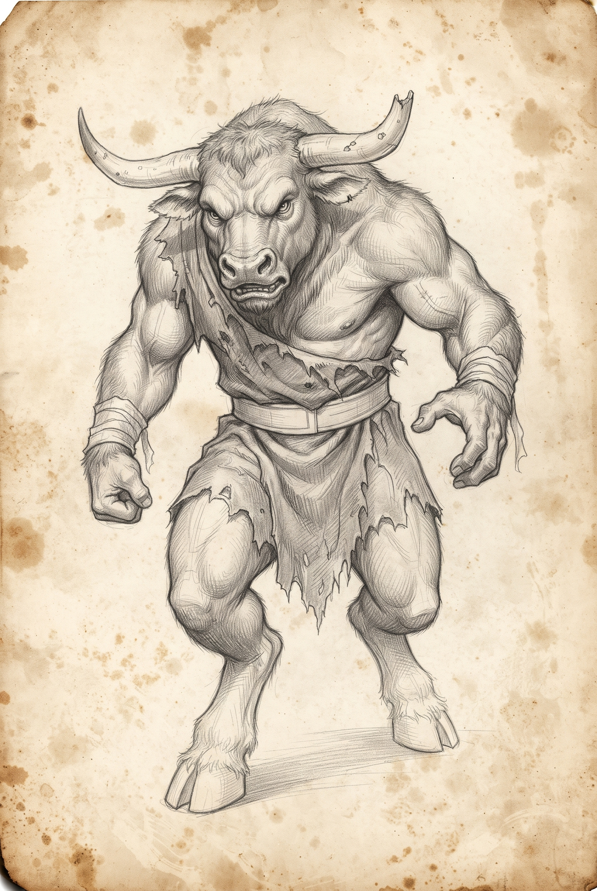

## Minotauro (C22)

**Tipo:** Monstro
**Nível:** 3
**Status:** Adaptada com atributos; equilíbrio ainda não validado.
**Vigor:** 4
**Destreza:** 1
**Intelecto:** 1

### Talentos e características

- identificador: armas-naturais
- identificador: pele-resistente
- identificador: vitalidade-adicional, faixa: 5
- identificador: lentidao-natural, faixa: -1

### Ações

- nome: Chifres, equipamento: arma-natural-c22, atributo: vigor

### Equipamento

- identificador: arma-natural-c22, nome: Chifres, tipo: arma, quantidade: 1, treinamento: armas-naturais, dano: 1d6, alcance: adjacente

### Saque

Sem moedas habituais. Ocasionalmente, uma chave de bronze presa ao cinto. O mestre decide que porta do labirinto ela abre. A aventura define qualquer tesouro guardado pelo minotauro.

### Detalhes

- titulo: Cena sugerida, texto: Guardião de um labirinto. Pode perseguir intrusos ou proteger um objeto.
- titulo: Adaptação, texto: Sem empurrão, investida especial ou alcance ampliado.

### Referência

Minotaur of Baphomet.

---

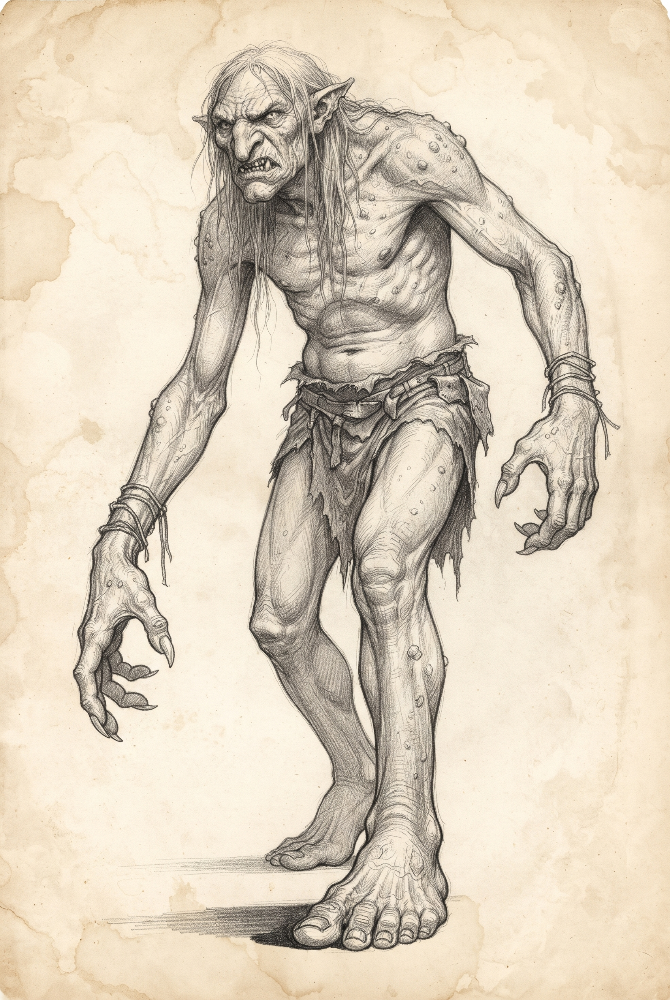

## Troll (C23)

**Tipo:** Monstro
**Nível:** 3
**Status:** Adaptada com atributos; equilíbrio ainda não validado.
**Vigor:** 3
**Destreza:** 1
**Intelecto:** 0

### Talentos e características

- identificador: armas-naturais
- identificador: pele-resistente
- identificador: vitalidade-adicional, faixa: 10
- identificador: lentidao-natural, faixa: -1

### Ações

- nome: Garra, equipamento: arma-natural-c23, atributo: vigor

### Equipamento

- identificador: arma-natural-c23, nome: Garra, tipo: arma, quantidade: 1, treinamento: armas-naturais, dano: 1d6, alcance: adjacente

### Saque

Sem moedas habituais. Ocasionalmente, uma pederneira entre os pertences de um viajante no abrigo do troll.

### Detalhes

- titulo: Cena sugerida, texto: Habitante de brejo ou ruína. É uma ameaça resistente que pode ser evitada.
- titulo: Adaptação, texto: Versão muito simplificada: sem regeneração, imunidades ou exigência de fogo para vencer.

### Referência

Troll.

---

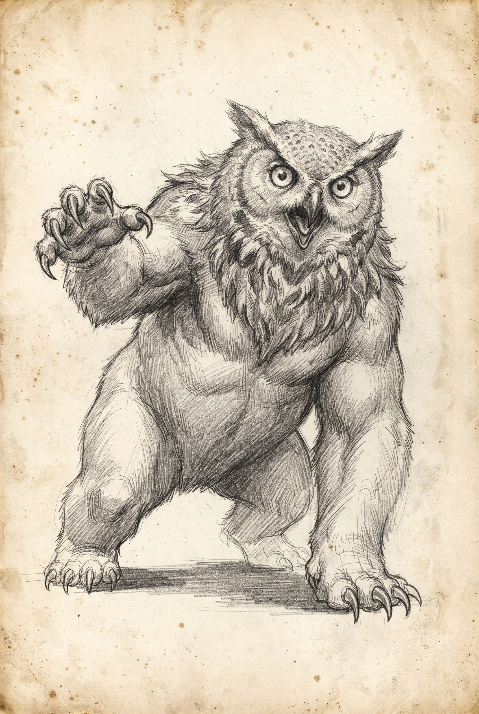

## Urso-coruja (C24)

**Tipo:** Monstro
**Nível:** 3
**Status:** Adaptada com atributos; equilíbrio ainda não validado.
**Vigor:** 4
**Destreza:** 1
**Intelecto:** 0

### Talentos e características

- identificador: armas-naturais
- identificador: pele-resistente
- identificador: vitalidade-adicional, faixa: 5

### Ações

- nome: Garra, equipamento: arma-natural-c24, atributo: vigor

### Equipamento

- identificador: arma-natural-c24, nome: Garra, tipo: arma, quantidade: 1, treinamento: armas-naturais, dano: 1d6, alcance: adjacente

### Saque

Sem moedas habituais. Ocasionalmente, uma pena grande e rajada, que também pode ser recolhida no ninho.

### Detalhes

- titulo: Cena sugerida, texto: Predador territorial. Seu ninho pode explicar a agressividade.
- titulo: Adaptação, texto: Uma garra por ação; bico não concede ataque adicional.

### Referência

Owlbear.

---

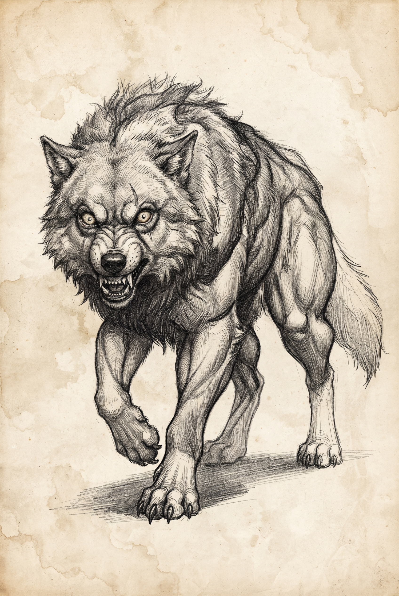

## Lobo atroz (C25)

**Tipo:** Animal
**Nível:** 3
**Status:** Adaptada com atributos; equilíbrio ainda não validado.
**Vigor:** 4
**Destreza:** 2
**Intelecto:** 0

### Talentos e características

- identificador: armas-naturais
- identificador: pele-resistente

### Ações

- nome: Mordida, equipamento: arma-natural-c25, atributo: vigor

### Equipamento

- identificador: arma-natural-c25, nome: Mordida, tipo: arma, quantidade: 1, treinamento: armas-naturais, dano: 1d6, alcance: adjacente

### Saque

Ocasionalmente, uma presa grande. Quem conhece a região pode identificar o animal por ela.

### Detalhes

- titulo: Cena sugerida, texto: Caçador de grandes clareiras. Sua mobilidade ameaça personagens isolados.
- titulo: Adaptação, texto: Sem derrubar ou bônus de matilha.

### Referência

Dire Wolf.

---

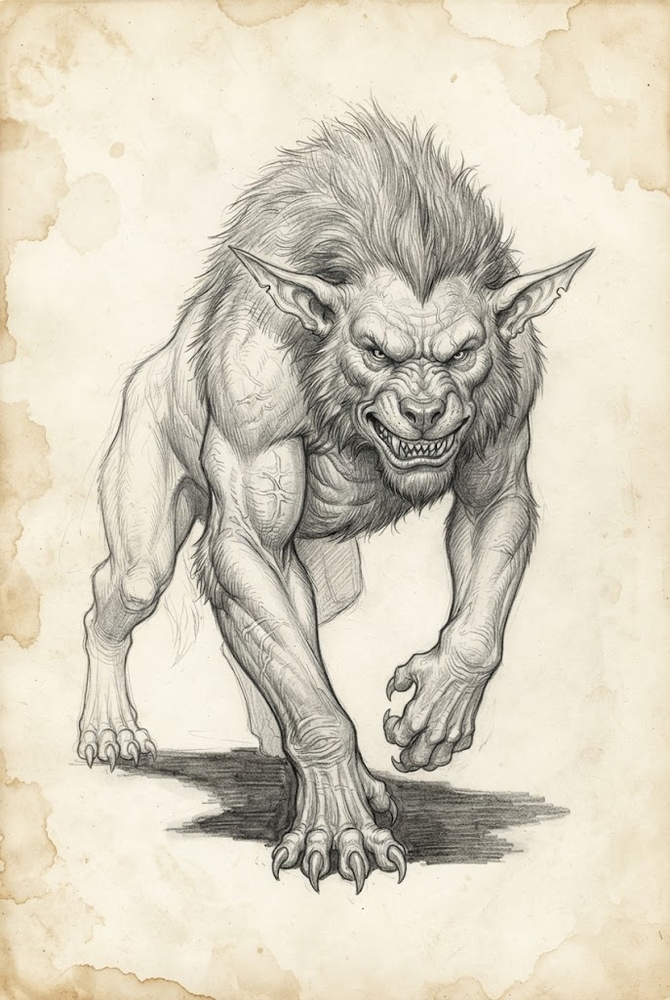

## Worg (C26)

**Tipo:** Monstro
**Nível:** 3
**Status:** Adaptada com atributos; equilíbrio ainda não validado.
**Vigor:** 4
**Destreza:** 2
**Intelecto:** 1

### Talentos e características

- identificador: armas-naturais
- identificador: pele-resistente
- identificador: lentidao-natural, faixa: -1

### Ações

- nome: Mordida, equipamento: arma-natural-c26, atributo: vigor

### Equipamento

- identificador: arma-natural-c26, nome: Mordida, tipo: arma, quantidade: 1, treinamento: armas-naturais, dano: 1d6, alcance: adjacente

### Saque

Sem moedas habituais. Quando acompanha uma patrulha organizada, o worg pode usar uma coleira com o símbolo da patrulha.

### Detalhes

- titulo: Cena sugerida, texto: Predador astuto. Pode defender um território ou acompanhar uma patrulha.
- titulo: Adaptação, texto: Sem bônus de montaria ou ataque adicional.

### Referência

Worg.

---

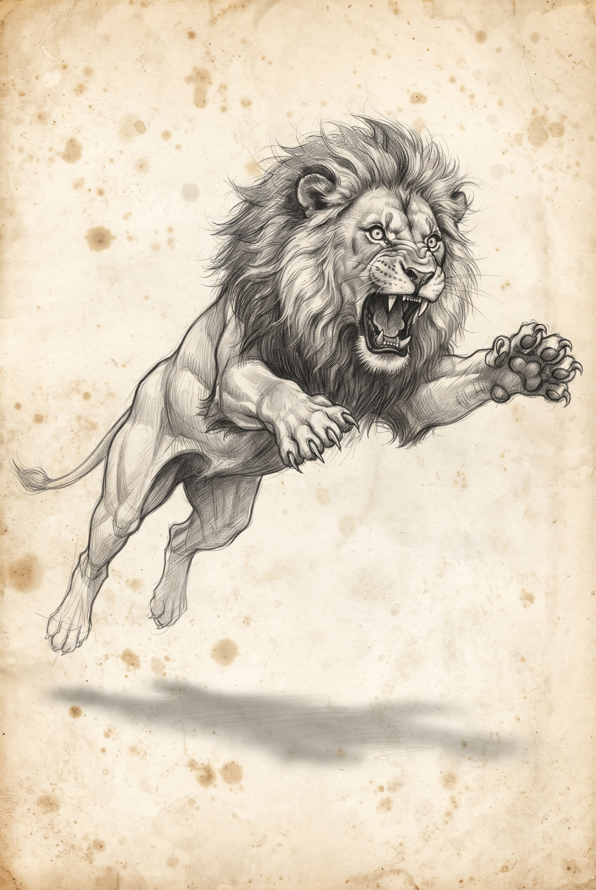

## Leão (C27)

**Tipo:** Animal
**Nível:** 3
**Status:** Adaptada com atributos; equilíbrio ainda não validado.
**Vigor:** 4
**Destreza:** 2
**Intelecto:** 0

### Talentos e características

- identificador: armas-naturais
- identificador: pele-resistente

### Ações

- nome: Garra, equipamento: arma-natural-c27, atributo: vigor

### Equipamento

- identificador: arma-natural-c27, nome: Garra, tipo: arma, quantidade: 1, treinamento: armas-naturais, dano: 1d6, alcance: adjacente

### Saque

Ocasionalmente, uma garra, aproveitável como pingente.

### Detalhes

- titulo: Cena sugerida, texto: Predador de campos abertos. Pode abandonar a disputa se o grupo recuar.
- titulo: Adaptação, texto: Sem salto especial ou derrubar.

### Referência

Lion.

---

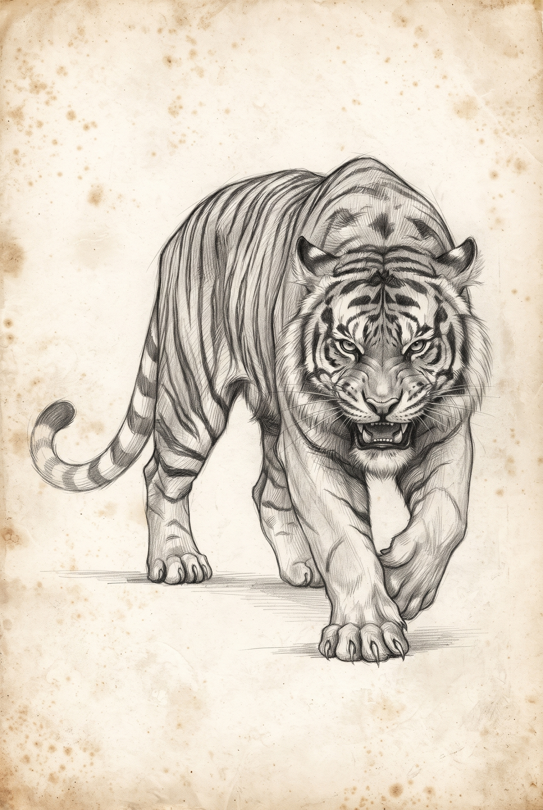

## Tigre (C28)

**Tipo:** Animal
**Nível:** 3
**Status:** Adaptada com atributos; equilíbrio ainda não validado.
**Vigor:** 5
**Destreza:** 2
**Intelecto:** 0

### Talentos e características

- identificador: armas-naturais
- identificador: pele-resistente
- identificador: lentidao-natural, faixa: -1

### Ações

- nome: Garra, equipamento: arma-natural-c28, atributo: vigor

### Equipamento

- identificador: arma-natural-c28, nome: Garra, tipo: arma, quantidade: 1, treinamento: armas-naturais, dano: 1d6, alcance: adjacente

### Saque

Ocasionalmente, uma presa longa, aproveitável como troféu.

### Detalhes

- titulo: Cena sugerida, texto: Caçador de mata fechada. Rastros podem oferecer aviso e rota alternativa.
- titulo: Adaptação, texto: Sem dano extra de emboscada; descoberta depende da cena e dos testes normais.

### Referência

Tiger.

---

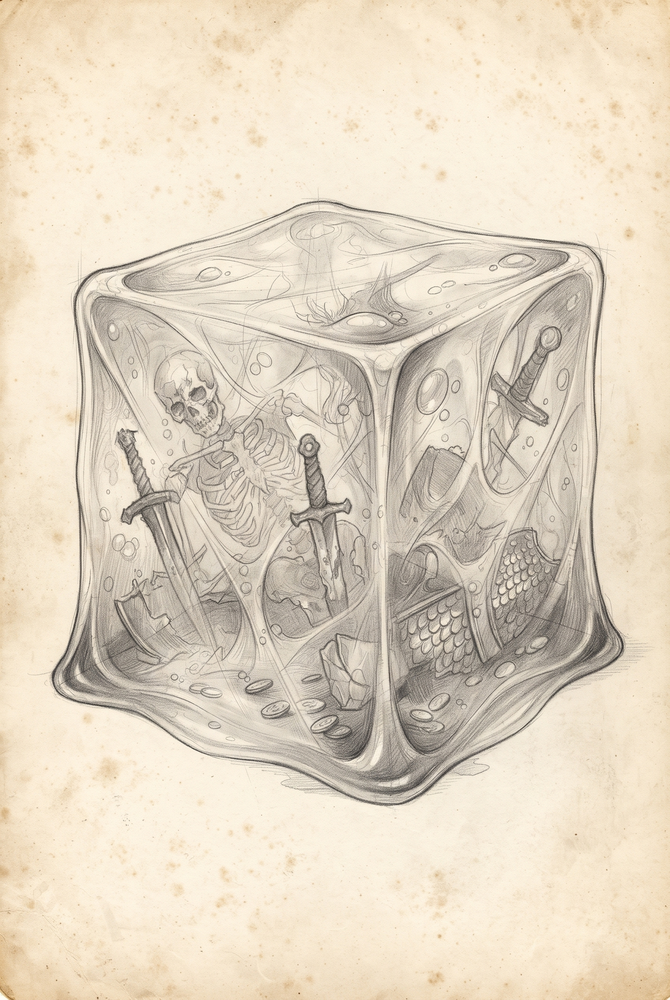

## Cubo gelatinoso (C29)

**Tipo:** Monstro
**Nível:** 3
**Status:** Adaptada com atributos; equilíbrio ainda não validado.
**Vigor:** 2
**Destreza:** 0
**Intelecto:** 0

### Talentos e características

- identificador: armas-naturais
- identificador: vitalidade-adicional, faixa: 10
- identificador: lentidao-natural, faixa: -2

### Ações

- nome: Contato corrosivo, equipamento: arma-natural-c29, atributo: vigor

### Equipamento

- identificador: arma-natural-c29, nome: Contato corrosivo, tipo: arma, quantidade: 1, treinamento: armas-naturais, dano: 1d6, alcance: adjacente

### Saque

Ocasionalmente, 4 a 10 moedas visíveis no interior do cubo. Os jogadores também podem avistar a chave de ferro de uma vítima anterior antes de decidir se querem recuperá-la.

### Detalhes

- titulo: Cena sugerida, texto: Ocupa uma passagem larga. Sua lentidão permite observar e buscar outra rota.
- titulo: Adaptação, texto: Contato é um ataque contra Defesa, não dano automático. Sem engolfar, paralisar ou destruir itens.

### Referência

Gelatinous Cube.

---

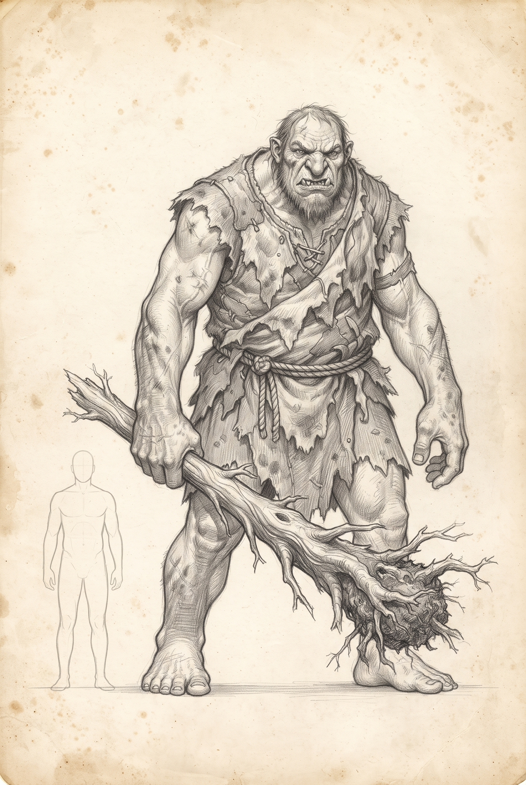

## Gigante das colinas (C30)

**Tipo:** Monstro
**Nível:** 3
**Status:** Adaptada com atributos; equilíbrio ainda não validado.
**Vigor:** 5
**Destreza:** 0
**Intelecto:** 0

### Talentos e características

- identificador: armas-pesadas
- identificador: pele-resistente
- identificador: vitalidade-adicional, faixa: 10
- identificador: lentidao-natural, faixa: -1

### Ações

- nome: Porrete de duas mãos, equipamento: porrete-duas-maos, atributo: vigor

### Equipamento

- identificador: porrete-duas-maos, nome: Porrete de duas mãos, tipo: arma, quantidade: 1, treinamento: armas-pesadas, dano: 1d6, alcance: adjacente

### Saque

4 a 10 moedas, caso tenha recebido tributo de viajantes. Ocasionalmente, um pequeno barril de provisões que o gigante carrega como lanche.

### Detalhes

- titulo: Cena sugerida, texto: Ocupante de um vale ou salão enorme. Pode exigir comida ou afastar intrusos.
- titulo: Adaptação, texto: Sem armadura ou escudo. Porrete de duas mãos treinado; uma ação por ataque. Sem rochas, alcance ampliado ou vários ataques; usar como ameaça anunciada.

### Referência

Hill Giant.

---

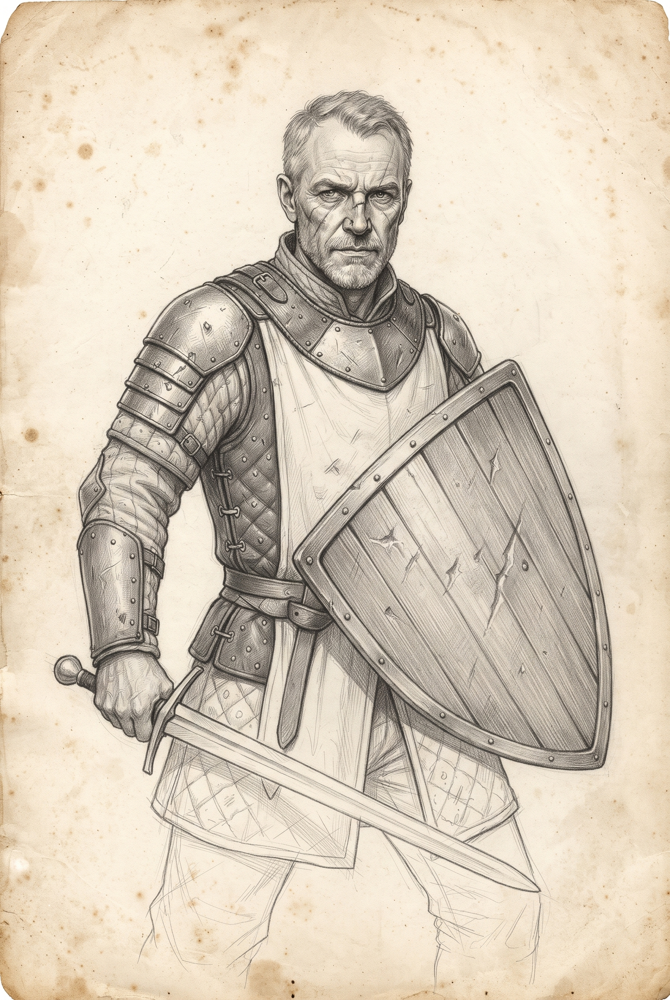

## Veterano humano (H05)

**Tipo:** Humano
**Nível:** 3
**Status:** Adaptada com atributos; equilíbrio ainda não validado.
**Vigor:** 5
**Destreza:** 1
**Intelecto:** 1

### Talentos e características

- identificador: laminas-uma-mao
- identificador: mobilidade-natural, faixa: 1
- identificador: treinamento-escudos

### Ações

- nome: Espada, equipamento: espada, atributo: vigor

### Equipamento

- identificador: espada, nome: Espada, tipo: arma, quantidade: 1, treinamento: laminas-uma-mao, dano: 1d4, alcance: adjacente
- identificador: armadura-media, nome: Armadura média, tipo: armadura, quantidade: 1, defesa: 2, penalidadeMovimento: 1
- identificador: escudo, nome: Escudo, tipo: escudo, quantidade: 1

### Saque

4 a 10 moedas. Ocasionalmente, uma poção de cura.

### Detalhes

- titulo: Cena sugerida, texto: Defensor experiente ou líder de patrulha. Pode aceitar duelo, acordo ou retirada.
- titulo: Atenção, texto: Defender a si mesmo eleva a Defesa a 17. Defender aliado exige ação, escudo e adjacência; eleva a Defesa do Veterano a 16 e concede +1 Defesa ao aliado até o próximo turno. Não pode atacar e Defender na mesma ação.

### Referência

Veteran Warrior, representado como humano nesta adaptação.

---

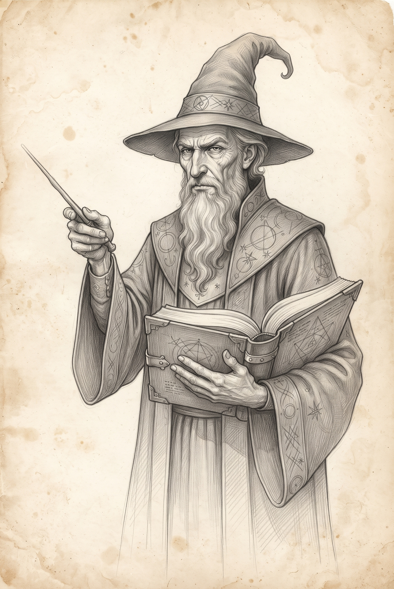

## Mago humano (H06)

**Tipo:** Humano
**Nível:** 2
**Status:** Adaptada com atributos; equilíbrio ainda não validado.
**Vigor:** 2
**Destreza:** 1
**Intelecto:** 3

### Talentos e características

- identificador: magia-ofensiva
- identificador: magia-controladora
- identificador: pergaminhos

### Ações

- nome: Catalisador de dano, equipamento: catalisador-dano, atributo: intelecto
- nome: Catalisador de controle, equipamento: catalisador-controle, atributo: intelecto
- nome: Pergaminho de recarga, equipamento: pergaminho-recarga, atributo: intelecto
- nome: Adaga, equipamento: adaga, atributo: vigor

### Equipamento

- identificador: catalisador-dano, nome: Catalisador de dano — 6 cargas, tipo: item-magico, quantidade: 1, treinamento: magia-ofensiva, cargasMaximas: 6, alcance: 6 casas, efeito: tipo: dano, valor: 1d3
- identificador: catalisador-controle, nome: Catalisador de controle — 5 cargas, tipo: item-magico, quantidade: 1, treinamento: magia-controladora, cargasMaximas: 5, alcance: 6 casas, efeito: tipo: controle
- identificador: pergaminho-recarga, nome: Pergaminho de recarga do catalisador de dano, tipo: pergaminho, quantidade: 1, efeito: tipo: recarga, alvoRecarga: catalisador-dano
- identificador: adaga, nome: Adaga, tipo: arma, quantidade: 1, treinamento: laminas-uma-mao, dano: 1d3, alcance: adjacente
- identificador: armadura-leve, nome: Armadura leve, tipo: armadura, quantidade: 1, defesa: 1, penalidadeMovimento: 0

### Saque

2 a 6 moedas. Ocasionalmente, o pergaminho de recarga do catalisador de dano que o mago carrega, somente se ele não tiver usado o pergaminho no encontro.

### Detalhes

- titulo: Cena sugerida, texto: Especialista em objetos arcanos. Pode ser rival, pesquisador ou aliado temporário.
- titulo: Atenção, texto: Controle não causa dano: impede deslocamento, inclusive Arrancada, e impõe −3 no próximo ataque até o início do próximo turno do usuário; o alvo ainda pode agir. Uma ação por uso. Falhas de ativação consomem carga. O pergaminho recarrega somente o catalisador de dano. Não tem magia própria nem Mana.

### Referência

Mage, representado como humano nesta adaptação.

---
