# Monstrous Compendium

Versão 0.15

## Rato gigante (C01)

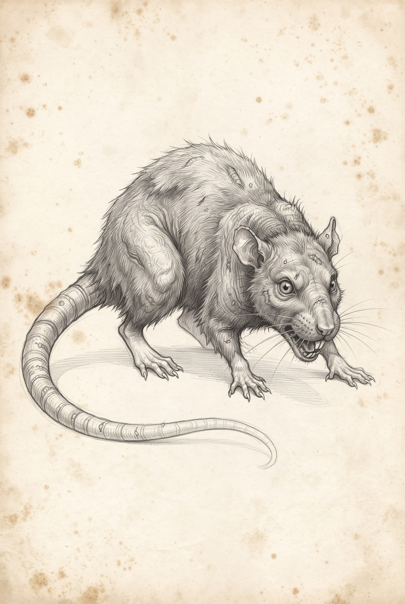

- **Status**: Adaptada com atributos; equilíbrio ainda não validado.
- **Tipo**: Animal
- **Nivel**: 1
- **Vigor**: 1
- **Destreza**: 2
- **Intelecto**: 0
- **Base**: largura: 1, comprimento: 1

### Talentos e características

- identificador: armas-naturais
- identificador: constituicao-fragil, faixa: -8
- identificador: lentidao-natural, faixa: -1

### Ações

- nome: Mordida, equipamento: arma-natural-c01, atributo: vigor

### Equipamento

- identificador: arma-natural-c01, nome: Mordida, tipo: arma, quantidade: 1, treinamento: armas-naturais, dano: 1d3, alcance: adjacente

### Saque

Sem saque habitual. O mestre pode colocar no ninho um objeto perdido no depósito.

### Detalhes

- **Cena sugerida**: Esgotos e depósitos. Pode fugir quando perde acesso à comida.
- **Adaptação**: Sem doenças ou veneno.

### Referência

Giant Rat.

## Besouro luminoso gigante (C02)

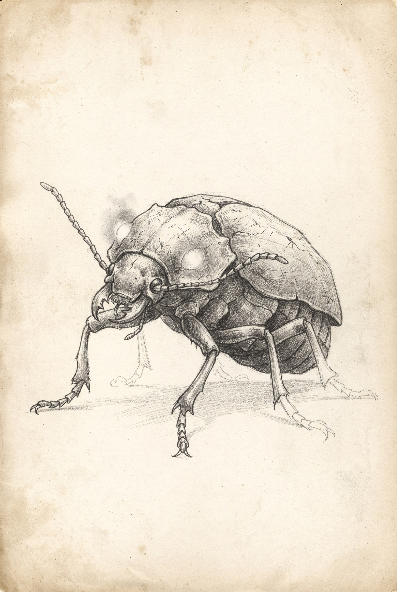

- **Status**: Adaptada com atributos; equilíbrio ainda não validado.
- **Tipo**: Animal
- **Nivel**: 1
- **Vigor**: 1
- **Destreza**: 0
- **Intelecto**: 0
- **Base**: largura: 1, comprimento: 1

### Talentos e características

- identificador: armas-naturais
- identificador: pele-resistente
- identificador: constituicao-fragil, faixa: -6
- identificador: lentidao-natural, faixa: -1

### Ações

- nome: Mordida, equipamento: arma-natural-c02, atributo: vigor

### Equipamento

- identificador: arma-natural-c02, nome: Mordida, tipo: arma, quantidade: 1, treinamento: armas-naturais, dano: 1d3, alcance: adjacente

### Saque

Ocasionalmente, uma asa rígida e iridescente, aproveitável como adorno.

### Detalhes

- **Cena sugerida**: Cavernas. Seu brilho ajuda a anunciar a presença antes do encontro.
- **Adaptação**: Brilho apenas descritivo; sem dano contínuo ou resistência a fogo.

### Referência

Giant Fire Beetle.

## Sapo gigante (C03)

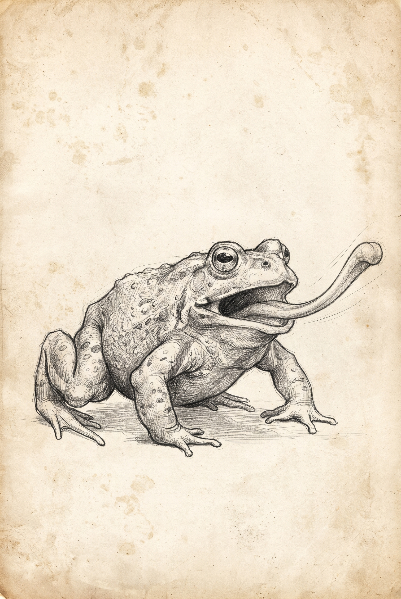

- **Status**: Adaptada com atributos; equilíbrio ainda não validado.
- **Tipo**: Animal
- **Nivel**: 1
- **Vigor**: 1
- **Destreza**: 1
- **Intelecto**: 0
- **Base**: largura: 1, comprimento: 1

### Talentos e características

- identificador: armas-naturais
- identificador: constituicao-fragil, faixa: -6
- identificador: lentidao-natural, faixa: -1

### Ações

- nome: Mordida, equipamento: arma-natural-c03, atributo: vigor

### Equipamento

- identificador: arma-natural-c03, nome: Mordida, tipo: arma, quantidade: 1, treinamento: armas-naturais, dano: 1d3, alcance: adjacente

### Saque

Sem saque habitual.

### Detalhes

- **Cena sugerida**: Margens de lagoas e ruínas úmidas. Defende seu esconderijo.
- **Adaptação**: Sem engolir ou agarrar; usar encontro em chão firme.

### Referência

Giant Frog.

## Lagarto gigante (C04)

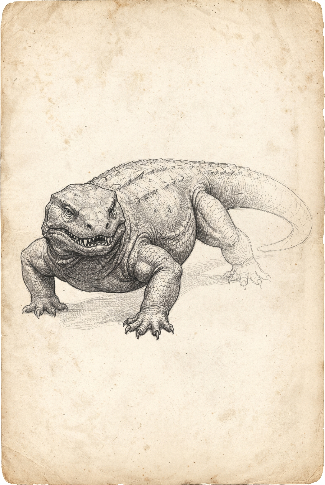

- **Status**: Adaptada com atributos; equilíbrio ainda não validado.
- **Tipo**: Animal
- **Nivel**: 1
- **Vigor**: 1
- **Destreza**: 1
- **Intelecto**: 0
- **Base**: largura: 2, comprimento: 2

### Talentos e características

- identificador: armas-naturais
- identificador: pele-resistente
- identificador: constituicao-fragil, faixa: -4

### Ações

- nome: Mordida, equipamento: arma-natural-c04, atributo: vigor

### Equipamento

- identificador: arma-natural-c04, nome: Mordida, tipo: arma, quantidade: 1, treinamento: armas-naturais, dano: 1d3, alcance: adjacente

### Saque

Ocasionalmente, um pedaço de casca de ovo junto ao ninho. Pode servir de amostra para identificar a criatura.

### Detalhes

- **Cena sugerida**: Pedreiras e túneis largos. Pode guardar um ninho.
- **Adaptação**: Sem escalada automática; o tamanho exige caminhos largos.

### Referência

Giant Lizard.

## Kobold (C05)

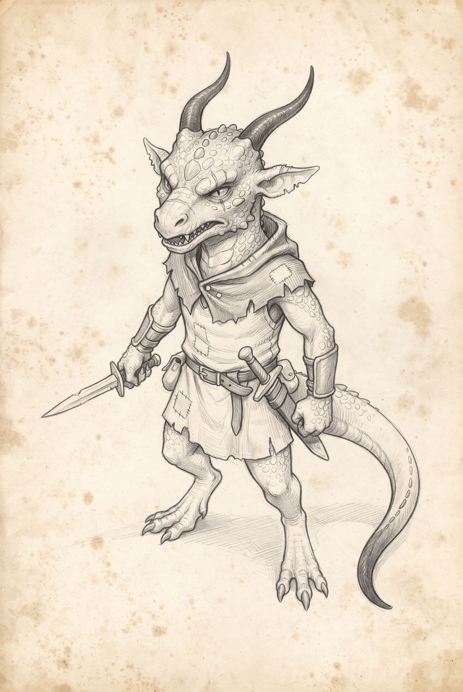

- **Status**: Adaptada com atributos; equilíbrio ainda não validado.
- **Tipo**: Monstro
- **Nivel**: 1
- **Vigor**: 1
- **Destreza**: 2
- **Intelecto**: 1
- **Base**: largura: 1, comprimento: 1

### Talentos e características

- identificador: laminas-uma-mao
- identificador: arremesso
- identificador: constituicao-fragil, faixa: -6

### Ações

- nome: Adaga, equipamento: adaga, atributo: vigor
- nome: Adaga arremessada, equipamento: adaga, atributo: destreza, alcance: 4 casas, treinamento: arremesso

### Equipamento

- identificador: adaga, nome: Adaga, tipo: arma, quantidade: 2, treinamento: laminas-uma-mao, dano: 1d3, alcance: adjacente
- identificador: armadura-leve, nome: Armadura leve, tipo: armadura, quantidade: 1, defesa: 1, penalidadeMovimento: 0

### Saque

1 a 3 moedas. Ocasionalmente, um pedaço de giz usado para marcar bifurcações nos túneis.

### Detalhes

- **Cena sugerida**: Pequeno sentinela de túneis. Pode negociar passagem ou pedir ajuda.
- **Adaptação**: Pode arremessar adaga com +2 (Destreza), dano 1d3, alcance 4; leva duas. Uma ação por ataque.

### Referência

Kobold Warrior.

## Goblin (C06)

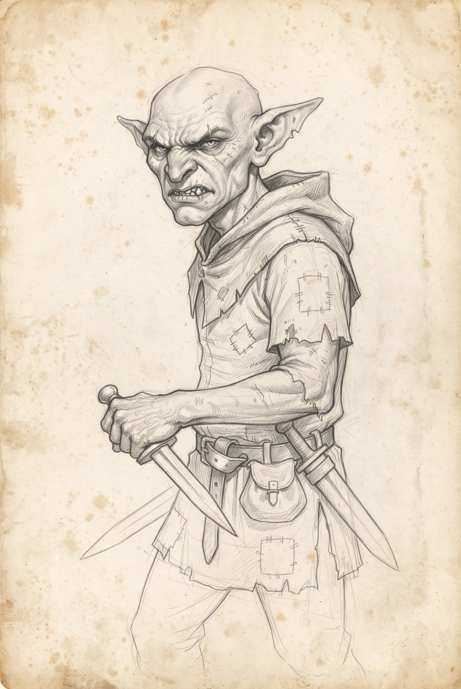

- **Status**: Adaptada com atributos; equilíbrio ainda não validado.
- **Tipo**: Monstro
- **Nivel**: 1
- **Vigor**: 1
- **Destreza**: 2
- **Intelecto**: 1
- **Base**: largura: 1, comprimento: 1

### Talentos e características

- identificador: laminas-uma-mao
- identificador: arremesso
- identificador: constituicao-fragil, faixa: -6

### Ações

- nome: Adaga, equipamento: adaga, atributo: vigor
- nome: Adaga arremessada, equipamento: adaga, atributo: destreza, alcance: 4 casas, treinamento: arremesso

### Equipamento

- identificador: adaga, nome: Adaga, tipo: arma, quantidade: 2, treinamento: laminas-uma-mao, dano: 1d3, alcance: adjacente
- identificador: armadura-leve, nome: Armadura leve, tipo: armadura, quantidade: 1, defesa: 1, penalidadeMovimento: 0

### Saque

1 a 3 moedas. Ocasionalmente, uma ração embrulhada em pano entre os suprimentos recolhidos nas ruínas.

### Detalhes

- **Cena sugerida**: Explorador de ruínas. Pode disputar suprimentos em vez de lutar até cair.
- **Adaptação**: Duas adagas e armadura leve. Arremesso: 1d20 + 2 (Destreza), dano 1d3, alcance 4 casas. Uma ação por ataque; sem ação extra.

### Referência

Goblin Warrior.

## Esqueleto (C07)

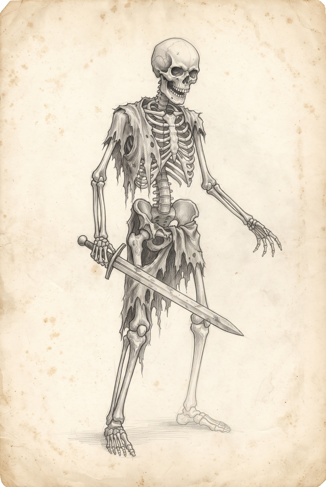

- **Status**: Adaptada com atributos; equilíbrio ainda não validado.
- **Tipo**: Monstro
- **Nivel**: 1
- **Vigor**: 1
- **Destreza**: 0
- **Intelecto**: 0
- **Base**: largura: 1, comprimento: 1

### Talentos e características

- identificador: laminas-uma-mao
- identificador: pele-resistente
- identificador: constituicao-fragil, faixa: -4
- identificador: lentidao-natural, faixa: -1

### Ações

- nome: Espada, equipamento: espada, atributo: vigor

### Equipamento

- identificador: espada, nome: Espada, tipo: arma, quantidade: 1, treinamento: laminas-uma-mao, dano: 1d4, alcance: adjacente

### Saque

Ocasionalmente, 1 a 3 moedas deixadas como oferenda funerária. Também pode haver uma insígnia antiga que permite reconhecer a quem o esqueleto servia em vida.

### Detalhes

- **Cena sugerida**: Guarda de uma porta antiga. Uma inscrição pode explicar sua tarefa.
- **Adaptação**: Sem imunidades, vulnerabilidades ou ataques extras.

### Referência

Skeleton.

## Zumbi (C08)

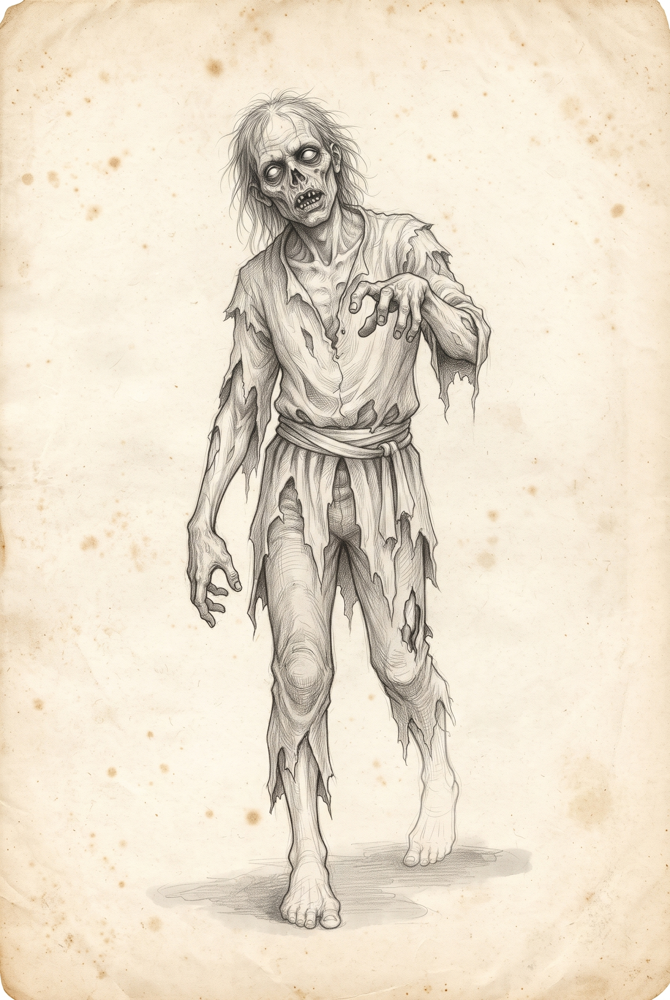

- **Status**: Adaptada com atributos; equilíbrio ainda não validado.
- **Tipo**: Monstro
- **Nivel**: 1
- **Vigor**: 1
- **Destreza**: 0
- **Intelecto**: 0
- **Base**: largura: 1, comprimento: 1

### Talentos e características

- identificador: armas-naturais
- identificador: constituicao-fragil, faixa: -2
- identificador: lentidao-natural, faixa: -2

### Ações

- nome: Pancada, equipamento: arma-natural-c08, atributo: vigor

### Equipamento

- identificador: arma-natural-c08, nome: Pancada, tipo: arma, quantidade: 1, treinamento: armas-naturais, dano: 1d3, alcance: adjacente

### Saque

Ocasionalmente, 1 a 3 moedas esquecidas num bolso. Também pode haver um anel com iniciais que ajudam a identificar quem o zumbi foi em vida.

### Detalhes

- **Cena sugerida**: Vigia lento de um local abandonado. É possível contorná-lo.
- **Adaptação**: Sem voltar a agir depois de derrotado.

### Referência

Zombie.

## Lobo (C09)

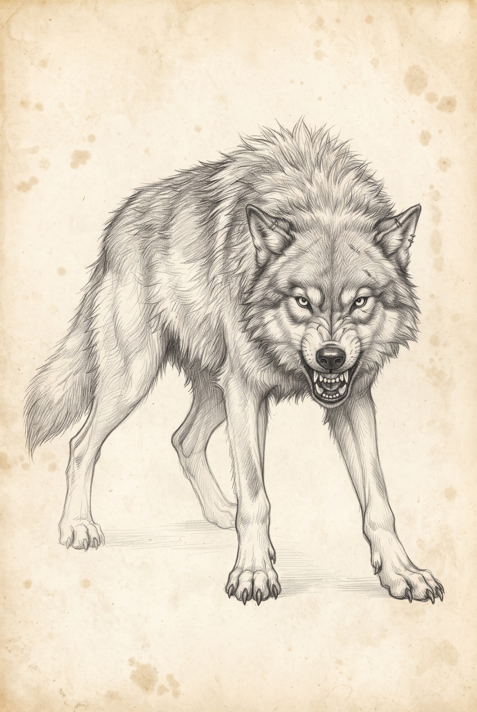

- **Status**: Adaptada com atributos; equilíbrio ainda não validado.
- **Tipo**: Animal
- **Nivel**: 1
- **Vigor**: 2
- **Destreza**: 2
- **Intelecto**: 0
- **Base**: largura: 1, comprimento: 1

### Talentos e características

- identificador: armas-naturais
- identificador: pele-resistente
- identificador: constituicao-fragil, faixa: -6

### Ações

- nome: Mordida, equipamento: mordida, atributo: vigor

### Equipamento

- identificador: mordida, nome: Mordida, tipo: arma, quantidade: 1, treinamento: armas-naturais, dano: 1d4, alcance: adjacente

### Saque

Sem saque habitual.

### Detalhes

- **Cena sugerida**: Bosques e cavernas. Pode proteger filhotes ou alimento.
- **Adaptação**: Sem armadura ou escudo. Mordida é uma arma natural treinada; uma ação por ataque. Sem derrubar e sem bônus automático de matilha.

### Referência

Wolf.

## Urso-negro (C10)

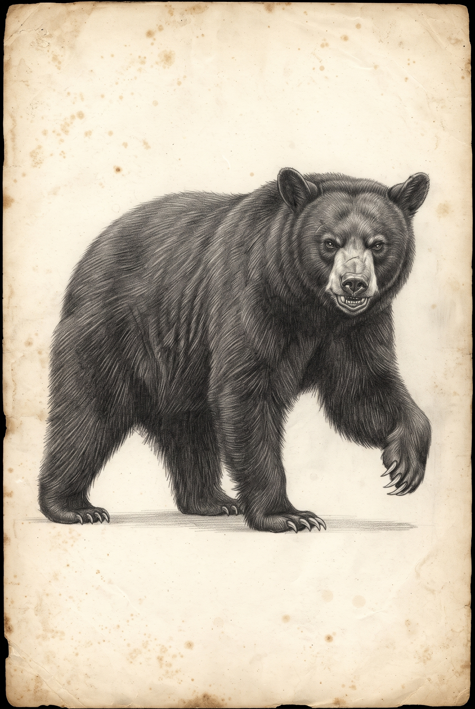

- **Status**: Adaptada com atributos; equilíbrio ainda não validado.
- **Tipo**: Animal
- **Nivel**: 1
- **Vigor**: 2
- **Destreza**: 0
- **Intelecto**: 0
- **Base**: largura: 1, comprimento: 1

### Talentos e características

- identificador: armas-naturais
- identificador: pele-resistente
- identificador: constituicao-fragil, faixa: -4
- identificador: lentidao-natural, faixa: -1

### Ações

- nome: Garra, equipamento: arma-natural-c10, atributo: vigor

### Equipamento

- identificador: arma-natural-c10, nome: Garra, tipo: arma, quantidade: 1, treinamento: armas-naturais, dano: 1d4, alcance: adjacente

### Saque

Ocasionalmente, uma garra que pode ser guardada como troféu.

### Detalhes

- **Cena sugerida**: Florestas. Prefere proteger seu espaço a perseguir aventureiros.
- **Adaptação**: Uma garra por ação; sem ataque adicional de mordida.

### Referência

Black Bear.

## Bandido (H01)

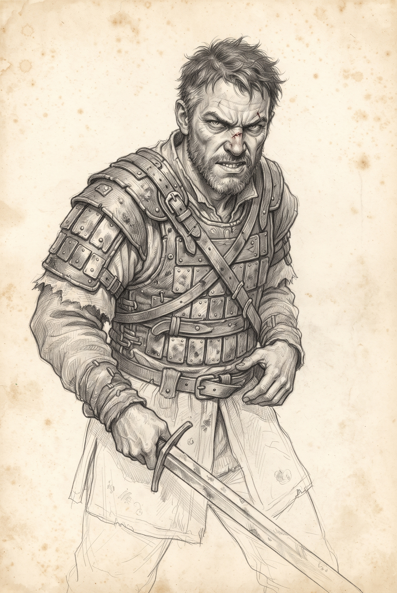

- **Status**: Adaptada com atributos; equilíbrio ainda não validado.
- **Tipo**: Humano
- **Nivel**: 1
- **Vigor**: 2
- **Destreza**: 1
- **Intelecto**: 1
- **Base**: largura: 1, comprimento: 1

### Talentos e características

- identificador: laminas-uma-mao
- identificador: mobilidade-natural, faixa: 1
- identificador: constituicao-fragil, faixa: -4

### Ações

- nome: Espada, equipamento: espada, atributo: vigor

### Equipamento

- identificador: espada, nome: Espada, tipo: arma, quantidade: 1, treinamento: laminas-uma-mao, dano: 1d4, alcance: adjacente
- identificador: armadura-media, nome: Armadura média, tipo: armadura, quantidade: 1, defesa: 2, penalidadeMovimento: 1

### Saque

1 a 3 moedas. Ocasionalmente, uma corda.

### Detalhes

- **Cena sugerida**: Pode ser inimigo, informante ou alguém disposto a se render.
- **Atenção**: Não possui escudo.

### Referência

Bandit, representado como humano nesta adaptação.

## Guarda (H02)

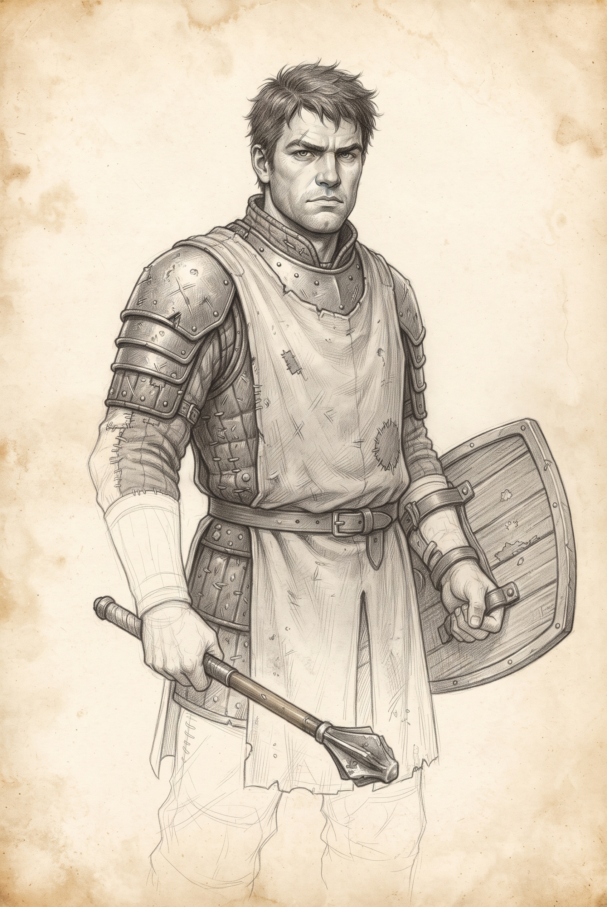

- **Status**: Adaptada com atributos; equilíbrio ainda não validado.
- **Tipo**: Humano
- **Nivel**: 1
- **Vigor**: 1
- **Destreza**: 0
- **Intelecto**: 1
- **Base**: largura: 1, comprimento: 1

### Talentos e características

- identificador: impacto-uma-mao
- identificador: constituicao-fragil, faixa: -2

### Ações

- nome: Maça, equipamento: maca, atributo: vigor

### Equipamento

- identificador: maca, nome: Maça, tipo: arma, quantidade: 1, treinamento: impacto-uma-mao, dano: 1d4, alcance: adjacente
- identificador: armadura-media, nome: Armadura média, tipo: armadura, quantidade: 1, defesa: 2, penalidadeMovimento: 1
- identificador: escudo, nome: Escudo, tipo: escudo, quantidade: 1

### Saque

1 a 3 moedas. Ocasionalmente, uma tocha.

### Detalhes

- **Cena sugerida**: Protege um portão ou acompanha uma caravana. Não precisa ser antagonista.
- **Atenção**: O escudo sem Treinamento com escudos concede +1 Defesa. Não pode Defender aliado.

### Referência

Guard, representado como humano nesta adaptação.

## Aranha gigante (C11)

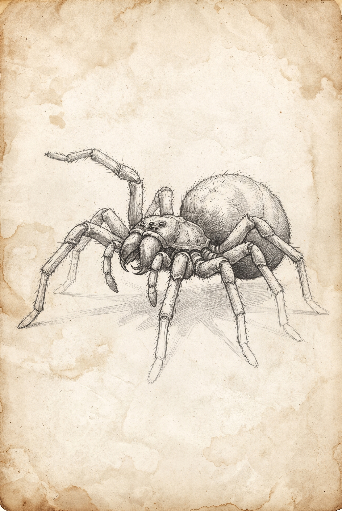

- **Status**: Adaptada com atributos; equilíbrio ainda não validado.
- **Tipo**: Animal
- **Nivel**: 2
- **Vigor**: 2
- **Destreza**: 2
- **Intelecto**: 0
- **Base**: largura: 2, comprimento: 2

### Talentos e características

- identificador: armas-naturais
- identificador: pele-resistente
- identificador: constituicao-fragil, faixa: -2
- identificador: lentidao-natural, faixa: -1

### Ações

- nome: Mordida, equipamento: arma-natural-c11, atributo: vigor

### Equipamento

- identificador: arma-natural-c11, nome: Mordida, tipo: arma, quantidade: 1, treinamento: armas-naturais, dano: 1d4, alcance: adjacente

### Saque

Ocasionalmente, uma bolsa de viajante presa na teia, se já houve uma vítima no local. O mestre decide o conteúdo conforme a aventura.

### Detalhes

- **Cena sugerida**: Salões abandonados. Teias antigas podem anunciar o perigo.
- **Adaptação**: Sem veneno ou aprisionamento nesta versão; teias são descrição, não condição automática.

### Referência

Giant Spider.

## Javali gigante (C12)

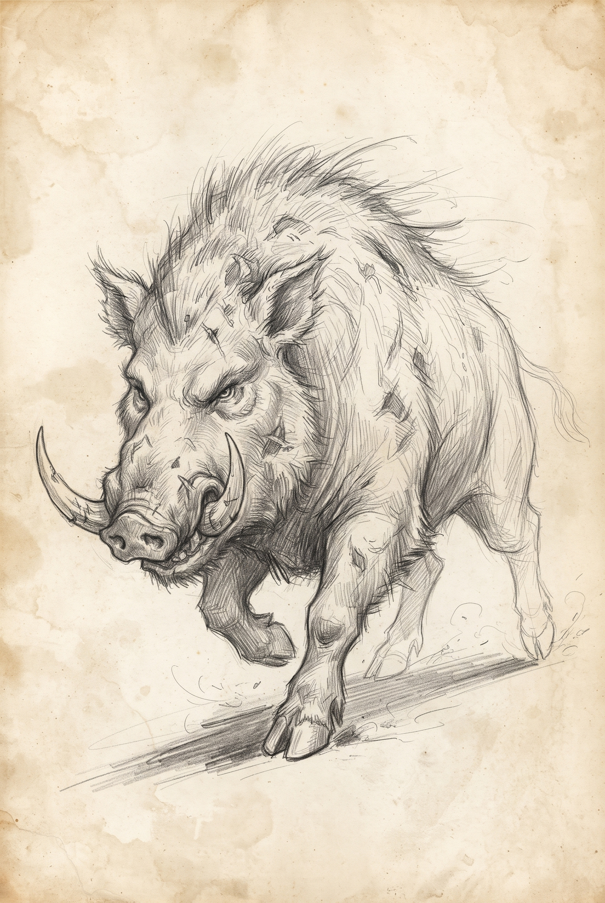

- **Status**: Adaptada com atributos; equilíbrio ainda não validado.
- **Tipo**: Animal
- **Nivel**: 2
- **Vigor**: 2
- **Destreza**: 1
- **Intelecto**: 0
- **Base**: largura: 2, comprimento: 2

### Talentos e características

- identificador: armas-naturais
- identificador: pele-resistente

### Ações

- nome: Presas, equipamento: arma-natural-c12, atributo: vigor

### Equipamento

- identificador: arma-natural-c12, nome: Presas, tipo: arma, quantidade: 1, treinamento: armas-naturais, dano: 1d4, alcance: adjacente

### Saque

Ocasionalmente, uma presa curva, aproveitável para entalhe ou como adorno.

### Detalhes

- **Cena sugerida**: Clareiras e passagens de mata. Pode reagir à aproximação brusca.
- **Adaptação**: Sem dano extra de investida.

### Referência

Giant Boar.

## Serpente constritora (C13)

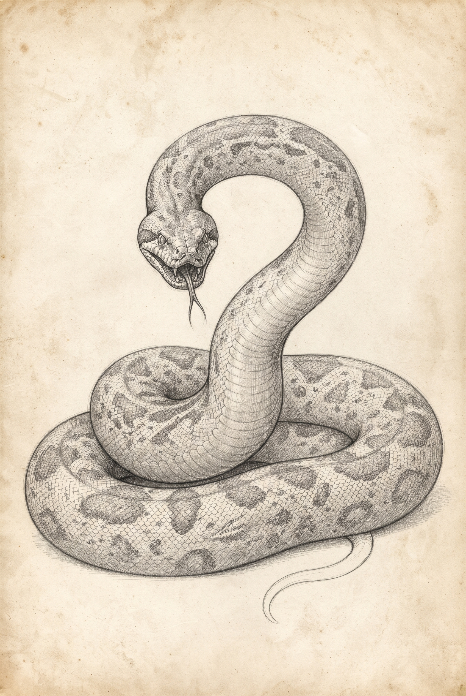

- **Status**: Adaptada com atributos; equilíbrio ainda não validado.
- **Tipo**: Animal
- **Nivel**: 2
- **Vigor**: 2
- **Destreza**: 1
- **Intelecto**: 0
- **Base**: largura: 2, comprimento: 2

### Talentos e características

- identificador: armas-naturais
- identificador: pele-resistente
- identificador: constituicao-fragil, faixa: -2

### Ações

- nome: Mordida, equipamento: arma-natural-c13, atributo: vigor

### Equipamento

- identificador: arma-natural-c13, nome: Mordida, tipo: arma, quantidade: 1, treinamento: armas-naturais, dano: 1d4, alcance: adjacente

### Saque

Ocasionalmente, uma muda de pele entre as pedras. Os jogadores podem recolhê-la mesmo que evitem o combate.

### Detalhes

- **Cena sugerida**: Ruínas tomadas pela vegetação. Pode ser evitada por outro caminho.
- **Adaptação**: Sem agarrar ou sufocar; a base representa o espaço de combate, não o comprimento total.

### Referência

Constrictor Snake.

## Centopeia gigante (C14)

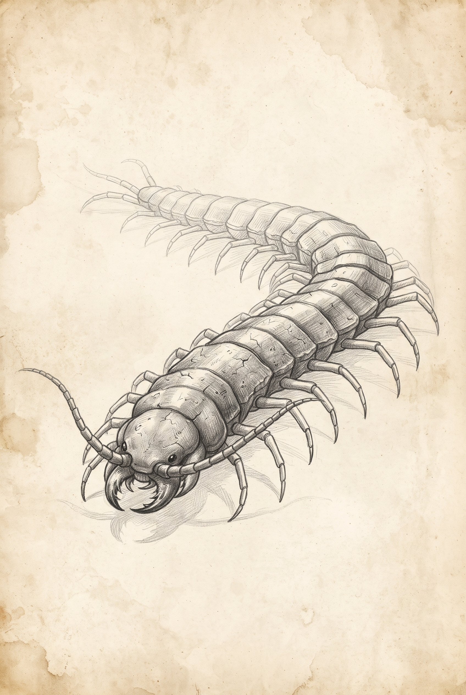

- **Status**: Adaptada com atributos; equilíbrio ainda não validado.
- **Tipo**: Animal
- **Nivel**: 2
- **Vigor**: 2
- **Destreza**: 2
- **Intelecto**: 0
- **Base**: largura: 1, comprimento: 1

### Talentos e características

- identificador: armas-naturais
- identificador: pele-resistente
- identificador: constituicao-fragil, faixa: -4
- identificador: lentidao-natural, faixa: -1

### Ações

- nome: Mordida, equipamento: arma-natural-c14, atributo: vigor

### Equipamento

- identificador: arma-natural-c14, nome: Mordida, tipo: arma, quantidade: 1, treinamento: armas-naturais, dano: 1d4, alcance: adjacente

### Saque

Sem saque habitual.

### Detalhes

- **Cena sugerida**: Fendas e depósitos úmidos. Pode sair quando seu abrigo é perturbado.
- **Adaptação**: Sem veneno; alcance somente adjacente.

### Referência

Giant Centipede.

## Caranguejo gigante (C15)

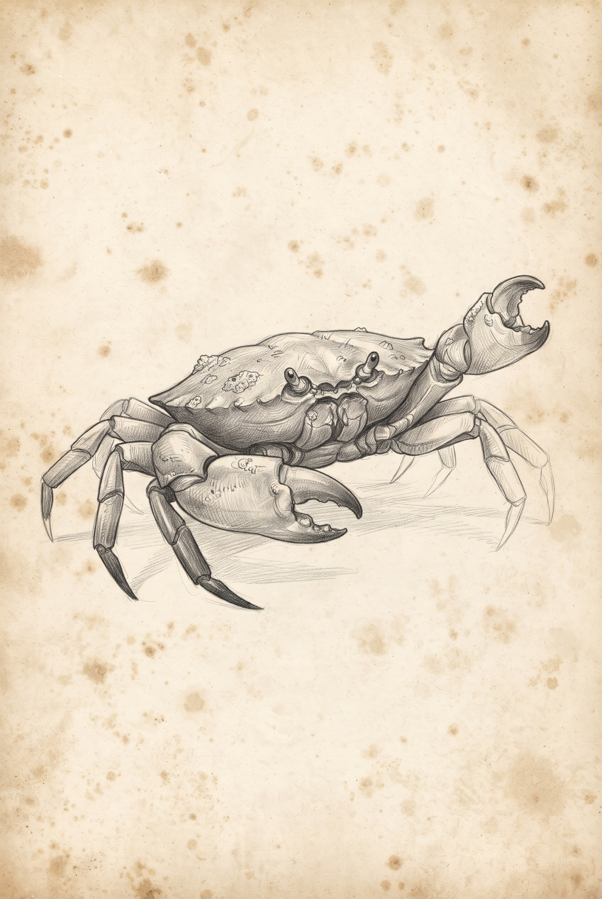

- **Status**: Adaptada com atributos; equilíbrio ainda não validado.
- **Tipo**: Animal
- **Nivel**: 2
- **Vigor**: 1
- **Destreza**: 0
- **Intelecto**: 0
- **Base**: largura: 1, comprimento: 1

### Talentos e características

- identificador: armas-naturais
- identificador: pele-resistente
- identificador: lentidao-natural, faixa: -2

### Ações

- nome: Pinça, equipamento: arma-natural-c15, atributo: vigor

### Equipamento

- identificador: arma-natural-c15, nome: Pinça, tipo: arma, quantidade: 1, treinamento: armas-naturais, dano: 1d4, alcance: adjacente

### Saque

Ocasionalmente, uma pinça intacta que pode servir de recipiente ou troféu.

### Detalhes

- **Cena sugerida**: Praias e grutas. Sua carapaça é sua principal defesa.
- **Adaptação**: Sem agarrar; encontro em superfície firme, sem regras de combate submerso.

### Referência

Giant Crab.

## Hobgoblin (C16)

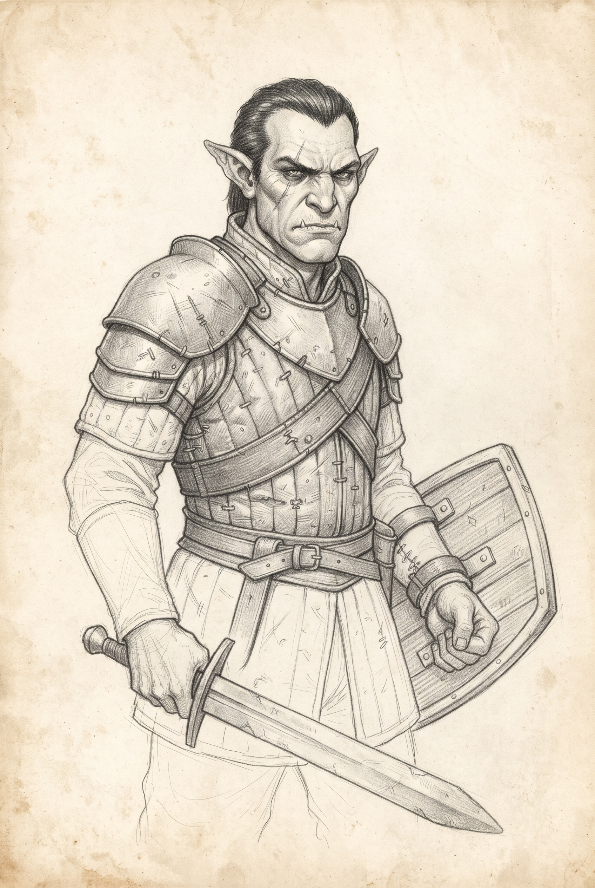

- **Status**: Adaptada com atributos; equilíbrio ainda não validado.
- **Tipo**: Monstro
- **Nivel**: 2
- **Vigor**: 2
- **Destreza**: 1
- **Intelecto**: 1
- **Base**: largura: 1, comprimento: 1

### Talentos e características

- identificador: laminas-uma-mao
- identificador: constituicao-fragil, faixa: -2

### Ações

- nome: Espada, equipamento: espada, atributo: vigor

### Equipamento

- identificador: espada, nome: Espada, tipo: arma, quantidade: 1, treinamento: laminas-uma-mao, dano: 1d4, alcance: adjacente
- identificador: armadura-media, nome: Armadura média, tipo: armadura, quantidade: 1, defesa: 2, penalidadeMovimento: 1
- identificador: escudo, nome: Escudo, tipo: escudo, quantidade: 1

### Saque

2 a 6 moedas. Ocasionalmente, uma ordem de patrulha que indica o posto de vigia e o horário da troca da guarda.

### Detalhes

- **Cena sugerida**: Sentinela disciplinado. Pode obedecer a ordens ou aceitar rendição.
- **Adaptação**: Armadura média e escudo sem treino: Defesa 10 + 2 + 1. Pode Defender a si, mas não aliado.

### Referência

Hobgoblin Warrior.

## Bugbear (C17)

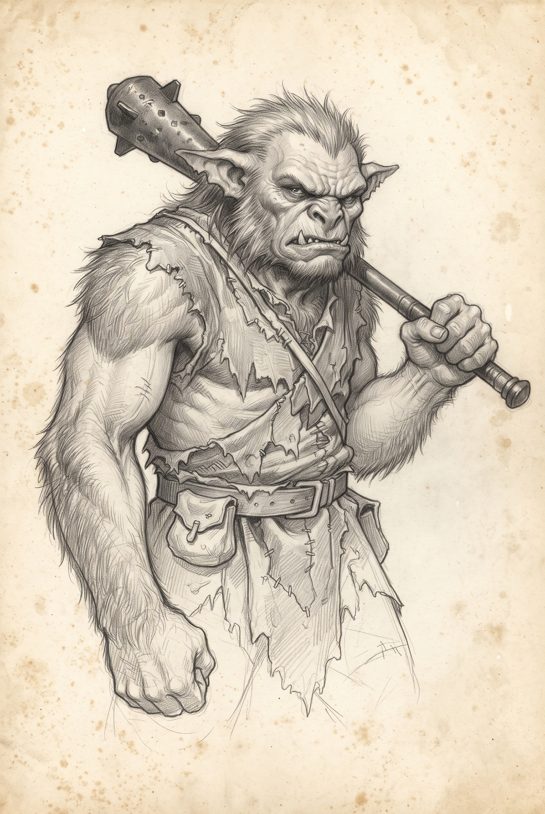

- **Status**: Adaptada com atributos; equilíbrio ainda não validado.
- **Tipo**: Monstro
- **Nivel**: 2
- **Vigor**: 3
- **Destreza**: 1
- **Intelecto**: 1
- **Base**: largura: 1, comprimento: 1

### Talentos e características

- identificador: impacto-uma-mao
- identificador: mobilidade-natural, faixa: 1
- identificador: constituicao-fragil, faixa: -2

### Ações

- nome: Maça, equipamento: maca, atributo: vigor

### Equipamento

- identificador: maca, nome: Maça, tipo: arma, quantidade: 1, treinamento: impacto-uma-mao, dano: 1d4, alcance: adjacente
- identificador: armadura-media, nome: Armadura média, tipo: armadura, quantidade: 1, defesa: 2, penalidadeMovimento: 1

### Saque

2 a 6 moedas. Ocasionalmente, um apito de osso usado para alertar o acampamento.

### Detalhes

- **Cena sugerida**: Vigia forte de um acampamento. Pode tentar encerrar a luta intimidando.
- **Adaptação**: Sem dano surpresa, alcance ampliado ou ataque extra.

### Referência

Bugbear Warrior.

## Gnoll (C18)

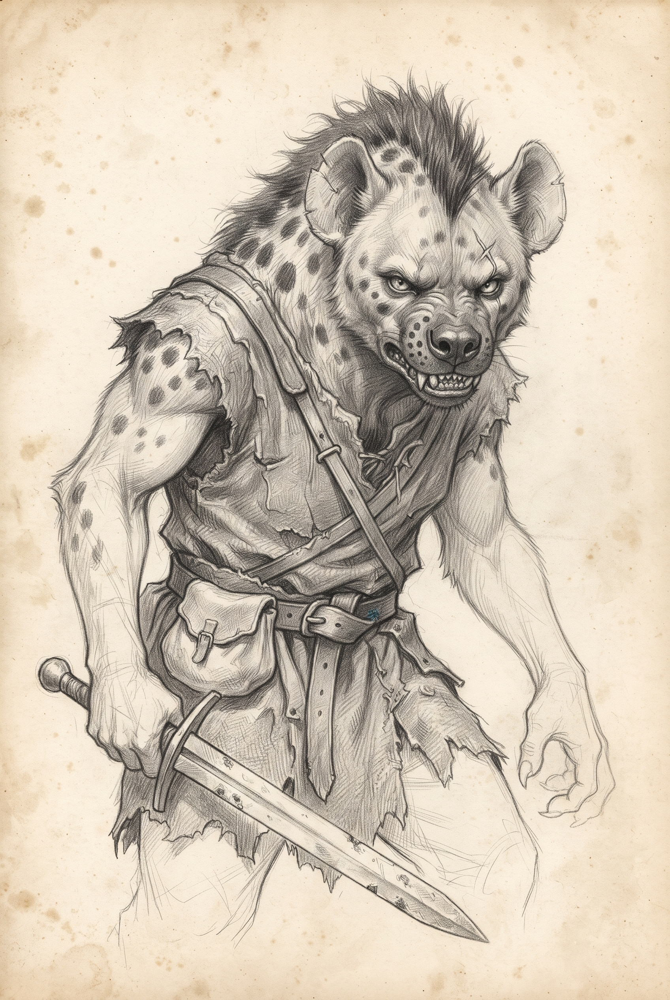

- **Status**: Adaptada com atributos; equilíbrio ainda não validado.
- **Tipo**: Monstro
- **Nivel**: 2
- **Vigor**: 2
- **Destreza**: 2
- **Intelecto**: 1
- **Base**: largura: 1, comprimento: 1

### Talentos e características

- identificador: laminas-uma-mao
- identificador: constituicao-fragil, faixa: -2

### Ações

- nome: Espada, equipamento: espada, atributo: vigor

### Equipamento

- identificador: espada, nome: Espada, tipo: arma, quantidade: 1, treinamento: laminas-uma-mao, dano: 1d4, alcance: adjacente
- identificador: armadura-media, nome: Armadura média, tipo: armadura, quantidade: 1, defesa: 2, penalidadeMovimento: 1

### Saque

2 a 6 moedas. Ocasionalmente, um mapa de trilha com um vau marcado para atravessar o rio.

### Detalhes

- **Cena sugerida**: Patrulheiro de ermos. Pode estar guardando uma rota ou mercadoria.
- **Adaptação**: Sem ataque adicional ao derrubar alguém.

### Referência

Gnoll Warrior.

## Armadura animada (C19)

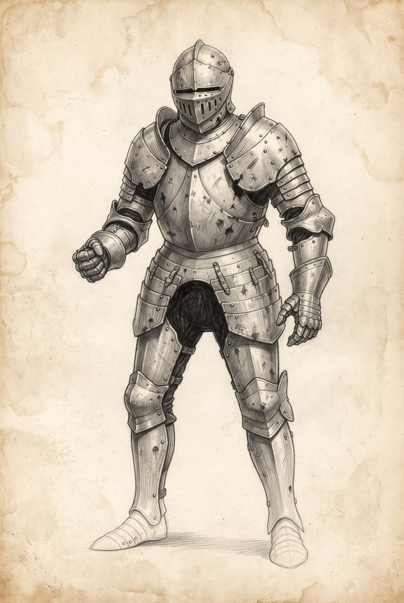

- **Status**: Adaptada com atributos; equilíbrio ainda não validado.
- **Tipo**: Monstro
- **Nivel**: 2
- **Vigor**: 2
- **Destreza**: 0
- **Intelecto**: 0
- **Base**: largura: 1, comprimento: 1

### Talentos e características

- identificador: armas-naturais
- identificador: pele-resistente
- identificador: constituicao-fragil, faixa: -2
- identificador: lentidao-natural, faixa: -2

### Ações

- nome: Pancada, equipamento: arma-natural-c19, atributo: vigor

### Equipamento

- identificador: arma-natural-c19, nome: Pancada, tipo: arma, quantidade: 1, treinamento: armas-naturais, dano: 1d4, alcance: adjacente

### Saque

Sem moedas habituais. Ocasionalmente, um brasão de metal preso ao peitoral identifica a casa que a armadura guarda.

### Detalhes

- **Cena sugerida**: Guarda mágico de salão. Pode obedecer a uma senha ou sinal.
- **Adaptação**: Defesa própria da criatura; sem imunidades. Não é armadura vestível automaticamente recuperável.

### Referência

Animated Armor.

## Urso-pardo (C20)

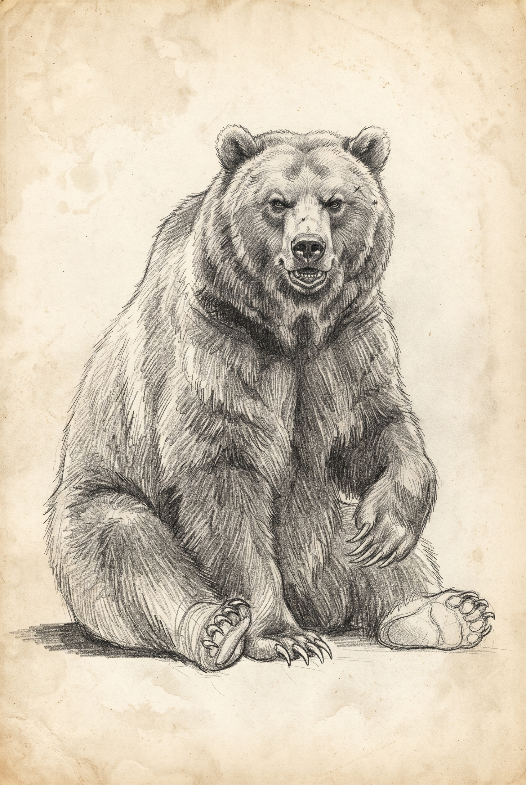

- **Status**: Adaptada com atributos; equilíbrio ainda não validado.
- **Tipo**: Animal
- **Nivel**: 2
- **Vigor**: 3
- **Destreza**: 1
- **Intelecto**: 0
- **Base**: largura: 2, comprimento: 2

### Talentos e características

- identificador: armas-naturais
- identificador: pele-resistente

### Ações

- nome: Garra, equipamento: arma-natural-c20, atributo: vigor

### Equipamento

- identificador: arma-natural-c20, nome: Garra, tipo: arma, quantidade: 1, treinamento: armas-naturais, dano: 1d4, alcance: adjacente

### Saque

Ocasionalmente, uma pele espessa, útil como coberta depois de preparada.

### Detalhes

- **Cena sugerida**: Matas e cavernas amplas. Anuncia sua presença antes de atacar.
- **Adaptação**: Uma garra por ação; sem agarrar.

### Referência

Brown Bear.

## Batedor humano (H03)

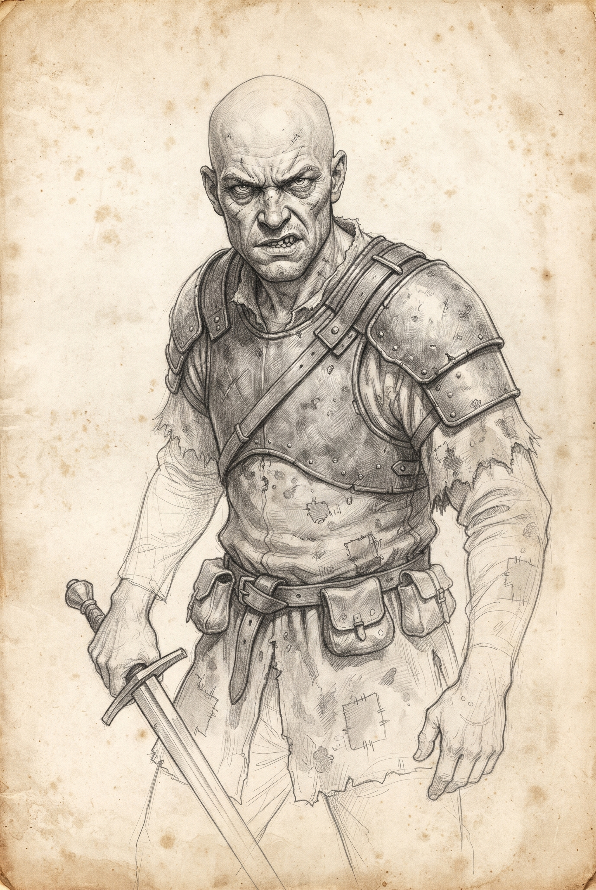

- **Status**: Adaptada com atributos; equilíbrio ainda não validado.
- **Tipo**: Humano
- **Nivel**: 2
- **Vigor**: 1
- **Destreza**: 3
- **Intelecto**: 1
- **Base**: largura: 1, comprimento: 1

### Talentos e características

- identificador: arquearia
- identificador: laminas-uma-mao

### Ações

- nome: Arco, equipamento: arco, atributo: destreza
- nome: Espada, equipamento: espada, atributo: vigor

### Equipamento

- identificador: arco, nome: Arco e flechas, tipo: arma, quantidade: 1, treinamento: arquearia, dano: 1d4, alcance: 8 casas
- identificador: espada, nome: Espada, tipo: arma, quantidade: 1, treinamento: laminas-uma-mao, dano: 1d4, alcance: adjacente
- identificador: armadura-leve, nome: Armadura leve, tipo: armadura, quantidade: 1, defesa: 1, penalidadeMovimento: 0

### Saque

2 a 6 moedas. Ocasionalmente, uma pederneira.

### Detalhes

- **Cena sugerida**: Vigia estradas e procura rotas seguras. Pode oferecer pistas ou perseguir intrusos.
- **Atenção**: O arco ocupa duas mãos e não pode ser disparado com inimigo adjacente, inclusive na diagonal. A aljava inicial contém 20 flechas; cada disparo consome uma. Trocar entre arco e espada consome uma ação.

### Referência

Scout, representado como humano nesta adaptação.

## Acólito humano (H04)

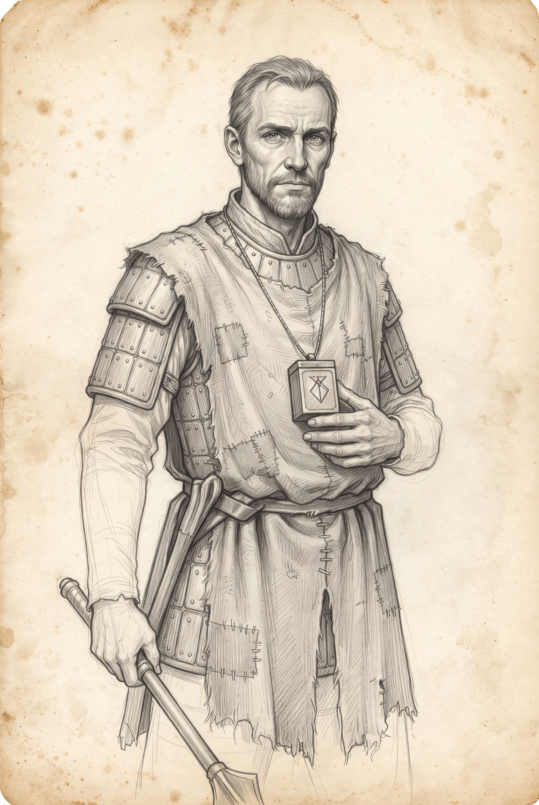

- **Status**: Adaptada com atributos; equilíbrio ainda não validado.
- **Tipo**: Humano
- **Nivel**: 2
- **Vigor**: 1
- **Destreza**: 0
- **Intelecto**: 2
- **Base**: largura: 1, comprimento: 1

### Talentos e características

- identificador: impacto-uma-mao
- identificador: milagres-restauradores

### Ações

- nome: Maça, equipamento: maca, atributo: vigor
- nome: Relicário de cura, equipamento: relicario-cura, atributo: intelecto

### Equipamento

- identificador: maca, nome: Maça, tipo: arma, quantidade: 1, treinamento: impacto-uma-mao, dano: 1d4, alcance: adjacente
- identificador: armadura-leve, nome: Armadura leve, tipo: armadura, quantidade: 1, defesa: 1, penalidadeMovimento: 0
- identificador: relicario-cura, nome: Relicário de cura — 3 cargas, tipo: item-magico, quantidade: 1, treinamento: milagres-restauradores, cargasMaximas: 3, alcance: 6 casas, efeito: {'tipo': 'cura', 'valor': 6}

### Saque

2 a 6 moedas. Ocasionalmente, um medalhão de madeira com o símbolo de seu templo.

### Detalhes

- **Cena sugerida**: Responsável por um santuário. Pode curar viajantes ou apoiar guardiões.
- **Atenção**: A cura bem-sucedida traz um inconsciente vivo de volta com 1 PV e ele perde a próxima rodada. Não ressuscita mortos. Sem Pergaminhos; não recarrega o relicário.

### Referência

Priest Acolyte, representado como humano nesta adaptação.

## Ogro (C21)

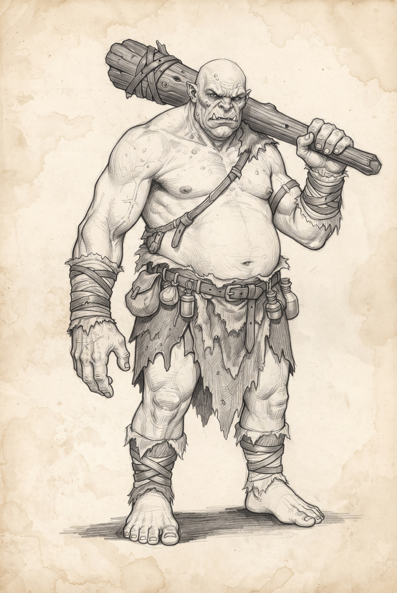

- **Status**: Adaptada com atributos; equilíbrio ainda não validado.
- **Tipo**: Monstro
- **Nivel**: 3
- **Vigor**: 5
- **Destreza**: 0
- **Intelecto**: 0
- **Base**: largura: 2, comprimento: 2

### Talentos e características

- identificador: armas-pesadas
- identificador: pele-resistente
- identificador: lentidao-natural, faixa: -1

### Ações

- nome: Porrete de duas mãos, equipamento: porrete-duas-maos, atributo: vigor

### Equipamento

- identificador: porrete-duas-maos, nome: Porrete de duas mãos, tipo: arma, quantidade: 1, treinamento: armas-pesadas, dano: 1d6, alcance: adjacente

### Saque

4 a 10 moedas recebidas como pedágio ou tomadas de viajantes. Ocasionalmente, uma panela de ferro recolhida de uma carroça.

### Detalhes

- **Cena sugerida**: Ocupante de ponte ou gruta. Pode cobrar passagem e aceitar uma negociação.
- **Adaptação**: O porrete de duas mãos causa 1d6 de dano base. Com Vigor 5, o ataque causa 1d6 + 2. Sem arremesso de rochas.

### Referência

Ogre.

## Minotauro (C22)

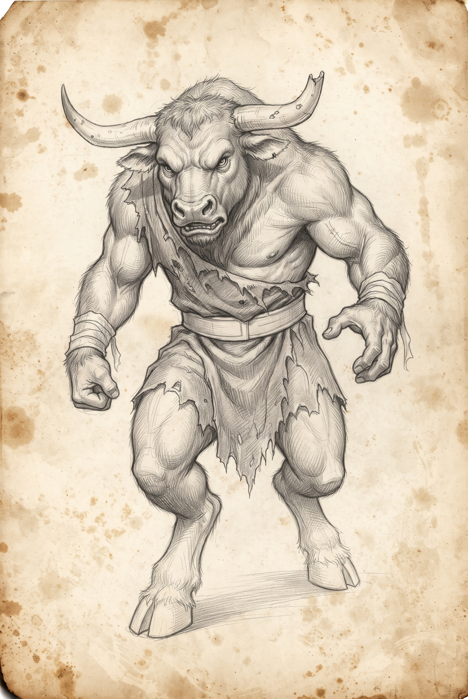

- **Status**: Adaptada com atributos; equilíbrio ainda não validado.
- **Tipo**: Monstro
- **Nivel**: 3
- **Vigor**: 4
- **Destreza**: 1
- **Intelecto**: 1
- **Base**: largura: 2, comprimento: 2

### Talentos e características

- identificador: armas-naturais
- identificador: pele-resistente
- identificador: vitalidade-adicional, faixa: 5
- identificador: lentidao-natural, faixa: -1

### Ações

- nome: Chifres, equipamento: arma-natural-c22, atributo: vigor

### Equipamento

- identificador: arma-natural-c22, nome: Chifres, tipo: arma, quantidade: 1, treinamento: armas-naturais, dano: 1d6, alcance: adjacente

### Saque

Sem moedas habituais. Ocasionalmente, uma chave de bronze presa ao cinto. O mestre decide que porta do labirinto ela abre. A aventura define qualquer tesouro guardado pelo minotauro.

### Detalhes

- **Cena sugerida**: Guardião de um labirinto. Pode perseguir intrusos ou proteger um objeto.
- **Adaptação**: Sem empurrão, investida especial ou alcance ampliado.

### Referência

Minotaur of Baphomet.

## Troll (C23)

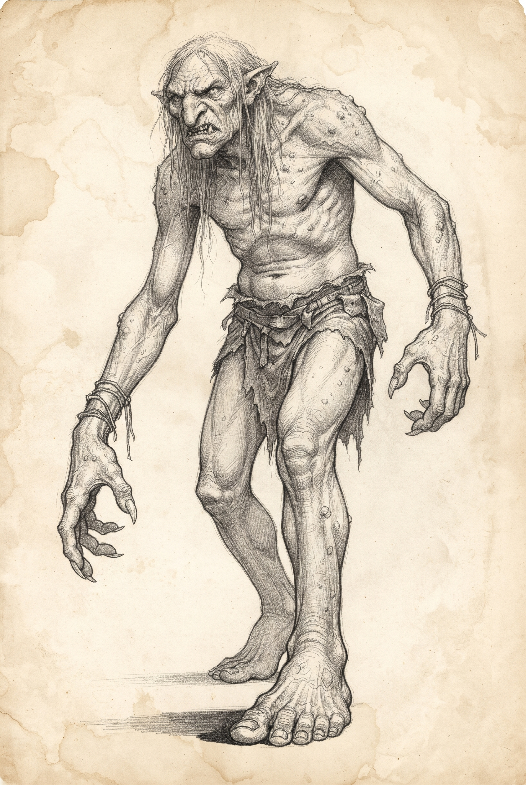

- **Status**: Adaptada com atributos; equilíbrio ainda não validado.
- **Tipo**: Monstro
- **Nivel**: 3
- **Vigor**: 3
- **Destreza**: 1
- **Intelecto**: 0
- **Base**: largura: 2, comprimento: 2

### Talentos e características

- identificador: armas-naturais
- identificador: pele-resistente
- identificador: vitalidade-adicional, faixa: 10
- identificador: lentidao-natural, faixa: -1

### Ações

- nome: Garra, equipamento: arma-natural-c23, atributo: vigor

### Equipamento

- identificador: arma-natural-c23, nome: Garra, tipo: arma, quantidade: 1, treinamento: armas-naturais, dano: 1d6, alcance: adjacente

### Saque

Sem moedas habituais. Ocasionalmente, uma pederneira entre os pertences de um viajante no abrigo do troll.

### Detalhes

- **Cena sugerida**: Habitante de brejo ou ruína. É uma ameaça resistente que pode ser evitada.
- **Adaptação**: Versão muito simplificada: sem regeneração, imunidades ou exigência de fogo para vencer.

### Referência

Troll.

## Urso-coruja (C24)

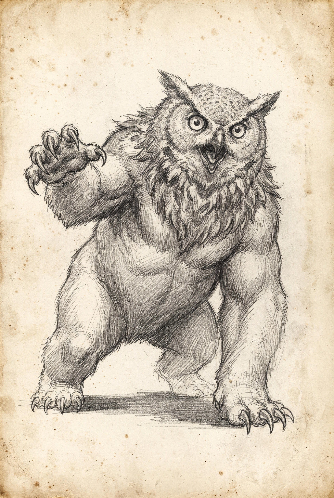

- **Status**: Adaptada com atributos; equilíbrio ainda não validado.
- **Tipo**: Monstro
- **Nivel**: 3
- **Vigor**: 4
- **Destreza**: 1
- **Intelecto**: 0
- **Base**: largura: 2, comprimento: 2

### Talentos e características

- identificador: armas-naturais
- identificador: pele-resistente
- identificador: vitalidade-adicional, faixa: 5

### Ações

- nome: Garra, equipamento: arma-natural-c24, atributo: vigor

### Equipamento

- identificador: arma-natural-c24, nome: Garra, tipo: arma, quantidade: 1, treinamento: armas-naturais, dano: 1d6, alcance: adjacente

### Saque

Sem moedas habituais. Ocasionalmente, uma pena grande e rajada, que também pode ser recolhida no ninho.

### Detalhes

- **Cena sugerida**: Predador territorial. Seu ninho pode explicar a agressividade.
- **Adaptação**: Uma garra por ação; bico não concede ataque adicional.

### Referência

Owlbear.

## Lobo atroz (C25)

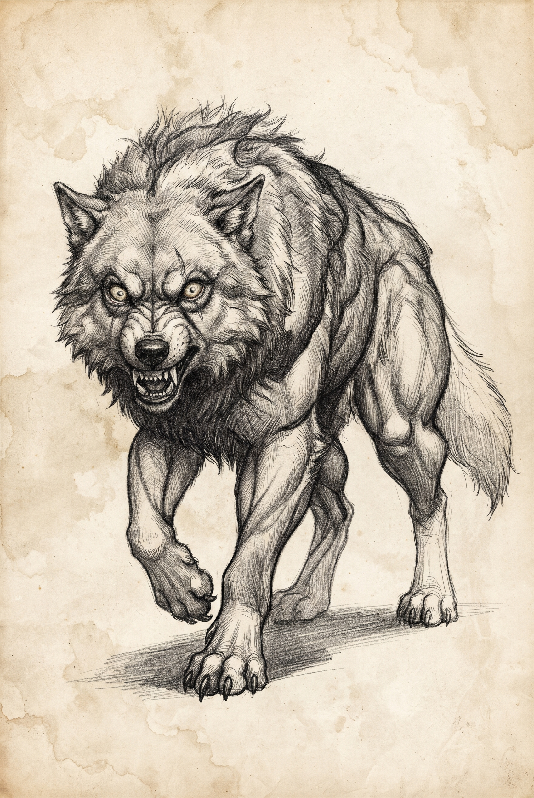

- **Status**: Adaptada com atributos; equilíbrio ainda não validado.
- **Tipo**: Animal
- **Nivel**: 3
- **Vigor**: 4
- **Destreza**: 2
- **Intelecto**: 0
- **Base**: largura: 2, comprimento: 2

### Talentos e características

- identificador: armas-naturais
- identificador: pele-resistente

### Ações

- nome: Mordida, equipamento: arma-natural-c25, atributo: vigor

### Equipamento

- identificador: arma-natural-c25, nome: Mordida, tipo: arma, quantidade: 1, treinamento: armas-naturais, dano: 1d6, alcance: adjacente

### Saque

Ocasionalmente, uma presa grande. Quem conhece a região pode identificar o animal por ela.

### Detalhes

- **Cena sugerida**: Caçador de grandes clareiras. Sua mobilidade ameaça personagens isolados.
- **Adaptação**: Sem derrubar ou bônus de matilha.

### Referência

Dire Wolf.

## Worg (C26)

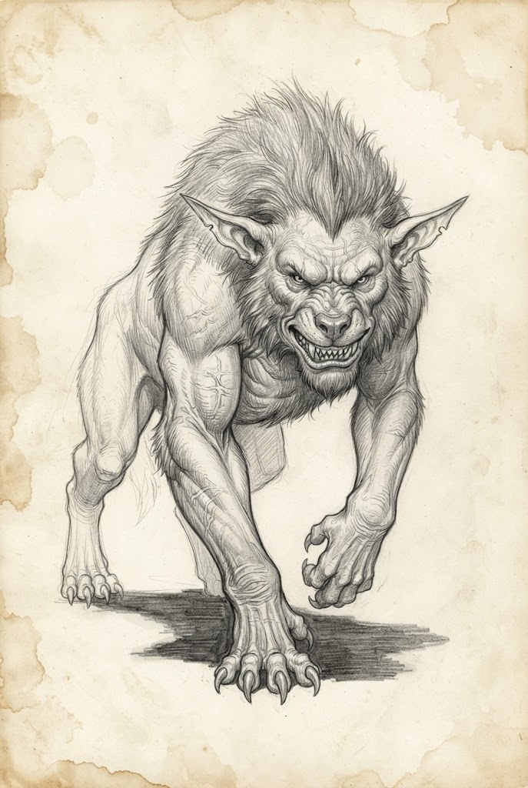

- **Status**: Adaptada com atributos; equilíbrio ainda não validado.
- **Tipo**: Monstro
- **Nivel**: 3
- **Vigor**: 4
- **Destreza**: 2
- **Intelecto**: 1
- **Base**: largura: 2, comprimento: 2

### Talentos e características

- identificador: armas-naturais
- identificador: pele-resistente
- identificador: lentidao-natural, faixa: -1

### Ações

- nome: Mordida, equipamento: arma-natural-c26, atributo: vigor

### Equipamento

- identificador: arma-natural-c26, nome: Mordida, tipo: arma, quantidade: 1, treinamento: armas-naturais, dano: 1d6, alcance: adjacente

### Saque

Sem moedas habituais. Quando acompanha uma patrulha organizada, o worg pode usar uma coleira com o símbolo da patrulha.

### Detalhes

- **Cena sugerida**: Predador astuto. Pode defender um território ou acompanhar uma patrulha.
- **Adaptação**: Sem bônus de montaria ou ataque adicional.

### Referência

Worg.

## Leão (C27)

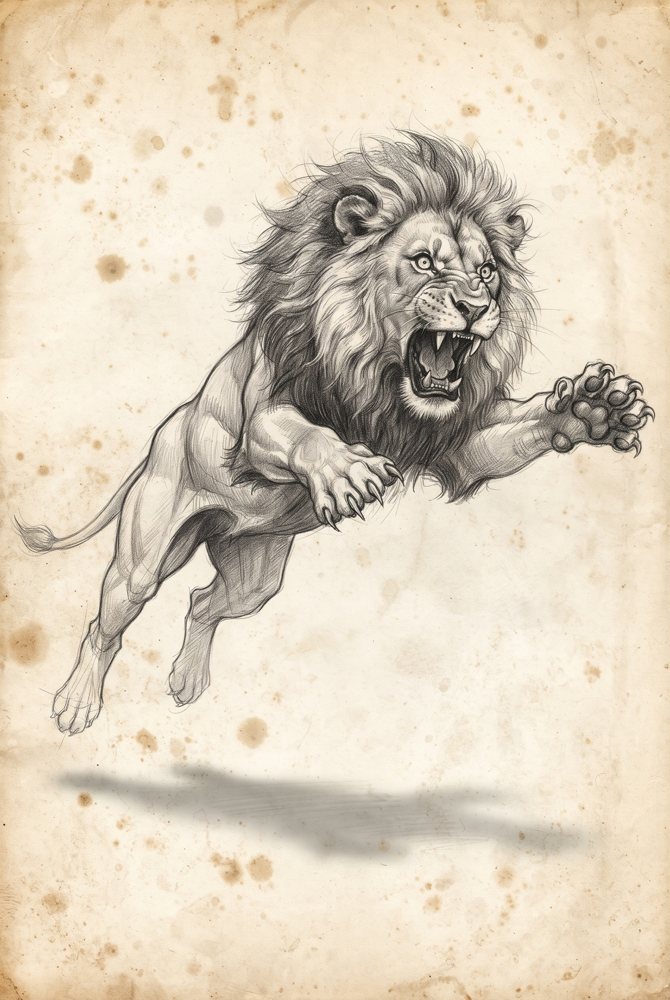

- **Status**: Adaptada com atributos; equilíbrio ainda não validado.
- **Tipo**: Animal
- **Nivel**: 3
- **Vigor**: 4
- **Destreza**: 2
- **Intelecto**: 0
- **Base**: largura: 2, comprimento: 2

### Talentos e características

- identificador: armas-naturais
- identificador: pele-resistente

### Ações

- nome: Garra, equipamento: arma-natural-c27, atributo: vigor

### Equipamento

- identificador: arma-natural-c27, nome: Garra, tipo: arma, quantidade: 1, treinamento: armas-naturais, dano: 1d6, alcance: adjacente

### Saque

Ocasionalmente, uma garra, aproveitável como pingente.

### Detalhes

- **Cena sugerida**: Predador de campos abertos. Pode abandonar a disputa se o grupo recuar.
- **Adaptação**: Sem salto especial ou derrubar.

### Referência

Lion.

## Tigre (C28)

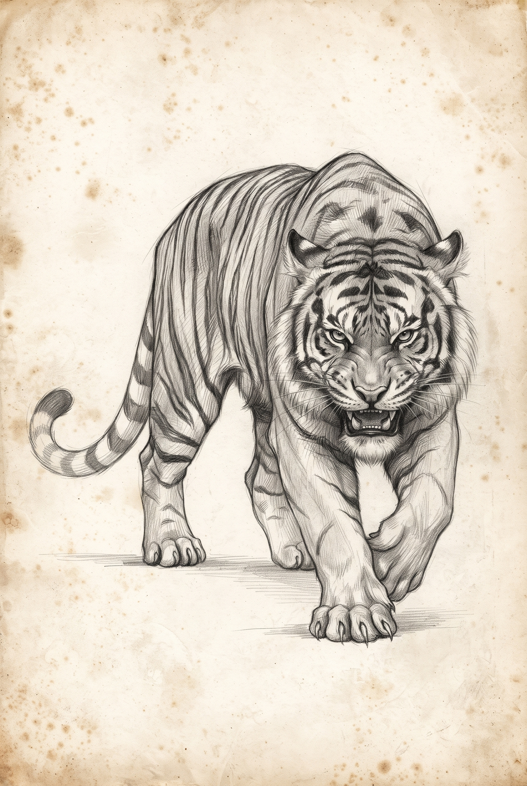

- **Status**: Adaptada com atributos; equilíbrio ainda não validado.
- **Tipo**: Animal
- **Nivel**: 3
- **Vigor**: 5
- **Destreza**: 2
- **Intelecto**: 0
- **Base**: largura: 2, comprimento: 2

### Talentos e características

- identificador: armas-naturais
- identificador: pele-resistente
- identificador: lentidao-natural, faixa: -1

### Ações

- nome: Garra, equipamento: arma-natural-c28, atributo: vigor

### Equipamento

- identificador: arma-natural-c28, nome: Garra, tipo: arma, quantidade: 1, treinamento: armas-naturais, dano: 1d6, alcance: adjacente

### Saque

Ocasionalmente, uma presa longa, aproveitável como troféu.

### Detalhes

- **Cena sugerida**: Caçador de mata fechada. Rastros podem oferecer aviso e rota alternativa.
- **Adaptação**: Sem dano extra de emboscada; descoberta depende da cena e dos testes normais.

### Referência

Tiger.

## Cubo gelatinoso (C29)

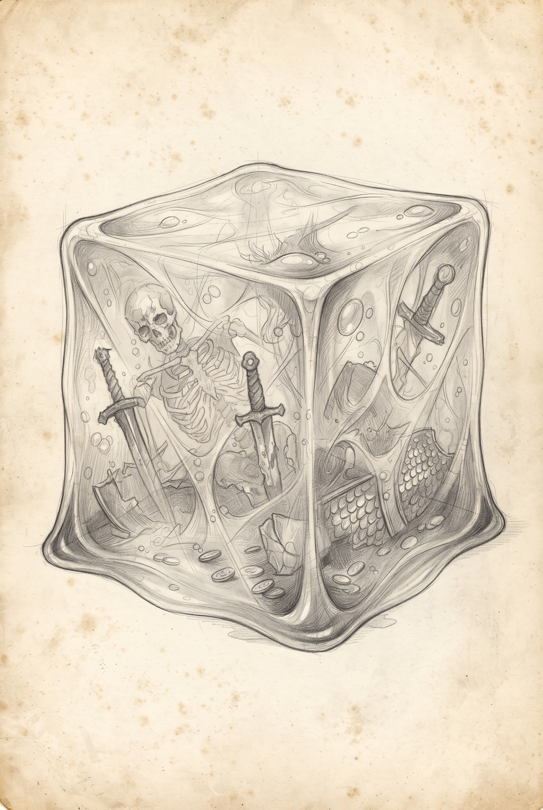

- **Status**: Adaptada com atributos; equilíbrio ainda não validado.
- **Tipo**: Monstro
- **Nivel**: 3
- **Vigor**: 2
- **Destreza**: 0
- **Intelecto**: 0
- **Base**: largura: 2, comprimento: 2

### Talentos e características

- identificador: armas-naturais
- identificador: vitalidade-adicional, faixa: 10
- identificador: lentidao-natural, faixa: -2

### Ações

- nome: Contato corrosivo, equipamento: arma-natural-c29, atributo: vigor

### Equipamento

- identificador: arma-natural-c29, nome: Contato corrosivo, tipo: arma, quantidade: 1, treinamento: armas-naturais, dano: 1d6, alcance: adjacente

### Saque

Ocasionalmente, 4 a 10 moedas visíveis no interior do cubo. Os jogadores também podem avistar a chave de ferro de uma vítima anterior antes de decidir se querem recuperá-la.

### Detalhes

- **Cena sugerida**: Ocupa uma passagem larga. Sua lentidão permite observar e buscar outra rota.
- **Adaptação**: Contato é um ataque contra Defesa, não dano automático. Sem engolfar, paralisar ou destruir itens.

### Referência

Gelatinous Cube.

## Gigante das colinas (C30)

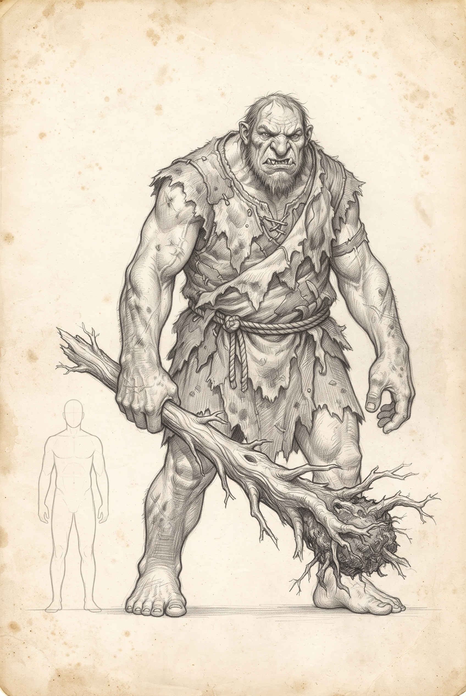

- **Status**: Adaptada com atributos; equilíbrio ainda não validado.
- **Tipo**: Monstro
- **Nivel**: 3
- **Vigor**: 5
- **Destreza**: 0
- **Intelecto**: 0
- **Base**: largura: 3, comprimento: 3

### Talentos e características

- identificador: armas-pesadas
- identificador: pele-resistente
- identificador: vitalidade-adicional, faixa: 10
- identificador: lentidao-natural, faixa: -1

### Ações

- nome: Porrete de duas mãos, equipamento: porrete-duas-maos, atributo: vigor

### Equipamento

- identificador: porrete-duas-maos, nome: Porrete de duas mãos, tipo: arma, quantidade: 1, treinamento: armas-pesadas, dano: 1d6, alcance: adjacente

### Saque

4 a 10 moedas, caso tenha recebido tributo de viajantes. Ocasionalmente, um pequeno barril de provisões que o gigante carrega como lanche.

### Detalhes

- **Cena sugerida**: Ocupante de um vale ou salão enorme. Pode exigir comida ou afastar intrusos.
- **Adaptação**: Sem armadura ou escudo. Porrete de duas mãos treinado; uma ação por ataque. Sem rochas, alcance ampliado ou vários ataques; usar como ameaça anunciada.

### Referência

Hill Giant.

## Veterano humano (H05)

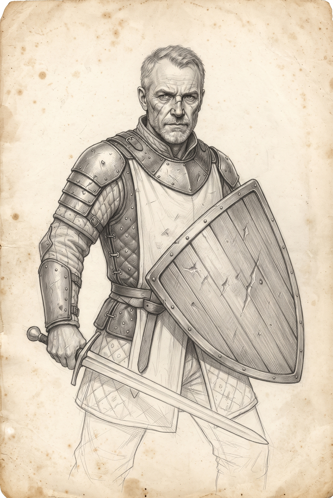

- **Status**: Adaptada com atributos; equilíbrio ainda não validado.
- **Tipo**: Humano
- **Nivel**: 3
- **Vigor**: 5
- **Destreza**: 1
- **Intelecto**: 1
- **Base**: largura: 1, comprimento: 1

### Talentos e características

- identificador: laminas-uma-mao
- identificador: mobilidade-natural, faixa: 1
- identificador: treinamento-escudos

### Ações

- nome: Espada, equipamento: espada, atributo: vigor

### Equipamento

- identificador: espada, nome: Espada, tipo: arma, quantidade: 1, treinamento: laminas-uma-mao, dano: 1d4, alcance: adjacente
- identificador: armadura-media, nome: Armadura média, tipo: armadura, quantidade: 1, defesa: 2, penalidadeMovimento: 1
- identificador: escudo, nome: Escudo, tipo: escudo, quantidade: 1

### Saque

4 a 10 moedas. Ocasionalmente, uma poção de cura.

### Detalhes

- **Cena sugerida**: Defensor experiente ou líder de patrulha. Pode aceitar duelo, acordo ou retirada.
- **Atenção**: Defender a si mesmo eleva a Defesa a 17. Defender aliado exige ação, escudo e adjacência; eleva a Defesa do Veterano a 16 e concede +1 Defesa ao aliado até o próximo turno. Não pode atacar e Defender na mesma ação.

### Referência

Veteran Warrior, representado como humano nesta adaptação.

## Mago humano (H06)

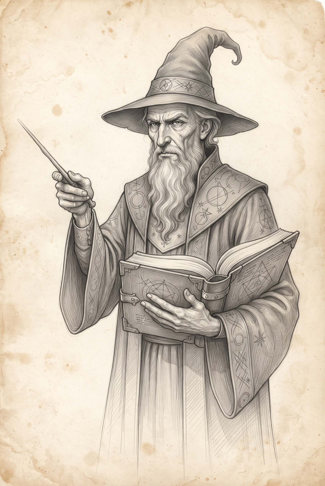

- **Status**: Adaptada com atributos; equilíbrio ainda não validado.
- **Tipo**: Humano
- **Nivel**: 2
- **Vigor**: 2
- **Destreza**: 1
- **Intelecto**: 3
- **Base**: largura: 1, comprimento: 1

### Talentos e características

- identificador: magia-ofensiva
- identificador: magia-controladora
- identificador: pergaminhos

### Ações

- nome: Catalisador de dano, equipamento: catalisador-dano, atributo: intelecto
- nome: Catalisador de controle, equipamento: catalisador-controle, atributo: intelecto
- nome: Pergaminho de recarga, equipamento: pergaminho-recarga, atributo: intelecto
- nome: Adaga, equipamento: adaga, atributo: vigor

### Equipamento

- identificador: catalisador-dano, nome: Catalisador de dano — 6 cargas, tipo: item-magico, quantidade: 1, treinamento: magia-ofensiva, cargasMaximas: 6, alcance: 6 casas, efeito: {'tipo': 'dano', 'valor': '1d3'}
- identificador: catalisador-controle, nome: Catalisador de controle — 5 cargas, tipo: item-magico, quantidade: 1, treinamento: magia-controladora, cargasMaximas: 5, alcance: 6 casas, efeito: {'tipo': 'controle'}
- identificador: pergaminho-recarga, nome: Pergaminho de recarga do catalisador de dano, tipo: pergaminho, quantidade: 1, efeito: {'tipo': 'recarga', 'alvoRecarga': 'catalisador-dano'}
- identificador: adaga, nome: Adaga, tipo: arma, quantidade: 1, treinamento: laminas-uma-mao, dano: 1d3, alcance: adjacente
- identificador: armadura-leve, nome: Armadura leve, tipo: armadura, quantidade: 1, defesa: 1, penalidadeMovimento: 0

### Saque

2 a 6 moedas. Ocasionalmente, o pergaminho de recarga do catalisador de dano que o mago carrega, somente se ele não tiver usado o pergaminho no encontro.

### Detalhes

- **Cena sugerida**: Especialista em objetos arcanos. Pode ser rival, pesquisador ou aliado temporário.
- **Atenção**: Controle não causa dano: impede deslocamento, inclusive Arrancada, e impõe −3 no próximo ataque até o início do próximo turno do usuário; o alvo ainda pode agir. Uma ação por uso. Falhas de ativação consomem carga. O pergaminho recarrega somente o catalisador de dano. Não tem magia própria nem Mana.

### Referência

Mage, representado como humano nesta adaptação.

### Atribuição

This work includes material from the System Reference Document 5.2.1 (“SRD 5.2.1”) by Wizards of the Coast LLC, available at https://www.dndbeyond.com/srd. The SRD 5.2.1 is licensed under the Creative Commons Attribution 4.0 International License, available at https://creativecommons.org/licenses/by/4.0/legalcode.
