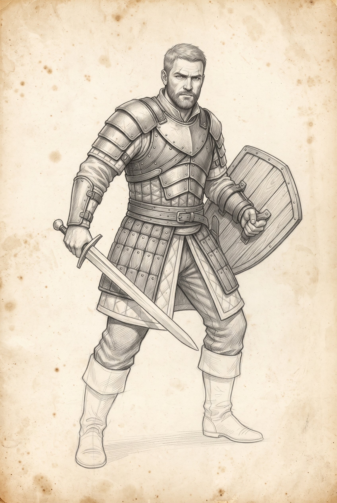
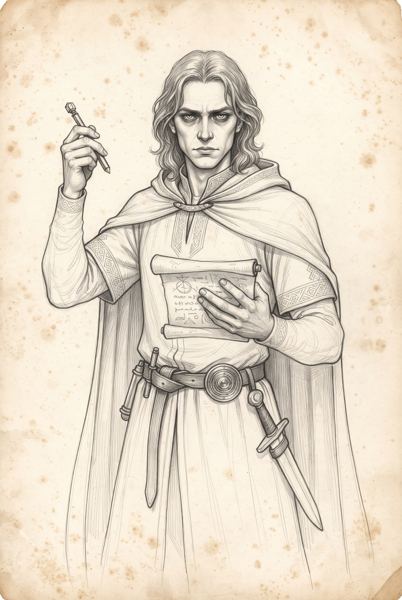
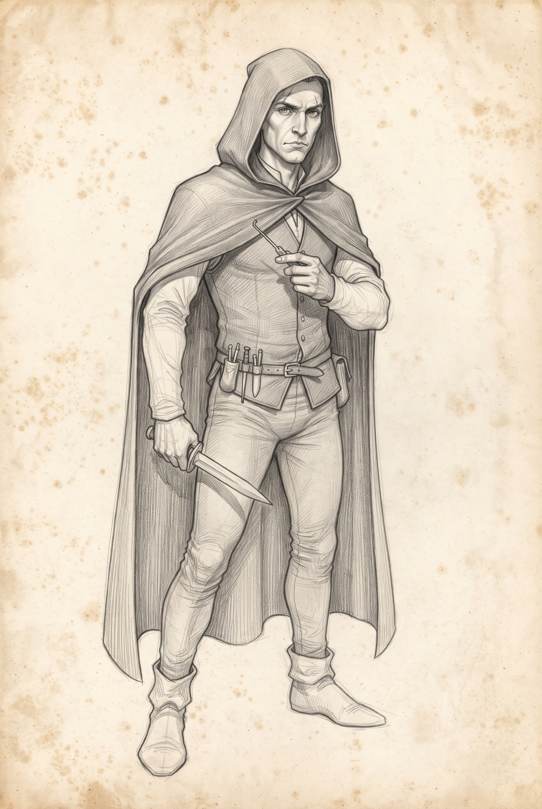
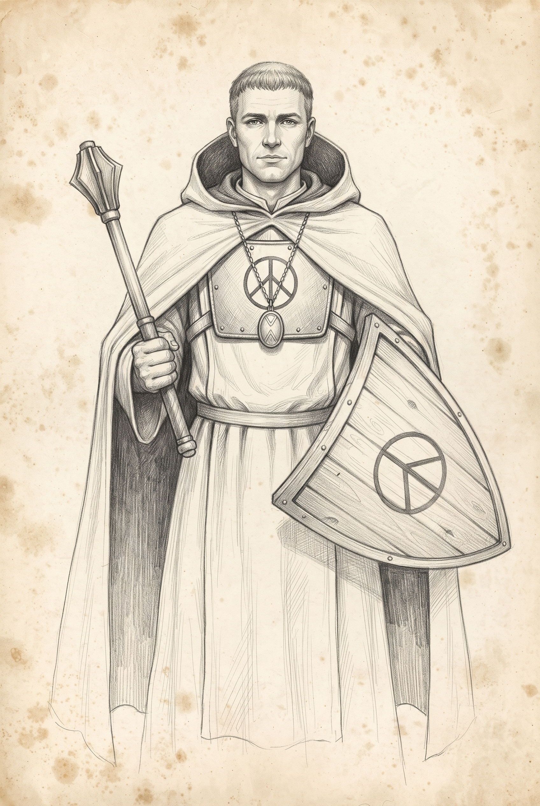
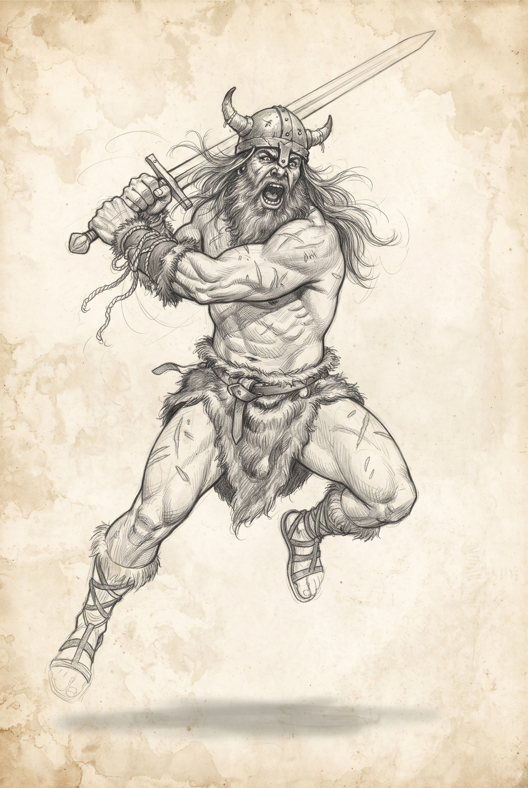
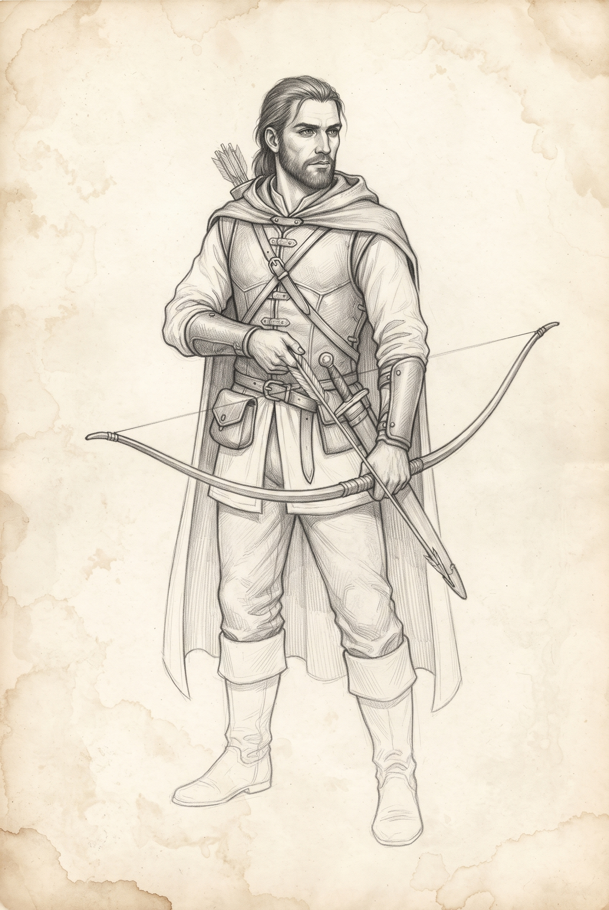
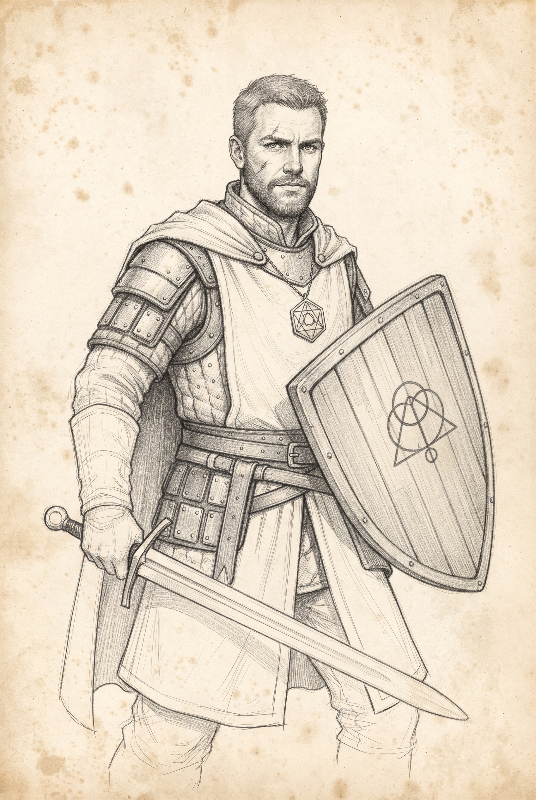
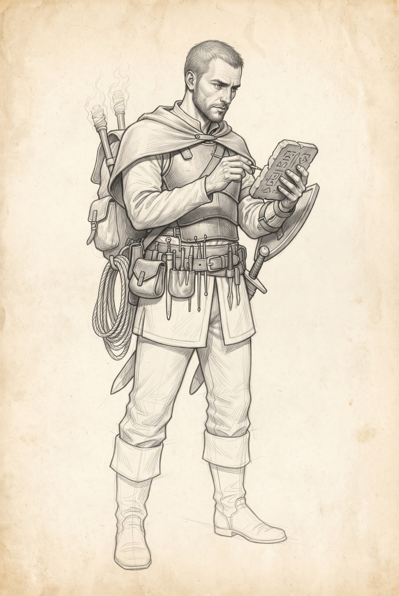
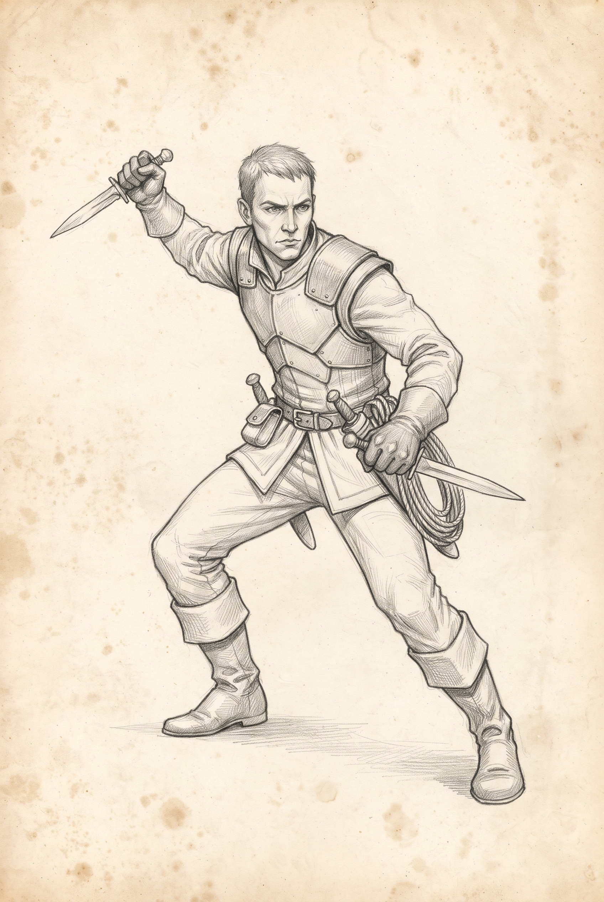
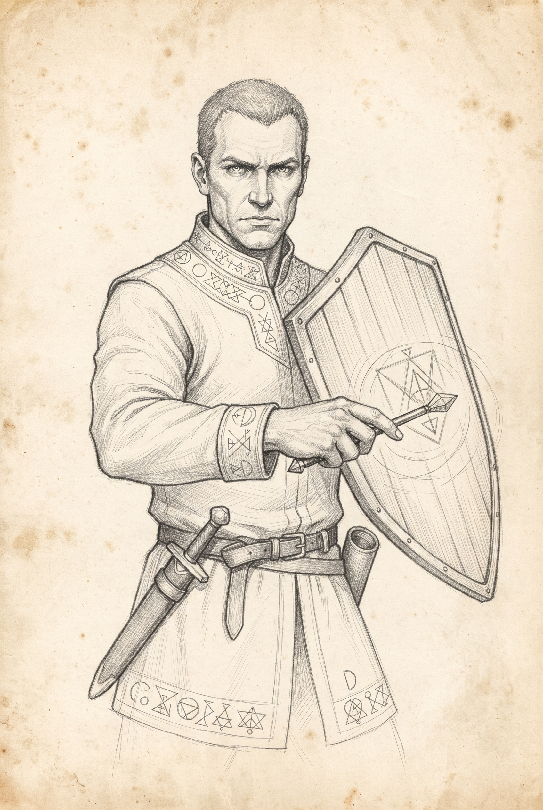

# Personagens iniciais

## Guerreiro (PC-GUERREIRO)

**Tipo:** PC
**Nível:** 1
**Status:** Modelo inicial de PC.
**Vigor:** 3
**Destreza:** 1
**Intelecto:** 0

### Talentos e características

- identificador: laminas-uma-mao
- identificador: treinamento-escudos
- identificador: atletismo

### Ações

- nome: Espada, equipamento: espada, atributo: vigor

### Equipamento

- identificador: espada, nome: Espada, tipo: arma, quantidade: 1, treinamento: laminas-uma-mao, dano: 3, alcance: adjacente
- identificador: escudo, nome: Escudo, tipo: escudo, quantidade: 1
- identificador: armadura-media, nome: Armadura média, tipo: armadura, quantidade: 1, defesa: 2, penalidadeMovimento: 1
- identificador: pocao-cura, nome: Poção de cura, tipo: item, quantidade: 2
- identificador: racao, nome: Ração, tipo: item, quantidade: 2
- identificador: pederneira, nome: Pederneira, tipo: item, quantidade: 1
- identificador: tocha, nome: Tocha, tipo: item, quantidade: 3
- identificador: corda, nome: Corda, tipo: item, quantidade: 1

### Saque

Não se aplica a PC.

### Detalhes

- titulo: Ações e observações, texto: Atletismo remove a penalidade de −3 nos testes de Vigor para escalar, nadar e saltar em situações difíceis.
- titulo: Atenção, texto: Não tem treinamento em magia.

### Referência

Regras locais; ficha inicial oficial.

---

## Mago (PC-MAGO)

**Tipo:** PC
**Nível:** 1
**Status:** Modelo inicial de PC.
**Vigor:** 0
**Destreza:** 1
**Intelecto:** 3

### Talentos e características

- identificador: magia-ofensiva
- identificador: magia-controladora
- identificador: pergaminhos

### Ações

- nome: Catalisador de dano, equipamento: catalisador-dano, atributo: intelecto
- nome: Catalisador de controle, equipamento: catalisador-controle, atributo: intelecto
- nome: Pergaminho de recarga, equipamento: pergaminho-recarga, atributo: intelecto
- nome: Adaga, equipamento: adaga, atributo: vigor

### Equipamento

- identificador: catalisador-dano, nome: Catalisador de dano — 6 cargas, tipo: item-magico, quantidade: 1, treinamento: magia-ofensiva, cargasMaximas: 6, alcance: 6 casas, efeito: tipo: dano, valor: 2
- identificador: catalisador-controle, nome: Catalisador de controle — 5 cargas, tipo: item-magico, quantidade: 1, treinamento: magia-controladora, cargasMaximas: 5, alcance: 6 casas, efeito: tipo: controle
- identificador: pergaminho-recarga, nome: Pergaminho de recarga do catalisador de dano, tipo: pergaminho, quantidade: 1, efeito: tipo: recarga, alvoRecarga: catalisador-dano
- identificador: adaga, nome: Adaga, tipo: arma, quantidade: 1, treinamento: laminas-uma-mao, dano: 2, alcance: adjacente
- identificador: racao, nome: Ração, tipo: item, quantidade: 2
- identificador: pederneira, nome: Pederneira, tipo: item, quantidade: 1
- identificador: tocha, nome: Tocha, tipo: item, quantidade: 3

### Saque

Não se aplica a PC.

### Detalhes

- titulo: Controle, texto: Imobiliza, inclusive contra Arrancada, e impõe −3 no próximo ataque até o início do próximo turno do usuário. O alvo ainda pode agir.
- titulo: Adaga arremessada, texto: Sem treinamento: 1d20 − 2; dano 2; alcance 4 casas.
- titulo: Recarga, texto: O pergaminho comprado restaura somente o catalisador de dano até 6 cargas.
- titulo: Atenção, texto: Sem armadura, poções ou corda; possui duas rações.

### Referência

Regras locais; ficha inicial oficial.

---

## Ladrão (PC-LADRAO)

**Tipo:** PC
**Nível:** 1
**Status:** Modelo inicial de PC.
**Vigor:** 1
**Destreza:** 3
**Intelecto:** 0

### Talentos e características

- identificador: laminas-uma-mao
- identificador: furtividade
- identificador: fechaduras

### Ações

- nome: Espada, equipamento: espada, atributo: vigor
- nome: Adaga corpo a corpo, equipamento: adaga, atributo: vigor
- nome: Adaga arremessada, equipamento: adaga, atributo: destreza, alcance: 4 casas, treinamento: arremesso

### Equipamento

- identificador: espada, nome: Espada, tipo: arma, quantidade: 1, treinamento: laminas-uma-mao, dano: 3, alcance: adjacente
- identificador: adaga, nome: Adaga, tipo: arma, quantidade: 1, treinamento: laminas-uma-mao, dano: 2, alcance: adjacente
- identificador: armadura-leve, nome: Armadura leve, tipo: armadura, quantidade: 1, defesa: 1, penalidadeMovimento: 0
- identificador: kit-gazuas, nome: Kit de gazuas — 5 unidades, tipo: item, quantidade: 1
- identificador: pocao-cura, nome: Poção de cura, tipo: item, quantidade: 2
- identificador: racao, nome: Ração, tipo: item, quantidade: 2
- identificador: pederneira, nome: Pederneira, tipo: item, quantidade: 1
- identificador: tocha, nome: Tocha, tipo: item, quantidade: 3
- identificador: corda, nome: Corda, tipo: item, quantidade: 1

### Saque

Não se aplica a PC.

### Detalhes

- titulo: Ações e observações, texto: Furtividade e Fechaduras: 1d20 + 3.
- titulo: Ações e observações, texto: Destreza não substitui Vigor no combate corpo a corpo. Não tem Desarmar armadilhas; nessa atividade sofre −3.
- titulo: Atenção, texto: Destreza não substitui Vigor no corpo a corpo. Não tem Desarmar armadilhas; nessa atividade sofre −3.

### Referência

Regras locais; ficha inicial oficial.

---

## Clérigo (PC-CLERIGO)

**Tipo:** PC
**Nível:** 1
**Status:** Modelo inicial de PC.
**Vigor:** 2
**Destreza:** 0
**Intelecto:** 2

### Talentos e características

- identificador: impacto-uma-mao
- identificador: milagres-restauradores
- identificador: pergaminhos

### Ações

- nome: Maça, equipamento: maca, atributo: vigor
- nome: Relicário de cura, equipamento: relicario-cura, atributo: intelecto
- nome: Pergaminho de recarga, equipamento: pergaminho-recarga, atributo: intelecto

### Equipamento

- identificador: maca, nome: Maça, tipo: arma, quantidade: 1, treinamento: impacto-uma-mao, dano: 3, alcance: adjacente
- identificador: escudo, nome: Escudo, tipo: escudo, quantidade: 1
- identificador: relicario-cura, nome: Relicário de cura — 3 cargas, tipo: item-magico, quantidade: 1, treinamento: milagres-restauradores, cargasMaximas: 3, alcance: 6 casas, efeito: tipo: cura, valor: 6
- identificador: pergaminho-recarga, nome: Pergaminho de recarga do relicário de cura, tipo: pergaminho, quantidade: 1, efeito: tipo: recarga, alvoRecarga: relicario-cura
- identificador: racao, nome: Ração, tipo: item, quantidade: 2
- identificador: pederneira, nome: Pederneira, tipo: item, quantidade: 1
- identificador: tocha, nome: Tocha, tipo: item, quantidade: 3
- identificador: corda, nome: Corda, tipo: item, quantidade: 1

### Saque

Não se aplica a PC.

### Detalhes

- titulo: Cura, texto: Recupera 6 PV até o máximo. Em inconsciente vivo, uma cura bem-sucedida devolve 1 PV; o alvo perde a próxima rodada. Não ressuscita mortos.
- titulo: Cargas, texto: As três cargas iniciais e as três restauradas pelo pergaminho permitem até seis tentativas. Falhas também consomem cargas.
- titulo: Atenção, texto: Não pode usar Defender aliado sem Treinamento com escudos. O escudo concede somente +1 Defesa. Não possui poção para cura garantida.

### Referência

Regras locais; ficha inicial oficial.

---

## Bárbaro (PC-BARBARO)

**Tipo:** PC
**Nível:** 1
**Status:** Modelo inicial de PC.
**Vigor:** 3
**Destreza:** 1
**Intelecto:** 0

### Talentos e características

- identificador: armas-pesadas
- identificador: atletismo
- identificador: sobrevivencia

### Ações

- nome: Espada de duas mãos, equipamento: espada-duas-maos, atributo: vigor

### Equipamento

- identificador: espada-duas-maos, nome: Espada de duas mãos, tipo: arma, quantidade: 1, treinamento: armas-pesadas, dano: 4, alcance: adjacente
- identificador: pocao-cura, nome: Poção de cura, tipo: item, quantidade: 4
- identificador: racao, nome: Ração, tipo: item, quantidade: 2
- identificador: pederneira, nome: Pederneira, tipo: item, quantidade: 1
- identificador: tocha, nome: Tocha, tipo: item, quantidade: 3
- identificador: corda, nome: Corda, tipo: item, quantidade: 1

### Saque

Não se aplica a PC.

### Detalhes

- titulo: Ações e observações, texto: Atletismo: 1d20 + 3. Sobrevivência: 1d20.
- titulo: Ações e observações, texto: A espada ocupa as duas mãos. O nome bárbaro não concede resistência, fúria nem redução de dano. Beber poção custa uma ação.
- titulo: Atenção, texto: A espada ocupa as duas mãos. O nome bárbaro não concede resistência, fúria nem redução de dano. Beber poção custa ação.

### Referência

Regras locais; ficha inicial oficial.

---

## Caçador (PC-CACADOR)

**Tipo:** PC
**Nível:** 1
**Status:** Modelo inicial de PC.
**Vigor:** 0
**Destreza:** 3
**Intelecto:** 1

### Talentos e características

- identificador: arquearia
- identificador: sobrevivencia
- identificador: furtividade

### Ações

- nome: Arco, equipamento: arco, atributo: destreza
- nome: Adaga corpo a corpo, equipamento: adaga, atributo: vigor
- nome: Adaga arremessada, equipamento: adaga, atributo: destreza, alcance: 4 casas, treinamento: arremesso

### Equipamento

- identificador: arco, nome: Arco e flechas, tipo: arma, quantidade: 1, treinamento: arquearia, dano: 3, alcance: 8 casas
- identificador: adaga, nome: Adaga, tipo: arma, quantidade: 1, treinamento: laminas-uma-mao, dano: 2, alcance: adjacente
- identificador: armadura-leve, nome: Armadura leve, tipo: armadura, quantidade: 1, defesa: 1, penalidadeMovimento: 0
- identificador: pocao-cura, nome: Poção de cura, tipo: item, quantidade: 2
- identificador: racao, nome: Ração, tipo: item, quantidade: 2
- identificador: pederneira, nome: Pederneira, tipo: item, quantidade: 1
- identificador: tocha, nome: Tocha, tipo: item, quantidade: 3
- identificador: corda, nome: Corda, tipo: item, quantidade: 1

### Saque

Não se aplica a PC.

### Detalhes

- titulo: Ações e observações, texto: Furtividade: 1d20 + 3. Sobrevivência: 1d20 + 1.
- titulo: Ações e observações, texto: Não pode disparar com inimigo adjacente, inclusive na diagonal. O arco ocupa duas mãos; trocar para adaga custa uma ação. A quantidade de flechas ainda não está especificada na loja.
- titulo: Atenção, texto: Não pode disparar com inimigo adjacente, inclusive na diagonal. Arco ocupa duas mãos; trocar para adaga custa uma ação. A quantidade de flechas ainda não está especificada na loja.

### Referência

Regras locais; ficha inicial oficial.

---

## Paladino (PC-PALADINO)

**Tipo:** PC
**Nível:** 1
**Status:** Modelo inicial de PC.
**Vigor:** 2
**Destreza:** 0
**Intelecto:** 2

### Talentos e características

- identificador: laminas-uma-mao
- identificador: treinamento-escudos
- identificador: milagres-protetivos

### Ações

- nome: Espada, equipamento: espada, atributo: vigor
- nome: Relicário de proteção, equipamento: relicario-protecao, atributo: intelecto

### Equipamento

- identificador: espada, nome: Espada, tipo: arma, quantidade: 1, treinamento: laminas-uma-mao, dano: 3, alcance: adjacente
- identificador: escudo, nome: Escudo, tipo: escudo, quantidade: 1
- identificador: armadura-leve, nome: Armadura leve, tipo: armadura, quantidade: 1, defesa: 1, penalidadeMovimento: 0
- identificador: relicario-protecao, nome: Relicário de proteção — 3 cargas, tipo: item-magico, quantidade: 1, treinamento: milagres-protetivos, cargasMaximas: 3, alcance: 6 casas, efeito: tipo: protecao, valor: 3
- identificador: pocao-cura, nome: Poção de cura, tipo: item, quantidade: 1
- identificador: racao, nome: Ração, tipo: item, quantidade: 2
- identificador: pederneira, nome: Pederneira, tipo: item, quantidade: 1
- identificador: tocha, nome: Tocha, tipo: item, quantidade: 3
- identificador: corda, nome: Corda, tipo: item, quantidade: 1

### Saque

Não se aplica a PC.

### Detalhes

- titulo: Ações e observações, texto: O relicário concede +3 Defesa a si ou a um aliado a até 6 casas até o início do próximo turno do usuário.
- titulo: Ações e observações, texto: Não tem Pergaminhos nem comprou recarga. Depende de outro personagem com o talento e pergaminho correspondente. Ativar o relicário e Defender são ações separadas.
- titulo: Atenção, texto: Não tem Pergaminhos nem compra recarga. Depende de outro personagem com o talento e o pergaminho correspondente para recarregar. Ativar o relicário e usar Defender são ações distintas; não faz ambas no mesmo turno.

### Referência

Regras locais; ficha inicial oficial.

---

## Explorador de ruínas (PC-EXPLORADOR)

**Tipo:** PC
**Nível:** 1
**Status:** Modelo inicial de PC.
**Vigor:** 0
**Destreza:** 2
**Intelecto:** 2

### Talentos e características

- identificador: investigacao
- identificador: conhecimento-antigo
- identificador: desarmar-armadilhas

### Ações

- nome: Adaga corpo a corpo, equipamento: adaga, atributo: vigor
- nome: Adaga arremessada, equipamento: adaga, atributo: destreza, alcance: 4 casas, treinamento: arremesso

### Equipamento

- identificador: adaga, nome: Adaga, tipo: arma, quantidade: 1, treinamento: laminas-uma-mao, dano: 2, alcance: adjacente
- identificador: escudo, nome: Escudo, tipo: escudo, quantidade: 1
- identificador: armadura-leve, nome: Armadura leve, tipo: armadura, quantidade: 1, defesa: 1, penalidadeMovimento: 0
- identificador: kit-gazuas, nome: Kit de gazuas — 5 unidades, tipo: item, quantidade: 2
- identificador: pocao-cura, nome: Poção de cura, tipo: item, quantidade: 2
- identificador: racao, nome: Ração, tipo: item, quantidade: 2
- identificador: corda, nome: Corda, tipo: item, quantidade: 2
- identificador: pederneira, nome: Pederneira, tipo: item, quantidade: 1
- identificador: tocha, nome: Tocha, tipo: item, quantidade: 3

### Saque

Não se aplica a PC.

### Detalhes

- titulo: Ações e observações, texto: Investigação e Conhecimento antigo: 1d20 + 2. Desarmar armadilhas identificadas: 1d20 + 2; ferramentas adequadas ao mecanismo são necessárias. Fechaduras sem treinamento: 1d20 − 1; usa gazua.
- titulo: Ações e observações, texto: Tem dez gazuas, mas elas não substituem toda ferramenta que um mecanismo possa exigir; o mestre avalia. Não tem treinamento de armas ou escudos e não pode usar Defender aliado.

### Referência

Regras locais; ficha inicial oficial.

---

## Batedor (PC-BATEDOR)

**Tipo:** PC
**Nível:** 1
**Status:** Modelo inicial de PC.
**Vigor:** 1
**Destreza:** 3
**Intelecto:** 0

### Talentos e características

- identificador: arremesso
- identificador: furtividade
- identificador: acrobacia

### Ações

- nome: Adaga arremessada, equipamento: adaga, atributo: destreza, alcance: 4 casas, treinamento: arremesso
- nome: Adaga corpo a corpo, equipamento: adaga, atributo: vigor

### Equipamento

- identificador: adaga, nome: Adaga, tipo: arma, quantidade: 4, treinamento: laminas-uma-mao, dano: 2, alcance: adjacente
- identificador: armadura-leve, nome: Armadura leve, tipo: armadura, quantidade: 1, defesa: 1, penalidadeMovimento: 0
- identificador: pocao-cura, nome: Poção de cura, tipo: item, quantidade: 3
- identificador: racao, nome: Ração, tipo: item, quantidade: 3
- identificador: corda, nome: Corda, tipo: item, quantidade: 1
- identificador: pederneira, nome: Pederneira, tipo: item, quantidade: 1
- identificador: tocha, nome: Tocha, tipo: item, quantidade: 3

### Saque

Não se aplica a PC.

### Detalhes

- titulo: Ações e observações, texto: Furtividade e Acrobacia: 1d20 + 3.
- titulo: Ações e observações, texto: Arremesso não treina combate corpo a corpo nem concede ataques extras. Recuperar adagas e outras manipulações não especificadas ficam a cargo do mestre; quatro adagas não significam quatro ataques no turno.

### Referência

Regras locais; ficha inicial oficial.

---

## Guardião arcano (PC-GUARDIAO)

**Tipo:** PC
**Nível:** 1
**Status:** Modelo inicial de PC.
**Vigor:** 1
**Destreza:** 0
**Intelecto:** 3

### Talentos e características

- identificador: treinamento-escudos
- identificador: magia-controladora
- identificador: pergaminhos

### Ações

- nome: Catalisador de controle, equipamento: catalisador-controle, atributo: intelecto
- nome: Pergaminho de recarga, equipamento: pergaminho-recarga, atributo: intelecto
- nome: Adaga corpo a corpo, equipamento: adaga, atributo: vigor
- nome: Adaga arremessada, equipamento: adaga, atributo: destreza, alcance: 4 casas, treinamento: arremesso

### Equipamento

- identificador: catalisador-controle, nome: Catalisador de controle — 5 cargas, tipo: item-magico, quantidade: 1, treinamento: magia-controladora, cargasMaximas: 5, alcance: 6 casas, efeito: tipo: controle
- identificador: escudo, nome: Escudo, tipo: escudo, quantidade: 1
- identificador: armadura-leve, nome: Armadura leve, tipo: armadura, quantidade: 1, defesa: 1, penalidadeMovimento: 0
- identificador: pergaminho-recarga, nome: Pergaminho de recarga do catalisador de controle, tipo: pergaminho, quantidade: 1, efeito: tipo: recarga, alvoRecarga: catalisador-controle
- identificador: adaga, nome: Adaga, tipo: arma, quantidade: 1, treinamento: laminas-uma-mao, dano: 2, alcance: adjacente
- identificador: racao, nome: Ração, tipo: item, quantidade: 2
- identificador: pederneira, nome: Pederneira, tipo: item, quantidade: 1
- identificador: tocha, nome: Tocha, tipo: item, quantidade: 3
- identificador: corda, nome: Corda, tipo: item, quantidade: 1

### Saque

Não se aplica a PC.

### Detalhes

- titulo: Ações e observações, texto: A recarga completa restaura cinco cargas, permitindo até dez tentativas com carga inicial e pergaminho.
- titulo: Ações e observações, texto: Controle não causa dano. Não possui catalisador ofensivo nem treinamento com adaga. Ativar controle e Defender exigem ações separadas.
- titulo: Atenção, texto: Controle não causa dano. Não possui catalisador ofensivo nem treinamento com adaga. Ativar controle e usar Defender exigem ações separadas.

### Referência

Regras locais; ficha inicial oficial.

---
