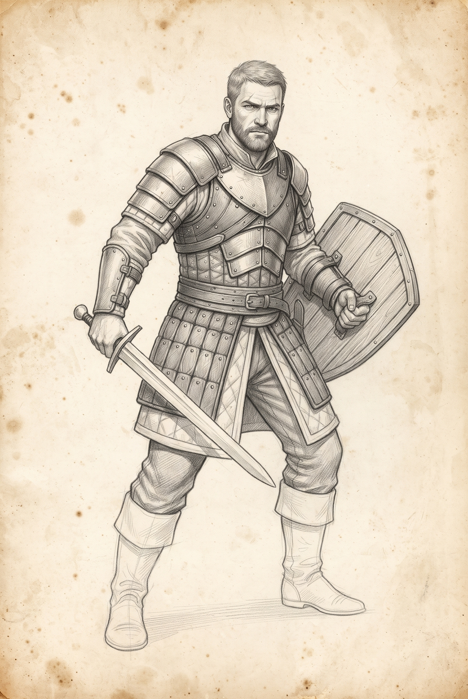
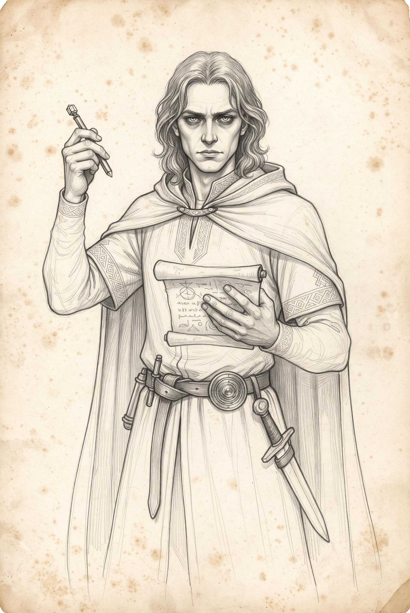
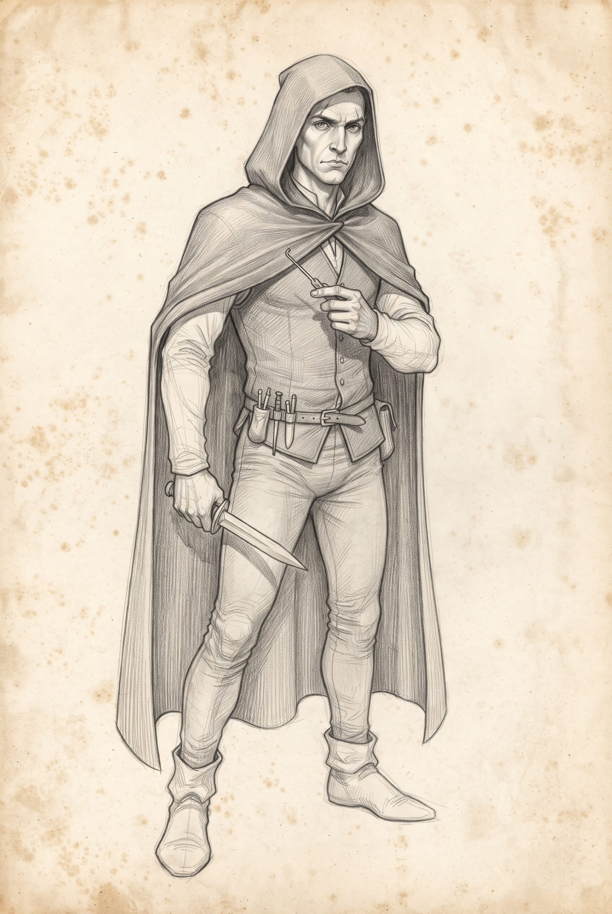
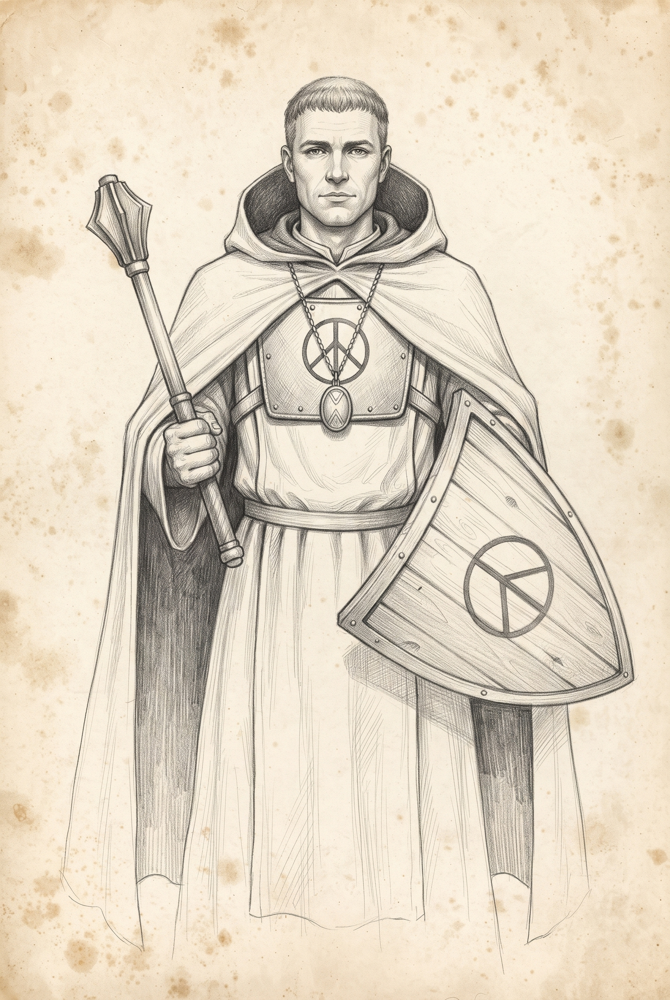
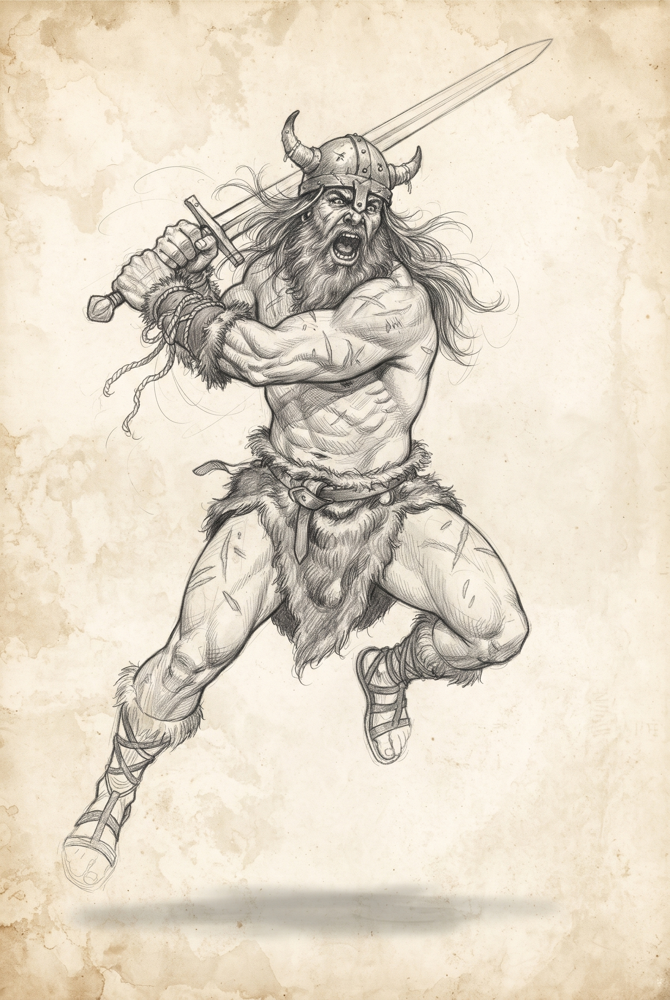
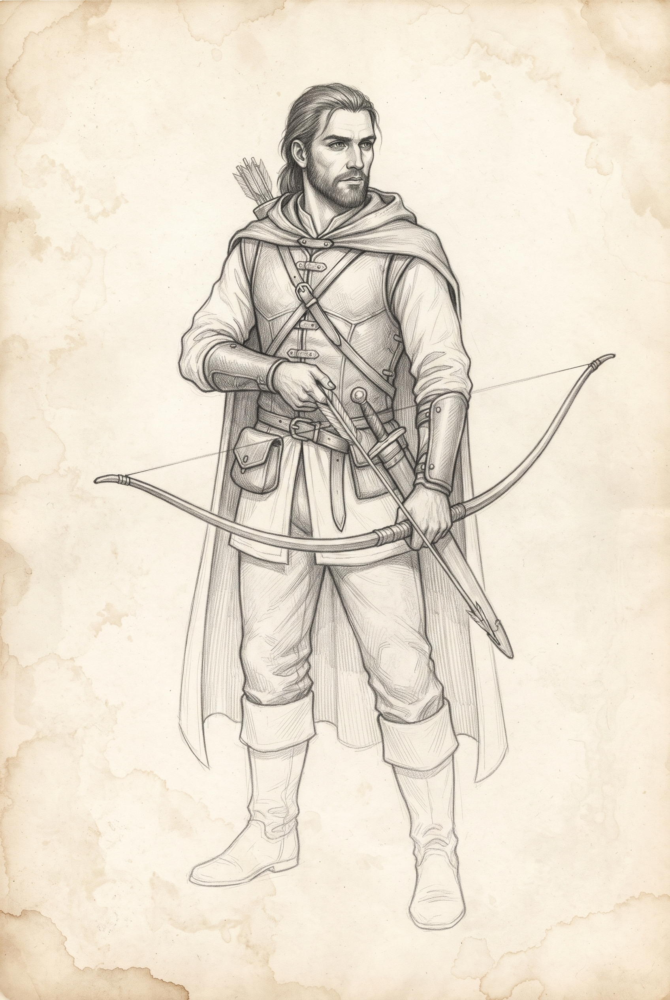
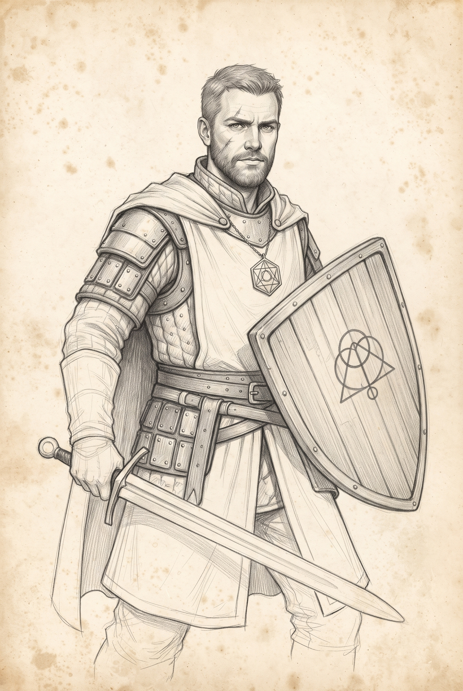
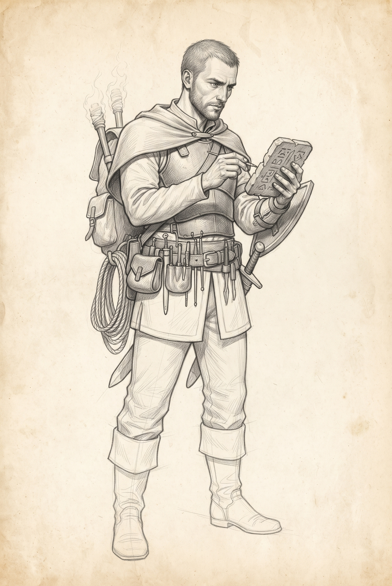
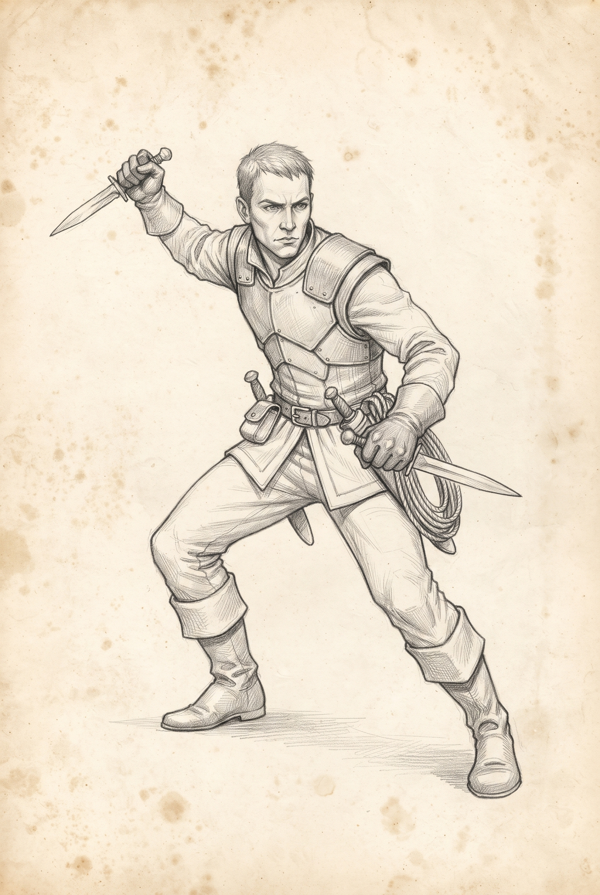
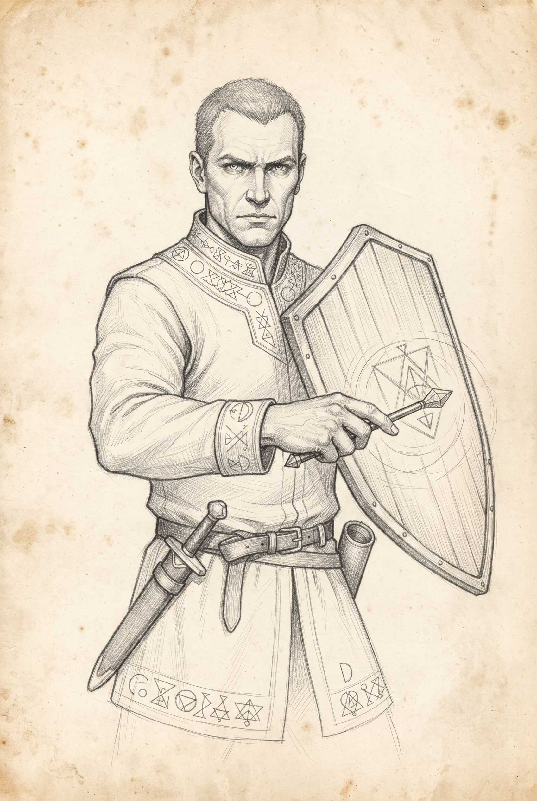

# Personagens iniciais

Versão 0.15 · Última modificação em 11/11/2026

## Guerreiro (PC-GUERREIRO)

- **Status**: Modelo inicial de PC.
- **Tipo**: PC
- **Nivel**: 1
- **Vigor**: 3
- **Destreza**: 1
- **Intelecto**: 0
- **Base**: largura: 1, comprimento: 1

Luta na linha de frente com espada e escudo, protege aliados e usa sua força para escalar, nadar e saltar.

- **Nome do personagem**: ____________________.
- **Atributos**: Vigor 3, Destreza 1, Intelecto 0.
- **Talentos**: Lâminas de uma mão; Treinamento com escudos; Atletismo.
- **PV**: 10 + (2 × 3) = **16**. PV atuais: ____.
- **Defesa**: 10 + armadura 2 + escudo 3 = **15**, antes de efeitos temporários.
- **Movimento**: 4 de base − 1 pela armadura média = **3 casas**.
- **Iniciativa**: 1d20 + 1; uma rolagem por encontro.

### Talentos e características

- identificador: laminas-uma-mao
- identificador: treinamento-escudos
- identificador: atletismo

### Ações

- nome: Espada, equipamento: espada, atributo: vigor

- Espada: 1d20 + 3; dano 1d4 + 1 (base 1d4 + 1 de Vigor); alvo adjacente.

### Equipamento

- identificador: espada, nome: Espada, tipo: arma, quantidade: 1, treinamento: laminas-uma-mao, dano: 1d4, alcance: adjacente
- identificador: escudo, nome: Escudo, tipo: escudo, quantidade: 1
- identificador: armadura-media, nome: Armadura média, tipo: armadura, quantidade: 1, defesa: 2, penalidadeMovimento: 1
- identificador: pocao-cura, nome: Poção de cura, tipo: item, quantidade: 2
- identificador: racao, nome: Ração, tipo: item, quantidade: 2
- identificador: pederneira, nome: Pederneira, tipo: item, quantidade: 1
- identificador: tocha, nome: Tocha, tipo: item, quantidade: 3
- identificador: corda, nome: Corda, tipo: item, quantidade: 1

### Compras

- Espada × 1 — 15 moedas por unidade, 15 no total.
- Escudo × 1 — 10 moedas por unidade, 10 no total.
- Armadura média × 1 — 25 moedas por unidade, 25 no total.
- Poção de cura × 2 — 15 moedas por unidade, 30 no total.
- Ração × 2 — 5 moedas por unidade, 10 no total.
- Pederneira × 1 — 2 moedas por unidade, 2 no total.
- Tocha × 3 — 1 moedas por unidade, 3 no total.
- Corda × 1 — 5 moedas por unidade, 5 no total.

Total: 100 moedas. Saldo: 0 moedas.

### Saque

Não se aplica a PC.

### Detalhes

- **Ações e observações**: Atletismo remove a penalidade de −3 nos testes de Vigor para escalar, nadar e saltar em situações difíceis.
- **Atenção**: Não tem treinamento em magia.

### Referência

Regras locais; ficha inicial oficial.

## Mago (PC-MAGO)

- **Status**: Modelo inicial de PC.
- **Tipo**: PC
- **Nivel**: 1
- **Vigor**: 0
- **Destreza**: 1
- **Intelecto**: 3
- **Base**: largura: 1, comprimento: 1

Conjurador que alterna ataques mágicos e imobilização de inimigos. Prefere ficar atrás dos companheiros; sua proteção física é baixa.

- **Nome do personagem**: ____________________.
- **Atributos**: Vigor 0, Destreza 1, Intelecto 3.
- **Talentos**: Magia ofensiva; Magia controladora; Pergaminhos.
- **PV**: 10 + (2 × 0) = **10**. PV atuais: ____.
- **Defesa**: 10 + armadura 0 + escudo 0 = **10**, antes de efeitos temporários.
- **Movimento**: 4 + Destreza 0 − penalidade de armadura 0 + treinamento 0 + sem armadura 1 = **5 casas**.
- **Iniciativa**: 1d20 + 1; uma rolagem por encontro.

### Talentos e características

- identificador: magia-ofensiva
- identificador: magia-controladora
- identificador: pergaminhos

### Ações

- nome: Catalisador de dano, equipamento: catalisador-dano, atributo: intelecto
- nome: Catalisador de controle, equipamento: catalisador-controle, atributo: intelecto
- nome: Pergaminho de recarga, equipamento: pergaminho-recarga, atributo: intelecto
- nome: Adaga, equipamento: adaga, atributo: vigor

- Ativação dos dois catalisadores: 1d20 + 3 contra 10; alcance 6 casas.
- Dano mágico: 1d3. Controle: imobiliza, inclusive contra Arrancada, e impõe −3 no próximo ataque até o início do próximo turno do usuário. O alvo ainda pode agir.
- Adaga corpo a corpo: 1d20 − 3; dano 1d3. Arremesso sem treinamento: 1d20 − 2; dano 1d3; alcance 4.

### Equipamento

- identificador: catalisador-dano, nome: Catalisador de dano — 6 cargas, tipo: item-magico, quantidade: 1, treinamento: magia-ofensiva, cargasMaximas: 6, alcance: 6 casas, efeito: {'tipo': 'dano', 'valor': '1d3'}
- identificador: catalisador-controle, nome: Catalisador de controle — 5 cargas, tipo: item-magico, quantidade: 1, treinamento: magia-controladora, cargasMaximas: 5, alcance: 6 casas, efeito: {'tipo': 'controle'}
- identificador: pergaminho-recarga, nome: Pergaminho de recarga do catalisador de dano, tipo: pergaminho, quantidade: 1, efeito: {'tipo': 'recarga', 'alvoRecarga': 'catalisador-dano'}
- identificador: adaga, nome: Adaga, tipo: arma, quantidade: 1, treinamento: laminas-uma-mao, dano: 1d3, alcance: adjacente
- identificador: racao, nome: Ração, tipo: item, quantidade: 2
- identificador: pederneira, nome: Pederneira, tipo: item, quantidade: 1
- identificador: tocha, nome: Tocha, tipo: item, quantidade: 3

### Compras

- Catalisador de dano — 6 cargas × 1 — 30 moedas por unidade, 30 no total.
- Catalisador de controle — 5 cargas × 1 — 30 moedas por unidade, 30 no total.
- Pergaminho de recarga do catalisador de dano × 1 — 20 moedas por unidade, 20 no total.
- Adaga × 1 — 5 moedas por unidade, 5 no total.
- Ração × 2 — 5 moedas por unidade, 10 no total.
- Pederneira × 1 — 2 moedas por unidade, 2 no total.
- Tocha × 3 — 1 moedas por unidade, 3 no total.

Total: 100 moedas. Saldo: 0 moedas.

### Saque

Não se aplica a PC.

### Detalhes

- **Controle**: Imobiliza, inclusive contra Arrancada, e impõe −3 no próximo ataque até o início do próximo turno do usuário. O alvo ainda pode agir.
- **Adaga arremessada**: Sem treinamento: 1d20 − 2; dano 1d3; alcance 4 casas.
- **Recarga**: O pergaminho comprado restaura somente o catalisador de dano até 6 cargas.
- **Atenção**: Sem armadura, poções ou corda; possui duas rações.

### Referência

Regras locais; ficha inicial oficial.

Sem armadura, poções ou corda. As compras foram ajustadas para incluir duas rações; o pergaminho comprado não recarrega controle.

## Ladrão (PC-LADRAO)

- **Status**: Modelo inicial de PC.
- **Tipo**: PC
- **Nivel**: 1
- **Vigor**: 1
- **Destreza**: 3
- **Intelecto**: 0
- **Base**: largura: 1, comprimento: 1

Especialista em entrar discretamente e abrir passagens trancadas. Luta com lâminas quando necessário, mas não é um combatente de linha de frente.

- **Nome do personagem**: ____________________.
- **Atributos**: Vigor 1, Destreza 3, Intelecto 0.
- **Talentos**: Lâminas de uma mão; Furtividade; Fechaduras.
- **PV**: 10 + (2 × 1) = **12**. PV atuais: ____.
- **Defesa**: 10 + armadura 1 + escudo 0 = **11**, antes de efeitos temporários.
- **Movimento**: 4 + Destreza 1 − penalidade de armadura 0 + treinamento 0 + sem armadura 0 = **5 casas**.
- **Iniciativa**: 1d20 + 3; uma rolagem por encontro.

### Talentos e características

- identificador: laminas-uma-mao
- identificador: furtividade
- identificador: fechaduras

### Ações

- nome: Espada, equipamento: espada, atributo: vigor
- nome: Adaga corpo a corpo, equipamento: adaga, atributo: vigor
- nome: Adaga arremessada, equipamento: adaga, atributo: destreza, alcance: 4 casas, treinamento: arremesso

- Espada: 1d20 + 1; dano 1d4; alvo adjacente. Adaga corpo a corpo: 1d20 + 1; dano 1d3.
- Furtividade e Fechaduras: 1d20 + 3.
- Arremesso de adaga sem treinamento: 1d20; dano 1d3; alcance 4.

### Equipamento

- identificador: espada, nome: Espada, tipo: arma, quantidade: 1, treinamento: laminas-uma-mao, dano: 1d4, alcance: adjacente
- identificador: adaga, nome: Adaga, tipo: arma, quantidade: 1, treinamento: laminas-uma-mao, dano: 1d3, alcance: adjacente
- identificador: armadura-leve, nome: Armadura leve, tipo: armadura, quantidade: 1, defesa: 1, penalidadeMovimento: 0
- identificador: kit-gazuas, nome: Kit de gazuas — 5 unidades, tipo: item, quantidade: 1
- identificador: pocao-cura, nome: Poção de cura, tipo: item, quantidade: 2
- identificador: racao, nome: Ração, tipo: item, quantidade: 2
- identificador: pederneira, nome: Pederneira, tipo: item, quantidade: 1
- identificador: tocha, nome: Tocha, tipo: item, quantidade: 3
- identificador: corda, nome: Corda, tipo: item, quantidade: 1

### Compras

- Espada × 1 — 15 moedas por unidade, 15 no total.
- Adaga × 1 — 5 moedas por unidade, 5 no total.
- Armadura leve × 1 — 10 moedas por unidade, 10 no total.
- Kit de gazuas — 5 unidades × 1 — 10 moedas por unidade, 10 no total.
- Poção de cura × 2 — 15 moedas por unidade, 30 no total.
- Ração × 2 — 5 moedas por unidade, 10 no total.
- Pederneira × 1 — 2 moedas por unidade, 2 no total.
- Tocha × 3 — 1 moedas por unidade, 3 no total.
- Corda × 1 — 5 moedas por unidade, 5 no total.

Total: 90 moedas. Saldo: 10 moedas.

### Saque

Não se aplica a PC.

### Detalhes

- **Ações e observações**: Furtividade e Fechaduras: 1d20 + 3.
- **Ações e observações**: Destreza não substitui Vigor no combate corpo a corpo. Não tem Desarmar armadilhas; nessa atividade sofre −3.
- **Atenção**: Destreza não substitui Vigor no corpo a corpo. Não tem Desarmar armadilhas; nessa atividade sofre −3.

### Referência

Regras locais; ficha inicial oficial.

## Clérigo (PC-CLERIGO)

- **Status**: Modelo inicial de PC.
- **Tipo**: PC
- **Nivel**: 1
- **Vigor**: 2
- **Destreza**: 0
- **Intelecto**: 2
- **Base**: largura: 1, comprimento: 1

Apoia o grupo com cura e pode lutar com maça. Sua resistência é razoável, mas seu escudo não tem o bônus de um usuário treinado.

- **Nome do personagem**: ____________________.
- **Atributos**: Vigor 2, Destreza 0, Intelecto 2.
- **Talentos**: Armas de impacto de uma mão; Milagres restauradores; Pergaminhos.
- **PV**: 10 + (2 × 2) = **14**. PV atuais: ____.
- **Defesa**: 10 + armadura 0 + escudo 1 = **11**, antes de efeitos temporários.
- **Movimento**: 4 + Destreza 0 − penalidade de armadura 0 + treinamento 0 + sem armadura 1 = **5 casas**.
- **Iniciativa**: 1d20; uma rolagem por encontro.

### Talentos e características

- identificador: impacto-uma-mao
- identificador: milagres-restauradores
- identificador: pergaminhos

### Ações

- nome: Maça, equipamento: maca, atributo: vigor
- nome: Relicário de cura, equipamento: relicario-cura, atributo: intelecto
- nome: Pergaminho de recarga, equipamento: pergaminho-recarga, atributo: intelecto

- Maça: 1d20 + 2; dano 1d4 + 1 (base 1d4 + 1 de Vigor); alvo adjacente.

### Equipamento

- identificador: maca, nome: Maça, tipo: arma, quantidade: 1, treinamento: impacto-uma-mao, dano: 1d4, alcance: adjacente
- identificador: escudo, nome: Escudo, tipo: escudo, quantidade: 1
- identificador: relicario-cura, nome: Relicário de cura — 3 cargas, tipo: item-magico, quantidade: 1, treinamento: milagres-restauradores, cargasMaximas: 3, alcance: 6 casas, efeito: {'tipo': 'cura', 'valor': 6}
- identificador: pergaminho-recarga, nome: Pergaminho de recarga do relicário de cura, tipo: pergaminho, quantidade: 1, efeito: {'tipo': 'recarga', 'alvoRecarga': 'relicario-cura'}
- identificador: racao, nome: Ração, tipo: item, quantidade: 2
- identificador: pederneira, nome: Pederneira, tipo: item, quantidade: 1
- identificador: tocha, nome: Tocha, tipo: item, quantidade: 3
- identificador: corda, nome: Corda, tipo: item, quantidade: 1

### Compras

- Maça × 1 — 15 moedas por unidade, 15 no total.
- Escudo × 1 — 10 moedas por unidade, 10 no total.
- Relicário de cura — 3 cargas × 1 — 30 moedas por unidade, 30 no total.
- Pergaminho de recarga do relicário de cura × 1 — 20 moedas por unidade, 20 no total.
- Ração × 2 — 5 moedas por unidade, 10 no total.
- Pederneira × 1 — 2 moedas por unidade, 2 no total.
- Tocha × 3 — 1 moedas por unidade, 3 no total.
- Corda × 1 — 5 moedas por unidade, 5 no total.

Total: 95 moedas. Saldo: 5 moedas.

### Saque

Não se aplica a PC.

### Detalhes

- **Cura**: Recupera 6 PV até o máximo. Em inconsciente vivo, uma cura bem-sucedida devolve 1 PV; o alvo perde a próxima rodada. Não ressuscita mortos.
- **Cargas**: As três cargas iniciais e as três restauradas pelo pergaminho permitem até seis tentativas. Falhas também consomem cargas.
- **Atenção**: Não pode usar Defender aliado sem Treinamento com escudos. O escudo concede somente +1 Defesa. Não possui poção para cura garantida.

### Referência

Regras locais; ficha inicial oficial.

Não pode usar Defender aliado: falta Treinamento com escudos. O escudo concede somente +1 Defesa. Não possui poção para cura garantida.

## Bárbaro (PC-BARBARO)

- **Status**: Modelo inicial de PC.
- **Tipo**: PC
- **Nivel**: 1
- **Vigor**: 3
- **Destreza**: 1
- **Intelecto**: 0
- **Base**: largura: 1, comprimento: 1

Combatente ofensivo sem armadura. Causa mais dano com a espada de duas mãos e se desloca rapidamente, mas fica muito exposto aos ataques.

- **Nome do personagem**: ____________________.
- **Atributos**: Vigor 3, Destreza 1, Intelecto 0.
- **Talentos**: Armas pesadas; Atletismo; Sobrevivência.
- **PV**: 10 + (2 × 3) = **16**. PV atuais: ____.
- **Defesa**: 10 + armadura 0 + escudo 0 = **10**, antes de efeitos temporários.
- **Movimento**: 4 + Destreza 0 − penalidade de armadura 0 + treinamento 0 + sem armadura 1 = **5 casas**.
- **Iniciativa**: 1d20 + 1; uma rolagem por encontro.

### Talentos e características

- identificador: armas-pesadas
- identificador: atletismo
- identificador: sobrevivencia

### Ações

- nome: Espada de duas mãos, equipamento: espada-duas-maos, atributo: vigor

- Espada de duas mãos: 1d20 + 3; dano 1d6 + 1 (base 1d6 + 1 de Vigor); alvo adjacente.

### Equipamento

- identificador: espada-duas-maos, nome: Espada de duas mãos, tipo: arma, quantidade: 1, treinamento: armas-pesadas, dano: 1d6, alcance: adjacente
- identificador: pocao-cura, nome: Poção de cura, tipo: item, quantidade: 4
- identificador: racao, nome: Ração, tipo: item, quantidade: 2
- identificador: pederneira, nome: Pederneira, tipo: item, quantidade: 1
- identificador: tocha, nome: Tocha, tipo: item, quantidade: 3
- identificador: corda, nome: Corda, tipo: item, quantidade: 1

### Compras

- Espada de duas mãos × 1 — 20 moedas por unidade, 20 no total.
- Poção de cura × 4 — 15 moedas por unidade, 60 no total.
- Ração × 2 — 5 moedas por unidade, 10 no total.
- Pederneira × 1 — 2 moedas por unidade, 2 no total.
- Tocha × 3 — 1 moedas por unidade, 3 no total.
- Corda × 1 — 5 moedas por unidade, 5 no total.

Total: 100 moedas. Saldo: 0 moedas.

### Saque

Não se aplica a PC.

### Detalhes

- **Ações e observações**: Atletismo: 1d20 + 3. Sobrevivência: 1d20.
- **Ações e observações**: A espada ocupa as duas mãos. O nome bárbaro não concede resistência, fúria nem redução de dano. Beber poção custa uma ação.
- **Atenção**: A espada ocupa as duas mãos. O nome bárbaro não concede resistência, fúria nem redução de dano. Beber poção custa ação.

### Referência

Regras locais; ficha inicial oficial.

## Caçador (PC-CACADOR)

- **Status**: Modelo inicial de PC.
- **Tipo**: PC
- **Nivel**: 1
- **Vigor**: 0
- **Destreza**: 3
- **Intelecto**: 1
- **Base**: largura: 1, comprimento: 1

Apoio à distância que encontra rastros e se aproxima sem fazer barulho. Precisa manter distância dos inimigos para usar seu arco.

- **Nome do personagem**: ____________________.
- **Atributos**: Vigor 0, Destreza 3, Intelecto 1.
- **Talentos**: Arquearia; Sobrevivência; Furtividade.
- **PV**: 10 + (2 × 0) = **10**. PV atuais: ____.
- **Defesa**: 10 + armadura 1 + escudo 0 = **11**, antes de efeitos temporários.
- **Movimento**: 4 + Destreza 1 − penalidade de armadura 0 + treinamento 0 + sem armadura 0 = **5 casas**.
- **Iniciativa**: 1d20 + 3; uma rolagem por encontro.

### Talentos e características

- identificador: arquearia
- identificador: sobrevivencia
- identificador: furtividade

### Ações

- nome: Arco, equipamento: arco, atributo: destreza
- nome: Adaga corpo a corpo, equipamento: adaga, atributo: vigor
- nome: Adaga arremessada, equipamento: adaga, atributo: destreza, alcance: 4 casas, treinamento: arremesso

- Arco: 1d20 + 3; dano 1d4; alcance 8 casas.
- Furtividade: 1d20 + 3. Sobrevivência: 1d20 + 1.
- Adaga corpo a corpo sem treinamento: 1d20 − 3; dano 1d3. Arremesso sem treinamento: 1d20; dano 1d3; alcance 4.

### Equipamento

- identificador: arco, nome: Arco e flechas, tipo: arma, quantidade: 1, treinamento: arquearia, dano: 1d4, alcance: 8 casas
- identificador: adaga, nome: Adaga, tipo: arma, quantidade: 1, treinamento: laminas-uma-mao, dano: 1d3, alcance: adjacente
- identificador: armadura-leve, nome: Armadura leve, tipo: armadura, quantidade: 1, defesa: 1, penalidadeMovimento: 0
- identificador: pocao-cura, nome: Poção de cura, tipo: item, quantidade: 2
- identificador: racao, nome: Ração, tipo: item, quantidade: 2
- identificador: pederneira, nome: Pederneira, tipo: item, quantidade: 1
- identificador: tocha, nome: Tocha, tipo: item, quantidade: 3
- identificador: corda, nome: Corda, tipo: item, quantidade: 1

### Compras

- Arco e flechas × 1 — 25 moedas por unidade, 25 no total.
- Adaga × 1 — 5 moedas por unidade, 5 no total.
- Armadura leve × 1 — 10 moedas por unidade, 10 no total.
- Poção de cura × 2 — 15 moedas por unidade, 30 no total.
- Ração × 2 — 5 moedas por unidade, 10 no total.
- Pederneira × 1 — 2 moedas por unidade, 2 no total.
- Tocha × 3 — 1 moedas por unidade, 3 no total.
- Corda × 1 — 5 moedas por unidade, 5 no total.

Total: 90 moedas. Saldo: 10 moedas.

### Saque

Não se aplica a PC.

### Detalhes

- **Ações e observações**: Furtividade: 1d20 + 3. Sobrevivência: 1d20 + 1.
- **Ações e observações**: Não pode disparar com inimigo adjacente, inclusive na diagonal. O arco ocupa duas mãos; trocar para adaga custa uma ação. A aljava inicial contém 20 flechas; cada disparo consome uma.
- **Atenção**: Não pode disparar com inimigo adjacente, inclusive na diagonal. Arco ocupa duas mãos; trocar para adaga custa uma ação. A aljava inicial contém 20 flechas; cada disparo consome uma.

### Referência

Regras locais; ficha inicial oficial.

## Paladino (PC-PALADINO)

- **Status**: Modelo inicial de PC.
- **Tipo**: PC
- **Nivel**: 1
- **Vigor**: 2
- **Destreza**: 0
- **Intelecto**: 2
- **Base**: largura: 1, comprimento: 1

Defensor que combina combate e um relicário de proteção. Pode proteger um aliado próximo com o escudo ou conceder proteção mágica à distância.

- **Nome do personagem**: ____________________.
- **Atributos**: Vigor 2, Destreza 0, Intelecto 2.
- **Talentos**: Lâminas de uma mão; Treinamento com escudos; Milagres protetivos.
- **PV**: 10 + (2 × 2) = **14**. PV atuais: ____.
- **Defesa**: 10 + armadura 1 + escudo 3 = **14**, antes de efeitos temporários.
- **Movimento**: 4 + Destreza 0 − penalidade de armadura 0 + treinamento 0 + sem armadura 0 = **4 casas**.
- **Iniciativa**: 1d20; uma rolagem por encontro.

### Talentos e características

- identificador: laminas-uma-mao
- identificador: treinamento-escudos
- identificador: milagres-protetivos

### Ações

- nome: Espada, equipamento: espada, atributo: vigor
- nome: Relicário de proteção, equipamento: relicario-protecao, atributo: intelecto

- Espada: 1d20 + 2; dano 1d4 + 1 (base 1d4 + 1 de Vigor); alvo adjacente.

### Equipamento

- identificador: espada, nome: Espada, tipo: arma, quantidade: 1, treinamento: laminas-uma-mao, dano: 1d4, alcance: adjacente
- identificador: escudo, nome: Escudo, tipo: escudo, quantidade: 1
- identificador: armadura-leve, nome: Armadura leve, tipo: armadura, quantidade: 1, defesa: 1, penalidadeMovimento: 0
- identificador: relicario-protecao, nome: Relicário de proteção — 3 cargas, tipo: item-magico, quantidade: 1, treinamento: milagres-protetivos, cargasMaximas: 3, alcance: 6 casas, efeito: {'tipo': 'protecao', 'valor': 3}
- identificador: pocao-cura, nome: Poção de cura, tipo: item, quantidade: 1
- identificador: racao, nome: Ração, tipo: item, quantidade: 2
- identificador: pederneira, nome: Pederneira, tipo: item, quantidade: 1
- identificador: tocha, nome: Tocha, tipo: item, quantidade: 3
- identificador: corda, nome: Corda, tipo: item, quantidade: 1

### Compras

- Espada × 1 — 15 moedas por unidade, 15 no total.
- Escudo × 1 — 10 moedas por unidade, 10 no total.
- Armadura leve × 1 — 10 moedas por unidade, 10 no total.
- Relicário de proteção — 3 cargas × 1 — 30 moedas por unidade, 30 no total.
- Poção de cura × 1 — 15 moedas por unidade, 15 no total.
- Ração × 2 — 5 moedas por unidade, 10 no total.
- Pederneira × 1 — 2 moedas por unidade, 2 no total.
- Tocha × 3 — 1 moedas por unidade, 3 no total.
- Corda × 1 — 5 moedas por unidade, 5 no total.

Total: 100 moedas. Saldo: 0 moedas.

### Saque

Não se aplica a PC.

### Detalhes

- **Ações e observações**: O relicário concede +3 Defesa a si ou a um aliado a até 6 casas até o início do próximo turno do usuário.
- **Ações e observações**: Não tem Pergaminhos nem comprou recarga. Depende de outro personagem com o talento e pergaminho correspondente. Ativar o relicário e Defender são ações separadas.
- **Atenção**: Não tem Pergaminhos nem compra recarga. Depende de outro personagem com o talento e o pergaminho correspondente para recarregar. Ativar o relicário e usar Defender são ações distintas; não faz ambas no mesmo turno.

### Referência

Regras locais; ficha inicial oficial.

## Explorador de ruínas (PC-EXPLORADOR)

- **Status**: Modelo inicial de PC.
- **Tipo**: PC
- **Nivel**: 1
- **Vigor**: 0
- **Destreza**: 2
- **Intelecto**: 2
- **Base**: largura: 1, comprimento: 1

Estudioso de ruínas que identifica pistas, interpreta inscrições e desarma mecanismos. Sua principal contribuição é abrir caminhos seguros, não derrotar inimigos.

- **Nome do personagem**: ____________________.
- **Atributos**: Vigor 0, Destreza 2, Intelecto 2.
- **Talentos**: Investigação; Conhecimento antigo; Desarmar armadilhas.
- **PV**: 10 + (2 × 0) = **10**. PV atuais: ____.
- **Defesa**: 10 + armadura 1 + escudo 1 = **12**, antes de efeitos temporários.
- **Movimento**: 4 + Destreza 1 − penalidade de armadura 0 + treinamento 0 + sem armadura 0 = **5 casas**.
- **Iniciativa**: 1d20 + 2; uma rolagem por encontro.

### Talentos e características

- identificador: investigacao
- identificador: conhecimento-antigo
- identificador: desarmar-armadilhas

### Ações

- nome: Adaga corpo a corpo, equipamento: adaga, atributo: vigor
- nome: Adaga arremessada, equipamento: adaga, atributo: destreza, alcance: 4 casas, treinamento: arremesso

- Investigação e Conhecimento antigo: 1d20 + 2.
- Desarmar armadilhas identificadas: 1d20 + 2; ferramentas adequadas ao mecanismo são necessárias.
- Adaga corpo a corpo sem treinamento: 1d20 − 3; dano 1d3. Arremesso sem treinamento: 1d20 − 1; dano 1d3; alcance 4.
- Fechaduras sem treinamento: 1d20 − 1; usa gazua.

### Equipamento

- identificador: adaga, nome: Adaga, tipo: arma, quantidade: 1, treinamento: laminas-uma-mao, dano: 1d3, alcance: adjacente
- identificador: escudo, nome: Escudo, tipo: escudo, quantidade: 1
- identificador: armadura-leve, nome: Armadura leve, tipo: armadura, quantidade: 1, defesa: 1, penalidadeMovimento: 0
- identificador: kit-gazuas, nome: Kit de gazuas — 5 unidades, tipo: item, quantidade: 2
- identificador: pocao-cura, nome: Poção de cura, tipo: item, quantidade: 2
- identificador: racao, nome: Ração, tipo: item, quantidade: 2
- identificador: corda, nome: Corda, tipo: item, quantidade: 2
- identificador: pederneira, nome: Pederneira, tipo: item, quantidade: 1
- identificador: tocha, nome: Tocha, tipo: item, quantidade: 3

### Compras

- Adaga × 1 — 5 moedas por unidade, 5 no total.
- Escudo × 1 — 10 moedas por unidade, 10 no total.
- Armadura leve × 1 — 10 moedas por unidade, 10 no total.
- Kit de gazuas — 5 unidades × 2 — 10 moedas por unidade, 20 no total.
- Poção de cura × 2 — 15 moedas por unidade, 30 no total.
- Ração × 2 — 5 moedas por unidade, 10 no total.
- Corda × 2 — 5 moedas por unidade, 10 no total.
- Pederneira × 1 — 2 moedas por unidade, 2 no total.
- Tocha × 3 — 1 moedas por unidade, 3 no total.

Total: 100 moedas. Saldo: 0 moedas.

### Saque

Não se aplica a PC.

### Detalhes

- **Ações e observações**: Investigação e Conhecimento antigo: 1d20 + 2. Desarmar armadilhas identificadas: 1d20 + 2; ferramentas adequadas ao mecanismo são necessárias. Fechaduras sem treinamento: 1d20 − 1; usa gazua.
- **Ações e observações**: Tem dez gazuas, mas elas não substituem toda ferramenta que um mecanismo possa exigir; o mestre avalia. Não tem treinamento de armas ou escudos e não pode usar Defender aliado.

### Referência

Regras locais; ficha inicial oficial.

## Batedor (PC-BATEDOR)

- **Status**: Modelo inicial de PC.
- **Tipo**: PC
- **Nivel**: 1
- **Vigor**: 1
- **Destreza**: 3
- **Intelecto**: 0
- **Base**: largura: 1, comprimento: 1

Avança discretamente, atravessa passagens difíceis e usa adagas arremessadas. Leva várias adagas porque cada arremesso tira uma de sua mão.

- **Nome do personagem**: ____________________.
- **Atributos**: Vigor 1, Destreza 3, Intelecto 0.
- **Talentos**: Arremesso; Furtividade; Acrobacia.
- **PV**: 10 + (2 × 1) = **12**. PV atuais: ____.
- **Defesa**: 10 + armadura 1 + escudo 0 = **11**, antes de efeitos temporários.
- **Movimento**: 4 + Destreza 1 − penalidade de armadura 0 + treinamento 0 + sem armadura 0 = **5 casas**.
- **Iniciativa**: 1d20 + 3; uma rolagem por encontro.

### Talentos e características

- identificador: arremesso
- identificador: furtividade
- identificador: acrobacia

### Ações

- nome: Adaga arremessada, equipamento: adaga, atributo: destreza, alcance: 4 casas, treinamento: arremesso
- nome: Adaga corpo a corpo, equipamento: adaga, atributo: vigor

- Arremesso de adaga: 1d20 + 3; dano 1d3; alcance 4 casas.
- Furtividade e Acrobacia: 1d20 + 3.
- Adaga corpo a corpo sem treinamento: 1d20 − 2; dano 1d3.

### Equipamento

- identificador: adaga, nome: Adaga, tipo: arma, quantidade: 4, treinamento: laminas-uma-mao, dano: 1d3, alcance: adjacente
- identificador: armadura-leve, nome: Armadura leve, tipo: armadura, quantidade: 1, defesa: 1, penalidadeMovimento: 0
- identificador: pocao-cura, nome: Poção de cura, tipo: item, quantidade: 3
- identificador: racao, nome: Ração, tipo: item, quantidade: 3
- identificador: corda, nome: Corda, tipo: item, quantidade: 1
- identificador: pederneira, nome: Pederneira, tipo: item, quantidade: 1
- identificador: tocha, nome: Tocha, tipo: item, quantidade: 3

### Compras

- Adaga × 4 — 5 moedas por unidade, 20 no total.
- Armadura leve × 1 — 10 moedas por unidade, 10 no total.
- Poção de cura × 3 — 15 moedas por unidade, 45 no total.
- Ração × 3 — 5 moedas por unidade, 15 no total.
- Corda × 1 — 5 moedas por unidade, 5 no total.
- Pederneira × 1 — 2 moedas por unidade, 2 no total.
- Tocha × 3 — 1 moedas por unidade, 3 no total.

Total: 100 moedas. Saldo: 0 moedas.

### Saque

Não se aplica a PC.

### Detalhes

- **Ações e observações**: Furtividade e Acrobacia: 1d20 + 3.
- **Ações e observações**: Arremesso não treina combate corpo a corpo nem concede ataques extras. Recuperar adagas e outras manipulações não especificadas ficam a cargo do mestre; quatro adagas não significam quatro ataques no turno.

### Referência

Regras locais; ficha inicial oficial.

## Guardião arcano (PC-GUARDIAO)

- **Status**: Modelo inicial de PC.
- **Tipo**: PC
- **Nivel**: 1
- **Vigor**: 1
- **Destreza**: 0
- **Intelecto**: 3
- **Base**: largura: 1, comprimento: 1

Protege companheiros próximos e impede aproximações com seu catalisador. É uma referência de apoio: troca poder ofensivo por defesa e controle.

- **Nome do personagem**: ____________________.
- **Atributos**: Vigor 1, Destreza 0, Intelecto 3.
- **Talentos**: Treinamento com escudos; Magia controladora; Pergaminhos.
- **PV**: 10 + (2 × 1) = **12**. PV atuais: ____.
- **Defesa**: 10 + armadura 1 + escudo 3 = **14**, antes de efeitos temporários.
- **Movimento**: 4 + Destreza 0 − penalidade de armadura 0 + treinamento 0 + sem armadura 0 = **4 casas**.
- **Iniciativa**: 1d20; uma rolagem por encontro.

### Talentos e características

- identificador: treinamento-escudos
- identificador: magia-controladora
- identificador: pergaminhos

### Ações

- nome: Catalisador de controle, equipamento: catalisador-controle, atributo: intelecto
- nome: Pergaminho de recarga, equipamento: pergaminho-recarga, atributo: intelecto
- nome: Adaga corpo a corpo, equipamento: adaga, atributo: vigor
- nome: Adaga arremessada, equipamento: adaga, atributo: destreza, alcance: 4 casas, treinamento: arremesso

- Controle: 1d20 + 3 contra 10; alcance 6; imobiliza e impõe −3 no próximo ataque até o início do próximo turno do usuário. O alvo ainda pode agir.
- Recarga completa restaura 5 cargas; até dez tentativas com a carga inicial e o pergaminho.
- Defender a si: Defesa 16. Defender aliado: Defesa 15 para si e +1 Defesa para o aliado adjacente.
- Adaga corpo a corpo sem treinamento: 1d20 − 2; dano 1d3. Arremesso sem treinamento: 1d20 − 3; dano 1d3; alcance 4.

### Equipamento

- identificador: catalisador-controle, nome: Catalisador de controle — 5 cargas, tipo: item-magico, quantidade: 1, treinamento: magia-controladora, cargasMaximas: 5, alcance: 6 casas, efeito: {'tipo': 'controle'}
- identificador: escudo, nome: Escudo, tipo: escudo, quantidade: 1
- identificador: armadura-leve, nome: Armadura leve, tipo: armadura, quantidade: 1, defesa: 1, penalidadeMovimento: 0
- identificador: pergaminho-recarga, nome: Pergaminho de recarga do catalisador de controle, tipo: pergaminho, quantidade: 1, efeito: {'tipo': 'recarga', 'alvoRecarga': 'catalisador-controle'}
- identificador: adaga, nome: Adaga, tipo: arma, quantidade: 1, treinamento: laminas-uma-mao, dano: 1d3, alcance: adjacente
- identificador: racao, nome: Ração, tipo: item, quantidade: 2
- identificador: pederneira, nome: Pederneira, tipo: item, quantidade: 1
- identificador: tocha, nome: Tocha, tipo: item, quantidade: 3
- identificador: corda, nome: Corda, tipo: item, quantidade: 1

### Compras

- Catalisador de controle — 5 cargas × 1 — 30 moedas por unidade, 30 no total.
- Escudo × 1 — 10 moedas por unidade, 10 no total.
- Armadura leve × 1 — 10 moedas por unidade, 10 no total.
- Pergaminho de recarga do catalisador de controle × 1 — 20 moedas por unidade, 20 no total.
- Adaga × 1 — 5 moedas por unidade, 5 no total.
- Ração × 2 — 5 moedas por unidade, 10 no total.
- Pederneira × 1 — 2 moedas por unidade, 2 no total.
- Tocha × 3 — 1 moedas por unidade, 3 no total.
- Corda × 1 — 5 moedas por unidade, 5 no total.

Total: 95 moedas. Saldo: 5 moedas.

### Saque

Não se aplica a PC.

### Detalhes

- **Ações e observações**: A recarga completa restaura cinco cargas, permitindo até dez tentativas com carga inicial e pergaminho.
- **Ações e observações**: Controle não causa dano. Não possui catalisador ofensivo nem treinamento com adaga. Ativar controle e Defender exigem ações separadas.
- **Atenção**: Controle não causa dano. Não possui catalisador ofensivo nem treinamento com adaga. Ativar controle e usar Defender exigem ações separadas.

### Referência

Regras locais; ficha inicial oficial.
